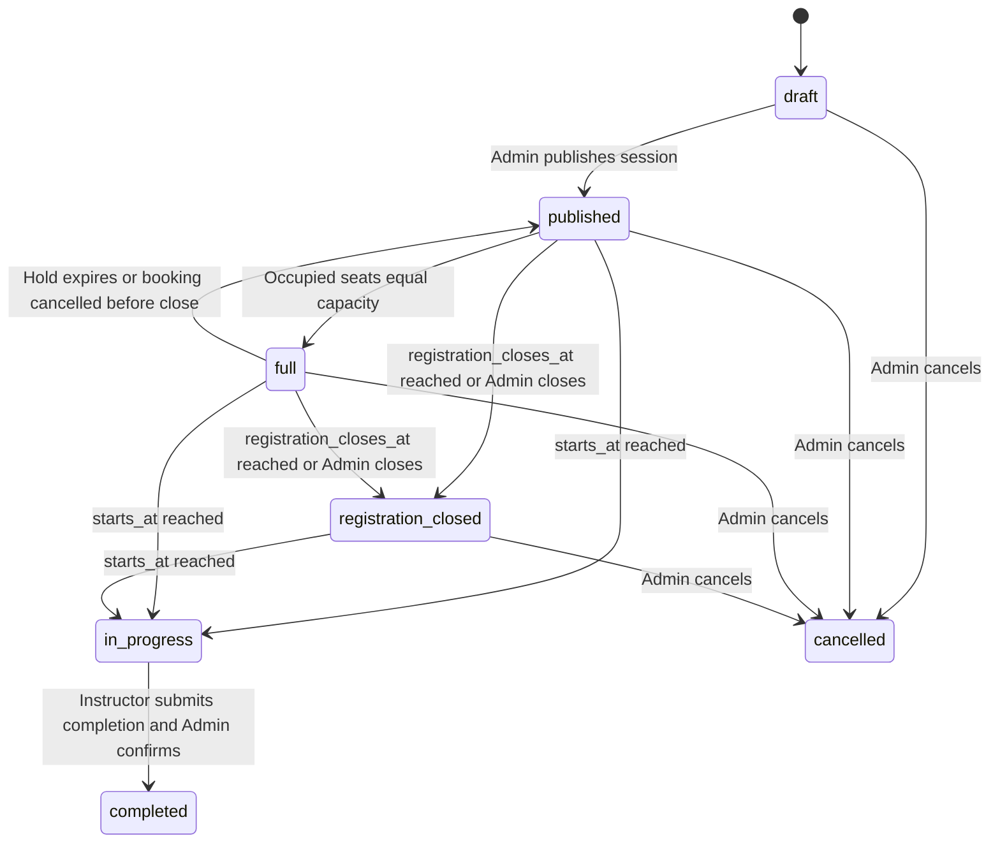
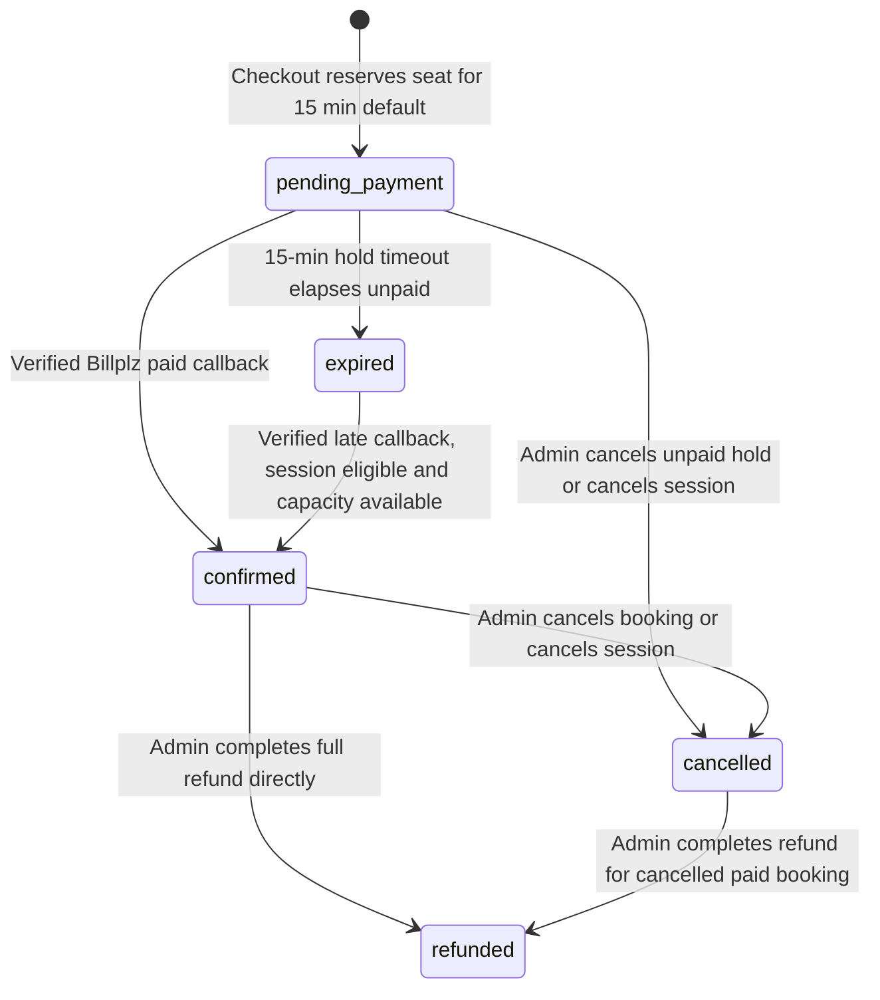
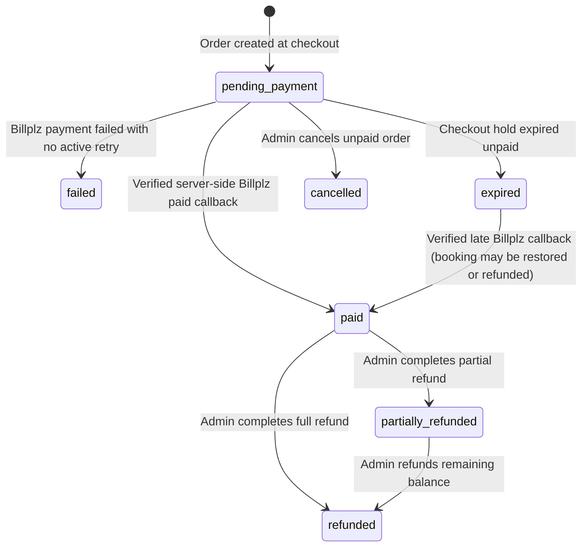
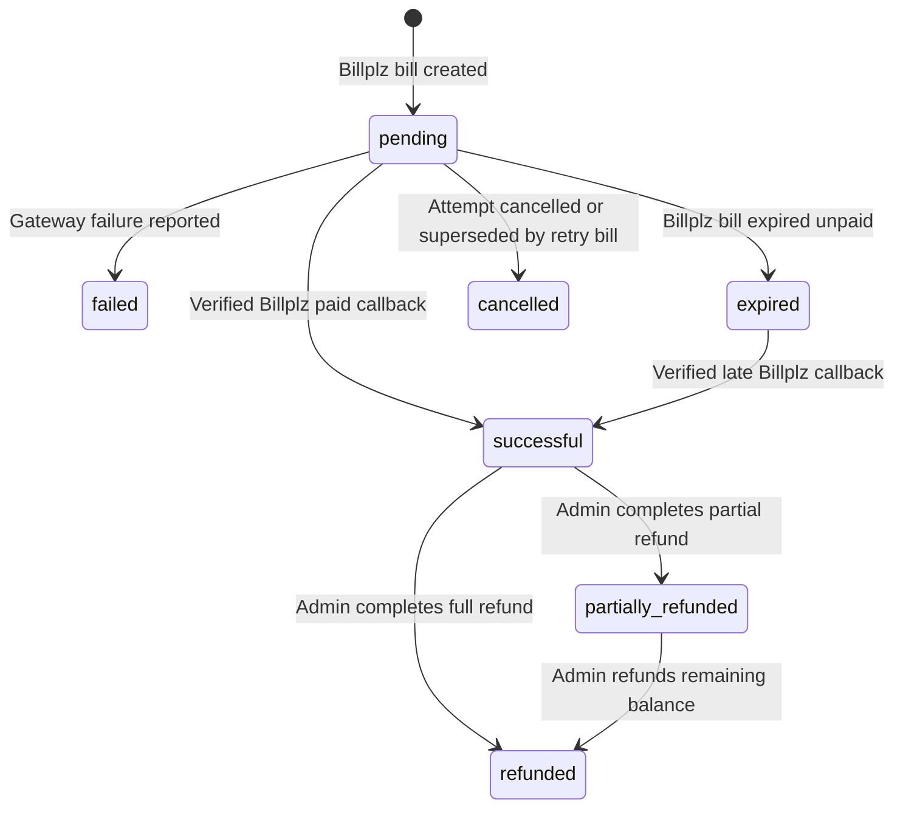
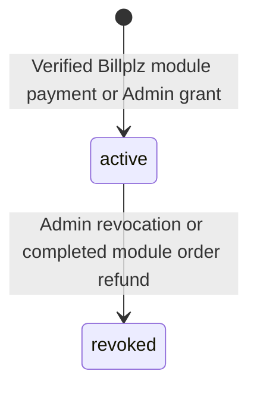
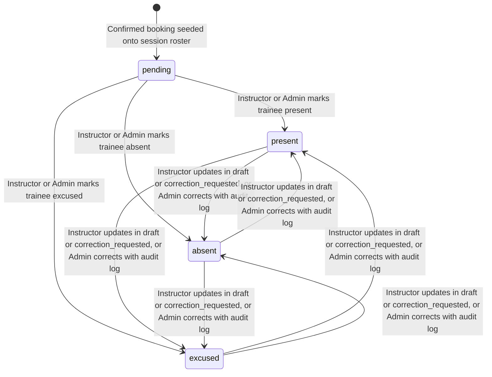
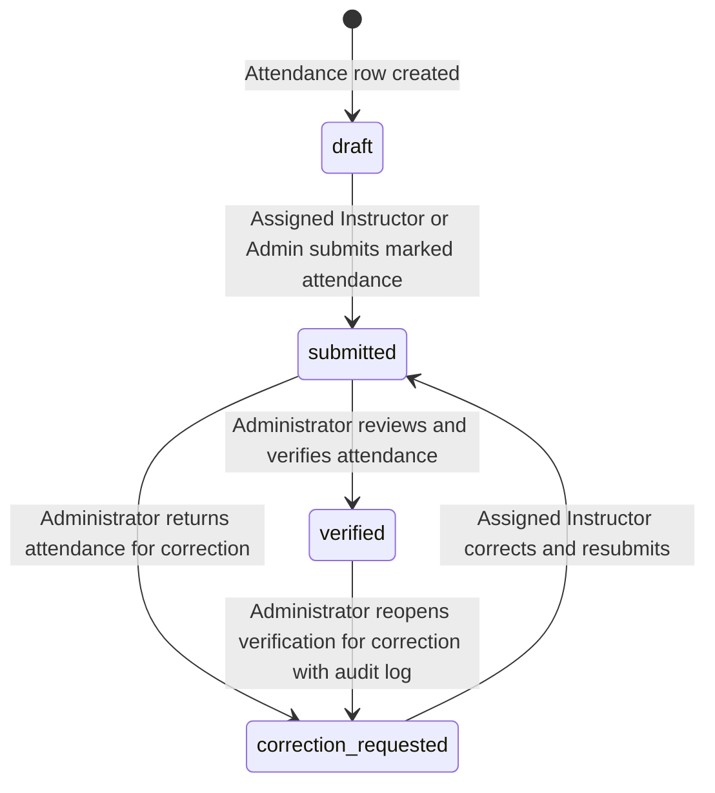
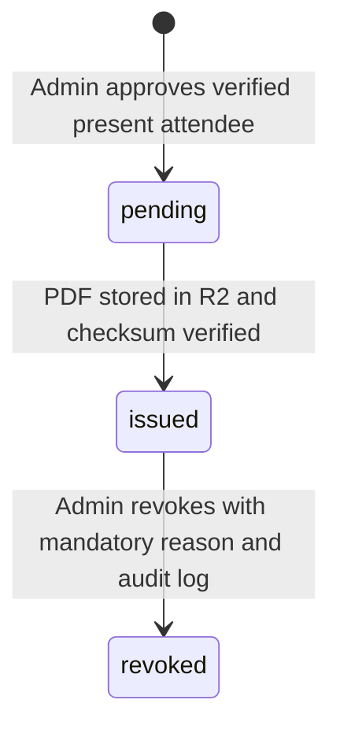
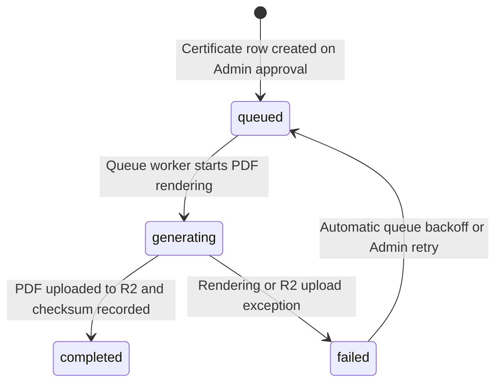
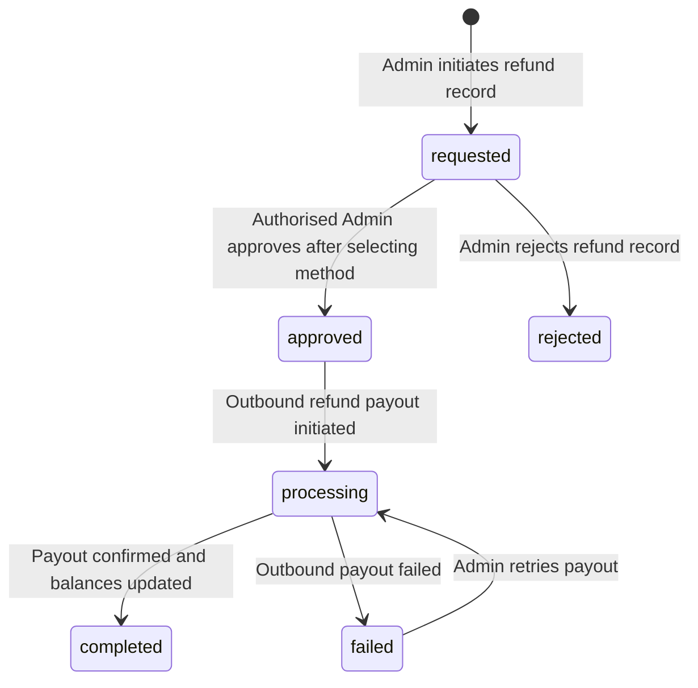

# ETMS Database Design & Data Dictionary

**Project:** Ecohydrotech Training Management System (ETMS)  
**Stage:** Stage 1 — Database Design (Revised after Review & Confirmed Decisions D-017..D-034 — Pending Final Approval)  
**Baseline:** [SRS and System Architecture v1.1](ETMS-SRS-and-System-Architecture-v1.1.md) & [Architecture and Business Decisions](DECISIONS.md)  
**Companion Diagram:** [Entity Relationship Diagram (ERD)](ERD.md)  
**Target RDBMS:** MySQL 8.4 (InnoDB)  
**Status:** Revised for independent review — **no migrations or application code generated**

---

## 1. Architectural & Schema Conventions

1. **Engine, Charset & Collation:** All tables use `InnoDB` with `utf8mb4` character set and `utf8mb4_unicode_ci` collation for full Unicode support and strict ACID transactional guarantees.
2. **Primary Keys & Public References:**
   - Every domain table (except composite-key RBAC pivots and UUID `notifications`) uses a `BIGINT UNSIGNED AUTO_INCREMENT` surrogate primary key (`id`) for Laravel 13 / Filament 5 alignment and compact InnoDB clustered indexing.
   - Customer-facing and externally verifiable entities (`orders`, `bookings`, `payments`, `refunds`, `certificates`, `modules`, `training_sessions`) carry separate `UNIQUE` public reference codes (`order_number`, `booking_reference`, `payment_reference`, `refund_reference`, `certificate_number`, `verification_token`, `code`, `session_code`) so internal sequential IDs are never exposed as proof or authorization tokens.
3. **Timestamps & Y2038 Safety:**
   - All date-time fields use MySQL `DATETIME` (stored in **UTC**) rather than `TIMESTAMP` to prevent the Year 2038 overflow (`2038-01-19`) on lifetime `module_entitlements`, `certificates`, and long-term financial audit records.
   - Presentation layers convert UTC values to `Asia/Kuala_Lumpur` (`UTC+8`) per SRS Section 9.3.
4. **Monetary Precision & Currency:**
   - Every monetary amount uses `DECIMAL(12,2)` (never `FLOAT` or `DOUBLE`).
   - Currency is stored explicitly in `CHAR(3)` ISO-4217 format defaulting to `'MYR'`.
   - Purchase snapshots (`orders` billing snapshot, `order_items` price/title/code snapshots) preserve historical receipts regardless of later catalogue or profile edits.
   - Billplz uses integer MYR cents. Convert losslessly with integer arithmetic: `provider_cents = DECIMAL amount * 100` after validating exactly two decimal places; `DECIMAL amount = provider_cents / 100` using a decimal library or integer-to-string formatting, never binary floating point. At callback time `amount` must equal the original `orders.total_amount` and `payments.amount`, and successful processing also requires `paid_amount` to equal the same cent value.
   - Billplz is MYR-only and callbacks do not supply an independent currency authority. ETMS therefore requires the order, payment and configured Billplz Collection to be `MYR`; any non-MYR local record or collection mismatch is rejected. `due_at` is informational and is not treated as a provider expiry.
5. **Status & Enum Enforcement:**
   - Discrete state columns use `VARCHAR(n)` paired with MySQL 8.4 `CHECK (col IN (...))` constraints (backed by PHP 8.3 backed Enums in Laravel), avoiding invasive `ALTER TABLE ... MODIFY COLUMN ENUM` table locks while preserving engine-level domain validation.
6. **Immutability, Deletion Policy & MySQL 8.4 `ERROR 3823` Compliance (SRS BR-15 & 9.3):**
   - Financial, booking, payment, webhook, refund, entitlement, attendance, certificate, and audit tables enforce `ON DELETE RESTRICT` and are **never** hard-deleted or casually soft-deleted.
   - All foreign key columns referenced inside table-level `CHECK` constraints (`order_items`, `module_entitlements`, `attendance`, `certificates`) strictly use `ON DELETE RESTRICT ON UPDATE RESTRICT` so MySQL 8.4 never raises `ERROR 3823` (which forbids `ON DELETE SET NULL` / `CASCADE` on columns evaluated inside a `CHECK` constraint).
   - Soft deletes (`deleted_at`) are restricted strictly to `users` (subject to zero-transaction/deactivation policies), `modules`, `module_materials`, `module_videos`, and `session_recordings` where SRS FR-02 permits deletion only if no dependent sessions, orders, entitlements, or certificates exist.
7. **Scope & Data Minimisation Guards (`D-003`, `D-022`, `D-023`, `D-024`, `D-028`, `D-030`):**
   - There are **no** `organizations`, `companies`, `organization_members`, `corporate_coordinators`, `employee_assignments`, `subscriptions`, `assessments`, `session_days`, or `category_module` tables.
   - Per **D-028**, NRIC/passport numbers and speculative SST/e-Invoice tax columns are excluded from the initial schema.

---

## 2. Complete Data Dictionary (29 Domain Tables)

### Domain A — Identity, RBAC, Customer & Instructor Profiles

#### A.1 `users`
Core authentication identity for all three permitted roles (`administrator`, `instructor`, `customer`). Per **D-026**, a staff user (`administrator` or `instructor`) may also hold the `customer` role when purchasing training.

| Column | Type | Null | Default | Key / Constraints | Description |
|---|---|---|---|---|---|
| `id` | `BIGINT UNSIGNED` | NO | `AUTO_INCREMENT` | `PK` | Internal user ID |
| `name` | `VARCHAR(150)` | NO | — | — | Full legal / display name (used for trainee booking & certificate snapshots, D-023) |
| `email` | `VARCHAR(255)` | NO | — | `UNIQUE` | Login email address (RFC-validated) |
| `email_verified_at` | `DATETIME` | YES | `NULL` | — | Email verification timestamp (FR-01) |
| `password` | `VARCHAR(255)` | NO | — | — | Bcrypt/Argon2id password hash |
| `remember_token` | `VARCHAR(100)` | YES | `NULL` | — | Laravel remember-me token |
| `status` | `VARCHAR(20)` | NO | `'active'` | `CHECK (status IN ('active','suspended','deactivated'))` | Account lifecycle status (FR-01) |
| `status_reason` | `TEXT` | YES | `NULL` | — | Administrative reason for suspension/deactivation |
| `status_changed_at` | `DATETIME` | YES | `NULL` | — | Timestamp of last account status change |
| `status_changed_by` | `BIGINT UNSIGNED` | YES | `NULL` | `FK -> users(id)` (`SET NULL`) | Admin who changed status |
| `two_factor_secret` | `TEXT` | YES | `NULL` | — | Encrypted TOTP MFA secret (required for Admins, Sec. 14) |
| `two_factor_recovery_codes` | `TEXT` | YES | `NULL` | — | Encrypted MFA recovery codes |
| `two_factor_confirmed_at` | `DATETIME` | YES | `NULL` | — | MFA activation confirmation timestamp |
| `last_login_at` | `DATETIME` | YES | `NULL` | — | Last successful authentication timestamp |
| `created_at` | `DATETIME` | NO | `CURRENT_TIMESTAMP` | — | Creation timestamp (UTC) |
| `updated_at` | `DATETIME` | NO | `CURRENT_TIMESTAMP` | — | Update timestamp (UTC) |
| `deleted_at` | `DATETIME` | YES | `NULL` | — | Soft-delete timestamp (only if never transacted) |

**Indexes:** `UNIQUE uq_users_email (email)`, `INDEX idx_users_status (status, deleted_at)`.

---

#### A.2 `roles`
Fixed application roles (`D-004`, `D-026`). Seeded strictly with the three approved roles: `administrator`, `instructor`, `customer`.

| Column | Type | Null | Default | Key / Constraints | Description |
|---|---|---|---|---|---|
| `id` | `BIGINT UNSIGNED` | NO | `AUTO_INCREMENT` | `PK` | Role ID |
| `slug` | `VARCHAR(50)` | NO | — | `UNIQUE`, `CHECK (slug IN ('administrator','instructor','customer'))` | Immutable role identifier |
| `name` | `VARCHAR(100)` | NO | — | — | Display label (`Administrator`, `Instructor`, `Trainee / Customer`) |
| `description` | `VARCHAR(255)` | YES | `NULL` | — | Role scope summary |
| `is_system` | `BOOLEAN` | NO | `TRUE` | — | Prevents accidental role deletion |
| `created_at` | `DATETIME` | NO | `CURRENT_TIMESTAMP` | — | Creation timestamp |
| `updated_at` | `DATETIME` | NO | `CURRENT_TIMESTAMP` | — | Update timestamp |

**Indexes:** `UNIQUE uq_roles_slug (slug)`.

---

#### A.3 `permissions`
Fine-grained capability registry mapped to roles and evaluated via Laravel Authorization Policies (`D-026`).

| Column | Type | Null | Default | Key / Constraints | Description |
|---|---|---|---|---|---|
| `id` | `BIGINT UNSIGNED` | NO | `AUTO_INCREMENT` | `PK` | Permission ID |
| `slug` | `VARCHAR(100)` | NO | — | `UNIQUE` | Machine permission key (e.g. `certificates.approve`) |
| `name` | `VARCHAR(150)` | NO | — | — | Human-readable label |
| `module_group` | `VARCHAR(50)` | NO | — | `INDEX` | Domain group (e.g. `training`, `payments`, `certificates`) |
| `created_at` | `DATETIME` | NO | `CURRENT_TIMESTAMP` | — | Creation timestamp |
| `updated_at` | `DATETIME` | NO | `CURRENT_TIMESTAMP` | — | Update timestamp |

**Indexes:** `UNIQUE uq_permissions_slug (slug)`, `INDEX idx_permissions_group (module_group)`.

---

#### A.4 `role_user`
Native RBAC join table assigning one or more roles to a user (`D-026`). Supports staff members holding `customer` alongside `administrator` or `instructor`.

| Column | Type | Null | Default | Key / Constraints | Description |
|---|---|---|---|---|---|
| `user_id` | `BIGINT UNSIGNED` | NO | — | `PK`, `FK -> users(id)` (`CASCADE`) | User reference |
| `role_id` | `BIGINT UNSIGNED` | NO | — | `PK`, `FK -> roles(id)` (`RESTRICT`) | Role reference |
| `assigned_by` | `BIGINT UNSIGNED` | YES | `NULL` | `FK -> users(id)` (`SET NULL`) | Assigning admin (`NULL` for self-registration) |
| `assigned_at` | `DATETIME` | NO | `CURRENT_TIMESTAMP` | — | Assignment timestamp |

**Indexes:** `PRIMARY KEY (user_id, role_id)`, `INDEX idx_role_user_role (role_id)`.

---

#### A.5 `permission_role`
Join table linking permissions to roles (`D-026`).

| Column | Type | Null | Default | Key / Constraints | Description |
|---|---|---|---|---|---|
| `permission_id` | `BIGINT UNSIGNED` | NO | — | `PK`, `FK -> permissions(id)` (`CASCADE`) | Permission reference |
| `role_id` | `BIGINT UNSIGNED` | NO | — | `PK`, `FK -> roles(id)` (`CASCADE`) | Role reference |

**Indexes:** `PRIMARY KEY (permission_id, role_id)`, `INDEX idx_permission_role_role (role_id)`.

---

#### A.6 `customer_profiles`
Customer contact information and optional company billing details (SRS Section 1.4, 2.3, 9.1; `D-001`, `D-002`, `D-028`). Used identically by individual and company buyers. Does not collect NRIC/passport numbers (`D-028`).

| Column | Type | Null | Default | Key / Constraints | Description |
|---|---|---|---|---|---|
| `id` | `BIGINT UNSIGNED` | NO | `AUTO_INCREMENT` | `PK` | Profile ID |
| `user_id` | `BIGINT UNSIGNED` | NO | — | `UNIQUE`, `FK -> users(id)` (`CASCADE`) | 1-to-1 owner user |
| `customer_type` | `VARCHAR(20)` | NO | `'individual'` | `CHECK (customer_type IN ('individual','company'))` | Indicates whether optional company billing details apply |
| `phone` | `VARCHAR(30)` | YES | `NULL` | — | Contact phone number (Malaysia/international) |
| `job_title` | `VARCHAR(120)` | YES | `NULL` | — | Optional role/designation |
| `company_name` | `VARCHAR(200)` | YES | `NULL` | — | Optional company name for receipts/invoices |
| `company_registration_no` | `VARCHAR(50)` | YES | `NULL` | — | Optional SSM / registration number |
| `billing_contact_name` | `VARCHAR(150)` | YES | `NULL` | — | Optional billing contact person |
| `billing_email` | `VARCHAR(255)` | YES | `NULL` | — | Optional billing/accounts email |
| `billing_phone` | `VARCHAR(30)` | YES | `NULL` | — | Optional billing contact phone |
| `billing_address_line_1` | `VARCHAR(255)` | YES | `NULL` | — | Optional billing address line 1 |
| `billing_address_line_2` | `VARCHAR(255)` | YES | `NULL` | — | Optional billing address line 2 |
| `billing_city` | `VARCHAR(100)` | YES | `NULL` | — | Optional billing city |
| `billing_state` | `VARCHAR(100)` | YES | `NULL` | — | Optional billing state (e.g. Selangor) |
| `billing_postcode` | `VARCHAR(20)` | YES | `NULL` | — | Optional postcode |
| `billing_country` | `CHAR(2)` | NO | `'MY'` | — | ISO-3166 alpha-2 country code |
| `created_at` | `DATETIME` | NO | `CURRENT_TIMESTAMP` | — | Creation timestamp |
| `updated_at` | `DATETIME` | NO | `CURRENT_TIMESTAMP` | — | Update timestamp |

**Indexes:** `UNIQUE uq_customer_profiles_user (user_id)`, `INDEX idx_customer_profiles_type (customer_type)`.

---

#### A.7 `instructor_profiles`
Public and administrative profile metadata for users holding the `instructor` role (`D-027`, `R-03`). Supports public display on session pages with explicit visibility control (`is_public`).

| Column | Type | Null | Default | Key / Constraints | Description |
|---|---|---|---|---|---|
| `id` | `BIGINT UNSIGNED` | NO | `AUTO_INCREMENT` | `PK` | Instructor profile ID |
| `user_id` | `BIGINT UNSIGNED` | NO | — | `UNIQUE`, `FK -> users(id)` (`CASCADE`) | 1-to-1 link to instructor user account |
| `display_name` | `VARCHAR(150)` | YES | `NULL` | — | Optional public display name / honorific (falls back to `users.name`) |
| `professional_title` | `VARCHAR(150)` | YES | `NULL` | — | Professional headline (e.g. `Principal Hydrologist`) |
| `qualifications` | `VARCHAR(255)` | YES | `NULL` | — | Academic/professional credentials summary |
| `short_bio` | `VARCHAR(500)` | YES | `NULL` | — | Concise summary displayed on session cards |
| `biography` | `TEXT` | YES | `NULL` | — | Full instructor biography for detail pages |
| `specialisations` | `JSON` | YES | `NULL` | — | Optional array of subject expertise tags |
| `photo_storage_disk` | `VARCHAR(30)` | YES | `NULL` | — | Storage disk (`r2` or `public`) for profile photograph |
| `photo_storage_key` | `VARCHAR(500)` | YES | `NULL` | — | Object key / path of instructor photograph |
| `is_public` | `BOOLEAN` | NO | `FALSE` | — | Controls whether profile details are visible on public pages (`R-03`) |
| `published_at` | `DATETIME` | YES | `NULL` | — | Timestamp when profile was enabled for public display |
| `updated_by` | `BIGINT UNSIGNED` | YES | `NULL` | `FK -> users(id)` (`SET NULL`) | Last administrator or instructor updating profile |
| `created_at` | `DATETIME` | NO | `CURRENT_TIMESTAMP` | — | Creation timestamp |
| `updated_at` | `DATETIME` | NO | `CURRENT_TIMESTAMP` | — | Update timestamp |

**Indexes:** `UNIQUE uq_instructor_profiles_user (user_id)`, `INDEX idx_instructor_profiles_public (is_public)`.

---

### Domain B — Training Catalogue, Materials & Videos

#### B.1 `categories`
Catalogue classification for training modules (FR-02, `D-024`).

| Column | Type | Null | Default | Key / Constraints | Description |
|---|---|---|---|---|---|
| `id` | `BIGINT UNSIGNED` | NO | `AUTO_INCREMENT` | `PK` | Category ID |
| `name` | `VARCHAR(100)` | NO | — | — | Display category name |
| `slug` | `VARCHAR(120)` | NO | — | `UNIQUE` | URL-safe slug |
| `description` | `TEXT` | YES | `NULL` | — | Category description |
| `sort_order` | `INT UNSIGNED` | NO | `0` | — | Catalogue display ordering |
| `is_active` | `BOOLEAN` | NO | `TRUE` | — | Controls public catalogue visibility |
| `created_at` | `DATETIME` | NO | `CURRENT_TIMESTAMP` | — | Creation timestamp |
| `updated_at` | `DATETIME` | NO | `CURRENT_TIMESTAMP` | — | Update timestamp |

**Indexes:** `UNIQUE uq_categories_slug (slug)`, `INDEX idx_categories_active_sort (is_active, sort_order)`.

---

#### B.2 `modules`
Reusable training modules (FR-02). Each module belongs to exactly one primary category (`D-024`), may have multiple physical sessions (`D-005`), and may be offered for independent lifetime purchase (`D-006`).

| Column | Type | Null | Default | Key / Constraints | Description |
|---|---|---|---|---|---|
| `id` | `BIGINT UNSIGNED` | NO | `AUTO_INCREMENT` | `PK` | Module ID |
| `category_id` | `BIGINT UNSIGNED` | NO | — | `FK -> categories(id)` (`RESTRICT`) | Single primary training category (`D-024`) |
| `code` | `VARCHAR(50)` | NO | — | `UNIQUE` | Unique module code (e.g. `EHT-HYD-101`) |
| `title` | `VARCHAR(200)` | NO | — | — | Module title |
| `slug` | `VARCHAR(220)` | NO | — | `UNIQUE` | URL-safe slug |
| `summary` | `VARCHAR(500)` | YES | `NULL` | — | Short catalogue summary |
| `description` | `LONGTEXT` | NO | — | — | Full module syllabus/description |
| `learning_objectives` | `JSON` | YES | `NULL` | — | Structured list of learning outcomes |
| `cover_image_disk` | `VARCHAR(30)` | YES | `NULL` | — | Storage disk for cover asset |
| `cover_image_path` | `VARCHAR(500)` | YES | `NULL` | — | Storage key/path for cover image |
| `is_available_independently` | `BOOLEAN` | NO | `TRUE` | — | Whether standalone purchase is enabled |
| `independent_price` | `DECIMAL(12,2)` | YES | `NULL` | `CHECK (independent_price IS NULL OR independent_price >= 0)` | Standalone module price (NULL if session-only) |
| `currency` | `CHAR(3)` | NO | `'MYR'` | — | Currency code |
| `status` | `VARCHAR(20)` | NO | `'draft'` | `CHECK (status IN ('draft','published','unpublished','archived'))` | Publication lifecycle status |
| `published_at` | `DATETIME` | YES | `NULL` | — | Initial/latest publication timestamp |
| `archived_at` | `DATETIME` | YES | `NULL` | — | Archival timestamp |
| `created_by` | `BIGINT UNSIGNED` | NO | — | `FK -> users(id)` (`RESTRICT`) | Creating admin |
| `updated_by` | `BIGINT UNSIGNED` | YES | `NULL` | `FK -> users(id)` (`SET NULL`) | Last modifying admin |
| `created_at` | `DATETIME` | NO | `CURRENT_TIMESTAMP` | — | Creation timestamp |
| `updated_at` | `DATETIME` | NO | `CURRENT_TIMESTAMP` | — | Update timestamp |
| `deleted_at` | `DATETIME` | YES | `NULL` | — | Soft delete (only permitted if no orders/sessions/entitlements) |

**Table Constraints:** `CHECK (is_available_independently = FALSE OR independent_price IS NOT NULL)`.  
**Indexes:** `UNIQUE uq_modules_code (code)`, `UNIQUE uq_modules_slug (slug)`, `INDEX idx_modules_catalogue (status, category_id, deleted_at)`, `INDEX idx_modules_independent (is_available_independently, status)`.

---

#### B.3 `module_materials`
Downloadable/viewable module documents stored in **Cloudflare R2** (FR-07, Sec. 11.2). Accessible strictly via active `module_entitlements` (`D-018`).

| Column | Type | Null | Default | Key / Constraints | Description |
|---|---|---|---|---|---|
| `id` | `BIGINT UNSIGNED` | NO | `AUTO_INCREMENT` | `PK` | Material ID |
| `module_id` | `BIGINT UNSIGNED` | NO | — | `FK -> modules(id)` (`RESTRICT`) | Parent module |
| `title` | `VARCHAR(200)` | NO | — | — | Material display title |
| `description` | `TEXT` | YES | `NULL` | — | Optional guidance notes |
| `material_type` | `VARCHAR(30)` | NO | `'pdf'` | `CHECK (material_type IN ('pdf','presentation','document','image','worksheet','other'))` | Document category |
| `storage_disk` | `VARCHAR(30)` | NO | `'r2'` | — | Laravel filesystem disk (`r2`) |
| `storage_bucket` | `VARCHAR(100)` | YES | `NULL` | — | R2 bucket identifier |
| `storage_key` | `VARCHAR(500)` | NO | — | — | Private R2 object key |
| `original_filename` | `VARCHAR(255)` | NO | — | — | Original uploaded filename |
| `mime_type` | `VARCHAR(127)` | NO | — | — | Validated MIME type |
| `file_size_bytes` | `BIGINT UNSIGNED` | NO | — | `CHECK (file_size_bytes > 0)` | File byte length |
| `checksum_sha256` | `CHAR(64)` | YES | `NULL` | — | File integrity hash |
| `is_downloadable` | `BOOLEAN` | NO | `TRUE` | — | Whether signed download is permitted |
| `sort_order` | `INT UNSIGNED` | NO | `0` | — | Display ordering within module |
| `status` | `VARCHAR(20)` | NO | `'draft'` | `CHECK (status IN ('draft','published','archived'))` | Publication status |
| `published_at` | `DATETIME` | YES | `NULL` | — | Publication timestamp |
| `uploaded_by` | `BIGINT UNSIGNED` | NO | — | `FK -> users(id)` (`RESTRICT`) | Uploading admin |
| `created_at` | `DATETIME` | NO | `CURRENT_TIMESTAMP` | — | Creation timestamp |
| `updated_at` | `DATETIME` | NO | `CURRENT_TIMESTAMP` | — | Update timestamp |
| `deleted_at` | `DATETIME` | YES | `NULL` | — | Soft delete |

**Indexes:** `INDEX idx_module_materials_module (module_id, status, sort_order, deleted_at)`.

---

#### B.4 `module_videos`
Pre-recorded module videos hosted on **Bunny Stream** (FR-07, Sec. 11.1). Accessible strictly via active `module_entitlements` (`D-018`). Metadata only; no binaries in MySQL.

| Column | Type | Null | Default | Key / Constraints | Description |
|---|---|---|---|---|---|
| `id` | `BIGINT UNSIGNED` | NO | `AUTO_INCREMENT` | `PK` | Module video ID |
| `module_id` | `BIGINT UNSIGNED` | NO | — | `FK -> modules(id)` (`RESTRICT`) | Parent module |
| `title` | `VARCHAR(200)` | NO | — | — | Video display title |
| `description` | `TEXT` | YES | `NULL` | — | Video synopsis |
| `provider` | `VARCHAR(30)` | NO | `'bunny_stream'` | `CHECK (provider IN ('bunny_stream'))` | Streaming provider |
| `provider_library_id` | `VARCHAR(100)` | NO | — | — | Bunny Stream library ID |
| `provider_video_id` | `VARCHAR(100)` | NO | — | — | Bunny Stream video GUID |
| `provider_collection_id` | `VARCHAR(100)` | YES | `NULL` | — | Optional Bunny collection ID |
| `duration_seconds` | `INT UNSIGNED` | YES | `NULL` | — | Video length once transcoded |
| `thumbnail_url` | `VARCHAR(500)` | YES | `NULL` | — | Bunny thumbnail URL / path |
| `encoding_status` | `VARCHAR(20)` | NO | `'pending'` | `CHECK (encoding_status IN ('pending','processing','ready','failed'))` | Transcoding readiness |
| `sort_order` | `INT UNSIGNED` | NO | `0` | — | Curriculum display ordering |
| `status` | `VARCHAR(20)` | NO | `'draft'` | `CHECK (status IN ('draft','published','archived'))` | Publication status |
| `published_at` | `DATETIME` | YES | `NULL` | — | Publication timestamp |
| `uploaded_by` | `BIGINT UNSIGNED` | NO | — | `FK -> users(id)` (`RESTRICT`) | Uploading admin |
| `created_at` | `DATETIME` | NO | `CURRENT_TIMESTAMP` | — | Creation timestamp |
| `updated_at` | `DATETIME` | NO | `CURRENT_TIMESTAMP` | — | Update timestamp |
| `deleted_at` | `DATETIME` | YES | `NULL` | — | Soft delete |

**Indexes:** `UNIQUE uq_module_videos_provider (provider, provider_library_id, provider_video_id)`, `INDEX idx_module_videos_module (module_id, status, sort_order, deleted_at)`.

---

### Domain C — Physical Sessions, Instructors & Recordings

#### C.1 `training_sessions`
Scheduled in-person training events belonging to a module (FR-03, BR-04, BR-05; `D-017`, `D-022`, `D-029`, `D-033`). Uses a single continuous `starts_at` / `ends_at` range (`D-022`) and enforces `registration_closes_at < starts_at` (`D-029`).

| Column | Type | Null | Default | Key / Constraints | Description |
|---|---|---|---|---|---|
| `id` | `BIGINT UNSIGNED` | NO | `AUTO_INCREMENT` | `PK` | Session ID |
| `module_id` | `BIGINT UNSIGNED` | NO | — | `FK -> modules(id)` (`RESTRICT`) | Parent training module (BR-04) |
| `session_code` | `VARCHAR(50)` | NO | — | `UNIQUE` | Unique schedule code (e.g. `SES-2026-001`) |
| `title` | `VARCHAR(200)` | NO | — | — | Session title |
| `slug` | `VARCHAR(220)` | NO | — | `UNIQUE` | URL-safe slug |
| `description` | `LONGTEXT` | YES | `NULL` | — | Session-specific outline/notes |
| `starts_at` | `DATETIME` | NO | — | — | Session start datetime (UTC, `D-022`) |
| `ends_at` | `DATETIME` | NO | — | — | Session end datetime (UTC, `D-022`) |
| `duration_minutes` | `INT UNSIGNED` | NO | — | `CHECK (duration_minutes > 0)` | Calculated display duration |
| `timezone` | `VARCHAR(64)` | NO | `'Asia/Kuala_Lumpur'` | — | Venue display timezone |
| `venue_name` | `VARCHAR(200)` | YES | `NULL` | — | Venue name (required before publish) |
| `venue_address` | `TEXT` | YES | `NULL` | — | Full venue street address |
| `venue_city` | `VARCHAR(100)` | YES | `NULL` | — | Venue city |
| `venue_state` | `VARCHAR(100)` | YES | `NULL` | — | Venue state |
| `venue_postcode` | `VARCHAR(20)` | YES | `NULL` | — | Venue postcode |
| `venue_map_url` | `VARCHAR(500)` | YES | `NULL` | — | Optional Google Maps URL |
| `venue_notes` | `TEXT` | YES | `NULL` | — | Room, parking, PPE/safety notes |
| `capacity` | `INT UNSIGNED` | NO | — | `CHECK (capacity >= 1)` | Maximum physical participants (BR-03) |
| `reserved_seats_count` | `INT UNSIGNED` | NO | `0` | — | Synchronized count of active `pending_payment` bookings (`D-033`) |
| `confirmed_seats_count` | `INT UNSIGNED` | NO | `0` | — | Synchronized count of active `confirmed` bookings (`D-033`) |
| `registration_opens_at` | `DATETIME` | YES | `NULL` | — | Optional registration opening timestamp (UTC) |
| `registration_closes_at` | `DATETIME` | NO | — | — | Registration deadline (UTC); must precede `starts_at` (`D-029`) |
| `price` | `DECIMAL(12,2)` | NO | — | `CHECK (price >= 0)` | Physical session ticket price |
| `currency` | `CHAR(3)` | NO | `'MYR'` | — | Currency code |
| `recording_access_policy` | `VARCHAR(30)` | NO | `'attendees_only'` | `CHECK (recording_access_policy IN ('attendees_only','none'))` | Recording access policy defaulting to `'attendees_only'` (`D-017`) |
| `status` | `VARCHAR(30)` | NO | `'draft'` | `CHECK (status IN ('draft','published','full','registration_closed','in_progress','completed','cancelled'))` | Session lifecycle state |
| `published_at` | `DATETIME` | YES | `NULL` | — | Publication timestamp |
| `closed_at` | `DATETIME` | YES | `NULL` | — | Registration closed timestamp |
| `completion_notes` | `TEXT` | YES | `NULL` | — | Instructor completion summary (Sec. 2.2) |
| `completion_submitted_by` | `BIGINT UNSIGNED` | YES | `NULL` | `FK -> users(id)` (`SET NULL`) | Instructor submitting completion info |
| `completion_submitted_at` | `DATETIME` | YES | `NULL` | — | Completion submission timestamp |
| `completed_at` | `DATETIME` | YES | `NULL` | — | Admin-finalized completion timestamp |
| `completed_by` | `BIGINT UNSIGNED` | YES | `NULL` | `FK -> users(id)` (`SET NULL`) | Admin confirming completion |
| `cancelled_at` | `DATETIME` | YES | `NULL` | — | Cancellation timestamp |
| `cancelled_by` | `BIGINT UNSIGNED` | YES | `NULL` | `FK -> users(id)` (`SET NULL`) | Admin who cancelled session |
| `cancellation_reason` | `TEXT` | YES | `NULL` | — | Reason for cancellation (triggers notices/refunds) |
| `created_by` | `BIGINT UNSIGNED` | NO | — | `FK -> users(id)` (`RESTRICT`) | Creating admin |
| `updated_by` | `BIGINT UNSIGNED` | YES | `NULL` | `FK -> users(id)` (`SET NULL`) | Last modifying admin |
| `created_at` | `DATETIME` | NO | `CURRENT_TIMESTAMP` | — | Creation timestamp |
| `updated_at` | `DATETIME` | NO | `CURRENT_TIMESTAMP` | — | Update timestamp |

**Table Constraints:**
- `CONSTRAINT chk_sessions_dates CHECK (ends_at > starts_at)` (`D-022`)
- `CONSTRAINT chk_sessions_reg_close CHECK (registration_closes_at < starts_at)` (`D-029`)
- `CONSTRAINT chk_sessions_reg_window CHECK (registration_opens_at IS NULL OR registration_opens_at < registration_closes_at)` (`D-029`)
- `CONSTRAINT chk_sessions_capacity CHECK (reserved_seats_count + confirmed_seats_count <= capacity)` (`BR-03`, `D-033`)

**Indexes:** `UNIQUE uq_sessions_code (session_code)`, `UNIQUE uq_sessions_slug (slug)`, `UNIQUE uq_sessions_id_module (id, module_id)` *(parent key for `certificates` composite FK)*, `INDEX idx_sessions_module_status (module_id, status, starts_at)`, `INDEX idx_sessions_upcoming (status, starts_at, registration_closes_at)`.

---

#### C.2 `session_instructors`
Many-to-many assignment of instructors to physical sessions (FR-03, Sec. 9.2).

| Column | Type | Null | Default | Key / Constraints | Description |
|---|---|---|---|---|---|
| `id` | `BIGINT UNSIGNED` | NO | `AUTO_INCREMENT` | `PK` | Assignment ID |
| `training_session_id` | `BIGINT UNSIGNED` | NO | — | `FK -> training_sessions(id)` (`CASCADE`) | Assigned session |
| `instructor_id` | `BIGINT UNSIGNED` | NO | — | `FK -> users(id)` (`RESTRICT`) | Assigned user (validated as `instructor` role in app policy) |
| `role_label` | `VARCHAR(50)` | YES | `'lead'` | — | Optional role label (`lead`, `co_instructor`, `assistant`) |
| `assigned_by` | `BIGINT UNSIGNED` | YES | `NULL` | `FK -> users(id)` (`SET NULL`) | Assigning administrator |
| `assigned_at` | `DATETIME` | NO | `CURRENT_TIMESTAMP` | — | Assignment timestamp |
| `created_at` | `DATETIME` | NO | `CURRENT_TIMESTAMP` | — | Creation timestamp |
| `updated_at` | `DATETIME` | NO | `CURRENT_TIMESTAMP` | — | Update timestamp |

**Indexes:** `UNIQUE uq_session_instructors_pair (training_session_id, instructor_id)`, `INDEX idx_session_instructors_user (instructor_id, training_session_id)`.

---

#### C.3 `session_recordings`
Physical training session recordings stored in **Bunny Stream**, supporting instructor submission and admin review/publication (Sec. 2.1, 2.2, FR-07, 11.1, 11.3; `D-017`). Playback requires `training_sessions.recording_access_policy = 'attendees_only'` AND verified attendance (`attendance_status = 'present'` AND `review_status = 'verified'`).

| Column | Type | Null | Default | Key / Constraints | Description |
|---|---|---|---|---|---|
| `id` | `BIGINT UNSIGNED` | NO | `AUTO_INCREMENT` | `PK` | Recording ID |
| `training_session_id` | `BIGINT UNSIGNED` | NO | — | `FK -> training_sessions(id)` (`RESTRICT`) | Source physical session |
| `title` | `VARCHAR(200)` | NO | — | — | Recording title |
| `description` | `TEXT` | YES | `NULL` | — | Recording description |
| `provider` | `VARCHAR(30)` | NO | `'bunny_stream'` | `CHECK (provider IN ('bunny_stream'))` | Streaming provider |
| `provider_library_id` | `VARCHAR(100)` | NO | — | — | Bunny Stream library ID |
| `provider_video_id` | `VARCHAR(100)` | NO | — | — | Bunny Stream video GUID |
| `duration_seconds` | `INT UNSIGNED` | YES | `NULL` | — | Recording duration |
| `thumbnail_url` | `VARCHAR(500)` | YES | `NULL` | — | Bunny thumbnail path |
| `encoding_status` | `VARCHAR(20)` | NO | `'pending'` | `CHECK (encoding_status IN ('pending','processing','ready','failed'))` | Transcoding status |
| `status` | `VARCHAR(30)` | NO | `'pending_review'` | `CHECK (status IN ('draft','pending_review','published','rejected','archived'))` | Review & publication status |
| `sort_order` | `INT UNSIGNED` | NO | `0` | — | Ordering if session has multiple parts |
| `submitted_by` | `BIGINT UNSIGNED` | NO | — | `FK -> users(id)` (`RESTRICT`) | Instructor or admin who submitted recording |
| `submitted_at` | `DATETIME` | NO | `CURRENT_TIMESTAMP` | — | Submission timestamp |
| `reviewed_by` | `BIGINT UNSIGNED` | YES | `NULL` | `FK -> users(id)` (`SET NULL`) | Admin who approved/rejected publication |
| `reviewed_at` | `DATETIME` | YES | `NULL` | — | Review timestamp |
| `review_notes` | `TEXT` | YES | `NULL` | — | Admin review comments/rejection reason |
| `published_at` | `DATETIME` | YES | `NULL` | — | Publication timestamp |
| `created_at` | `DATETIME` | NO | `CURRENT_TIMESTAMP` | — | Creation timestamp |
| `updated_at` | `DATETIME` | NO | `CURRENT_TIMESTAMP` | — | Update timestamp |
| `deleted_at` | `DATETIME` | YES | `NULL` | — | Soft delete |

**Indexes:** `UNIQUE uq_session_recordings_provider (provider, provider_library_id, provider_video_id)`, `INDEX idx_session_recordings_session (training_session_id, status, sort_order, deleted_at)`, `INDEX idx_session_recordings_review (status, submitted_at)`.

---

### Domain D — Commerce, Orders, Bookings, Payments & Refunds

#### D.1 `orders`
Commercial purchase headers with immutable customer/company billing snapshots (SRS 1.4, FR-04, FR-05, FR-06, 9.3; `D-020`, `D-028`, `D-030`, `D-031`, `D-032`). Strictly separates physical session orders from independent module orders (`order_type`) and exposes composite unique keys `(id, order_type)` and `(id, user_id)` for downstream referential integrity.

| Column | Type | Null | Default | Key / Constraints | Description |
|---|---|---|---|---|---|
| `id` | `BIGINT UNSIGNED` | NO | `AUTO_INCREMENT` | `PK` | Order ID |
| `order_number` | `VARCHAR(40)` | NO | — | `UNIQUE` | Public order reference (e.g. `ORD-20261117-000123`) |
| `user_id` | `BIGINT UNSIGNED` | NO | — | `FK -> users(id)` (`RESTRICT`) | Customer placing the order (`BR-01`, `D-023`) |
| `order_type` | `VARCHAR(30)` | NO | — | `CHECK (order_type IN ('session_booking','module_purchase'))` | Strictly separates session vs module purchases (`D-030`) |
| `status` | `VARCHAR(30)` | NO | `'pending_payment'` | `CHECK (status IN ('pending_payment','paid','failed','cancelled','expired','refunded','partially_refunded'))` | Commercial order lifecycle (Billplz launch scope, `D-020`) |
| `currency` | `CHAR(3)` | NO | `'MYR'` | — | Currency code |
| `subtotal_amount` | `DECIMAL(12,2)` | NO | — | `CHECK (subtotal_amount >= 0)` | Sum of line items |
| `total_amount` | `DECIMAL(12,2)` | NO | — | `CHECK (total_amount >= 0)` | Authoritative payable amount (`subtotal_amount == total_amount` in MVP, `D-028`) |
| `customer_name` | `VARCHAR(150)` | NO | — | — | Customer name snapshot |
| `customer_email` | `VARCHAR(255)` | NO | — | — | Customer email snapshot |
| `customer_phone` | `VARCHAR(30)` | YES | `NULL` | — | Customer phone snapshot |
| `customer_type` | `VARCHAR(20)` | NO | `'individual'` | `CHECK (customer_type IN ('individual','company'))` | Snapshot of buyer classification |
| `company_name` | `VARCHAR(200)` | YES | `NULL` | — | Billing company name snapshot |
| `company_registration_no` | `VARCHAR(50)` | YES | `NULL` | — | Billing company registration snapshot |
| `billing_contact_name` | `VARCHAR(150)` | YES | `NULL` | — | Billing contact snapshot |
| `billing_email` | `VARCHAR(255)` | YES | `NULL` | — | Billing email snapshot |
| `billing_phone` | `VARCHAR(30)` | YES | `NULL` | — | Billing phone snapshot |
| `billing_address_line_1` | `VARCHAR(255)` | YES | `NULL` | — | Billing address snapshot |
| `billing_address_line_2` | `VARCHAR(255)` | YES | `NULL` | — | Billing address line 2 snapshot |
| `billing_city` | `VARCHAR(100)` | YES | `NULL` | — | Billing city snapshot |
| `billing_state` | `VARCHAR(100)` | YES | `NULL` | — | Billing state snapshot |
| `billing_postcode` | `VARCHAR(20)` | YES | `NULL` | — | Billing postcode snapshot |
| `billing_country` | `CHAR(2)` | YES | `'MY'` | — | Billing country snapshot |
| `expires_at` | `DATETIME` | YES | `NULL` | — | Unpaid checkout expiry (aligned with 15-min booking hold, `D-019`) |
| `paid_at` | `DATETIME` | YES | `NULL` | — | Verified payment completion timestamp |
| `cancelled_at` | `DATETIME` | YES | `NULL` | — | Order cancellation timestamp |
| `refunded_at` | `DATETIME` | YES | `NULL` | — | Full/latest refund timestamp |
| `notes` | `TEXT` | YES | `NULL` | — | Internal/customer order remarks |
| `created_at` | `DATETIME` | NO | `CURRENT_TIMESTAMP` | — | Order creation timestamp |
| `updated_at` | `DATETIME` | NO | `CURRENT_TIMESTAMP` | — | Order update timestamp |

**Indexes:**
- `UNIQUE uq_orders_number (order_number)`
- `UNIQUE uq_orders_id_type (id, order_type)` *(parent key for `order_items` type-consistency composite FK, `D-031`)*
- `UNIQUE uq_orders_id_user (id, user_id)` *(parent key for `bookings`, `payments`, and `module_entitlements` ownership composite FKs, `D-032`)*
- `INDEX idx_orders_user (user_id, created_at)`
- `INDEX idx_orders_status_type (status, order_type, created_at)`
- `INDEX idx_orders_expiry (status, expires_at)`

---

#### D.2 `order_items`
Line items belonging to an order, preserving point-in-time product code, title, and pricing snapshots (SRS 9.3; `D-023`, `D-030`, `D-031`). Enforces strict order-type alignment via composite FK `(order_id, order_type) -> orders (id, order_type)`.

| Column | Type | Null | Default | Key / Constraints | Description |
|---|---|---|---|---|---|
| `id` | `BIGINT UNSIGNED` | NO | `AUTO_INCREMENT` | `PK` | Order item ID |
| `order_id` | `BIGINT UNSIGNED` | NO | — | `FK -> orders(id)` (`RESTRICT`) | Parent order |
| `order_type` | `VARCHAR(30)` | NO | — | `CHECK (order_type IN ('session_booking','module_purchase'))` | Mirrors parent `orders.order_type` via composite FK (`D-031`) |
| `item_type` | `VARCHAR(30)` | NO | — | `CHECK (item_type IN ('training_session','module'))` | Line-item product discriminator |
| `training_session_id` | `BIGINT UNSIGNED` | YES | `NULL` | `FK -> training_sessions(id)` (`RESTRICT`) | Target physical session (when `item_type = 'training_session'`) |
| `module_id` | `BIGINT UNSIGNED` | YES | `NULL` | `FK -> modules(id)` (`RESTRICT`) | Target module (when `item_type = 'module'`) |
| `item_code_snapshot` | `VARCHAR(50)` | NO | — | — | Snapshot of `session_code` or `module.code` |
| `item_title_snapshot` | `VARCHAR(255)` | NO | — | — | Snapshot of session or module title |
| `unit_price` | `DECIMAL(12,2)` | NO | — | `CHECK (unit_price >= 0)` | Snapshot price at checkout |
| `quantity` | `INT UNSIGNED` | NO | `1` | `CHECK (quantity = 1)` | Single-seat / single-entitlement quantity (`D-023`) |
| `line_total` | `DECIMAL(12,2)` | NO | — | `CHECK (line_total >= 0 AND line_total = unit_price * quantity)` | Line total |
| `currency` | `CHAR(3)` | NO | `'MYR'` | — | Currency code |
| `metadata_snapshot` | `JSON` | YES | `NULL` | — | Snapshot of schedule/venue/module metadata at checkout |
| `created_at` | `DATETIME` | NO | `CURRENT_TIMESTAMP` | — | Creation timestamp |
| `updated_at` | `DATETIME` | NO | `CURRENT_TIMESTAMP` | — | Update timestamp |

**Table Constraints & Composite FKs:**
- `CONSTRAINT fk_order_items_order_type FOREIGN KEY (order_id, order_type) REFERENCES orders (id, order_type) ON DELETE RESTRICT ON UPDATE RESTRICT` *(guarantees every item matches its parent order's `order_type`, `D-031`)*
- `CONSTRAINT chk_order_items_type_alignment CHECK ((order_type = 'session_booking' AND item_type = 'training_session' AND training_session_id IS NOT NULL AND module_id IS NULL) OR (order_type = 'module_purchase' AND item_type = 'module' AND module_id IS NOT NULL AND training_session_id IS NULL))` *(guarantees `session_booking` orders contain only `training_session` items and `module_purchase` orders contain only `module` items, `D-030`, `D-031`)*

**Indexes:**
- `INDEX idx_order_items_order (order_id, order_type)`
- `UNIQUE uq_order_items_id_order_session (id, order_id, training_session_id)` *(parent key for `bookings` composite FK)*
- `UNIQUE uq_order_items_id_order_module (id, order_id, module_id)` *(parent key for `module_entitlements` composite FK)*
- `INDEX idx_order_items_session (training_session_id)`
- `INDEX idx_order_items_module (module_id)`

---

#### D.3 `bookings`
Seat allocations and booking lifecycle for **physical training sessions only** (FR-04, 9.2, 10.1; `D-019`, `D-021`, `D-023`, `D-025`, `D-032`, `D-033`). Never created for independent module purchases. Attendance is tracked separately in `attendance`.

| Column | Type | Null | Default | Key / Constraints | Description |
|---|---|---|---|---|---|
| `id` | `BIGINT UNSIGNED` | NO | `AUTO_INCREMENT` | `PK` | Booking ID |
| `booking_reference` | `VARCHAR(40)` | NO | — | `UNIQUE` | Public booking reference (e.g. `BKG-20261117-000123`) |
| `user_id` | `BIGINT UNSIGNED` | NO | — | `FK -> users(id)` (`RESTRICT`) | Booked trainee/customer (`D-023`) |
| `training_session_id` | `BIGINT UNSIGNED` | NO | — | `FK -> training_sessions(id)` (`RESTRICT`) | Booked physical session |
| `order_id` | `BIGINT UNSIGNED` | NO | — | `FK -> orders(id)` (`RESTRICT`) | Commercial order |
| `order_item_id` | `BIGINT UNSIGNED` | NO | — | `UNIQUE`, `FK -> order_items(id)` (`RESTRICT`) | 1-to-1 link to session `order_item` |
| `status` | `VARCHAR(30)` | NO | `'pending_payment'` | `CHECK (status IN ('pending_payment','confirmed','expired','cancelled','refunded'))` | Pure booking/seat lifecycle (`D-025`) |
| `is_active_booking` | `TINYINT` | YES | *GENERATED* | `GENERATED ALWAYS AS (IF(status IN ('pending_payment','confirmed'), 1, NULL)) VIRTUAL` | `1` while holding a seat; `NULL` when released |
| `reserved_at` | `DATETIME` | NO | `CURRENT_TIMESTAMP` | — | Temporary seat reservation start timestamp |
| `reservation_expires_at` | `DATETIME` | YES | `NULL` | — | Seat hold expiry timestamp (`reserved_at + 15 min` default, `D-019`) |
| `confirmed_at` | `DATETIME` | YES | `NULL` | — | Seat confirmation timestamp (after verified Billplz callback) |
| `expired_at` | `DATETIME` | YES | `NULL` | — | Hold expiration timestamp |
| `cancelled_at` | `DATETIME` | YES | `NULL` | — | Admin cancellation timestamp (`D-021`) |
| `refunded_at` | `DATETIME` | YES | `NULL` | — | Refund completion timestamp |
| `cancelled_by` | `BIGINT UNSIGNED` | YES | `NULL` | `FK -> users(id)` (`SET NULL`) | Admin cancelling booking (`NULL` if auto-expired) |
| `cancellation_reason` | `TEXT` | YES | `NULL` | — | Cancellation or session-cancellation explanation |
| `notes` | `TEXT` | YES | `NULL` | — | Administrative booking notes |
| `created_at` | `DATETIME` | NO | `CURRENT_TIMESTAMP` | — | Creation timestamp |
| `updated_at` | `DATETIME` | NO | `CURRENT_TIMESTAMP` | — | Update timestamp |

**Table Constraints & Composite FKs:**
- `CONSTRAINT fk_bookings_order_user FOREIGN KEY (order_id, user_id) REFERENCES orders (id, user_id) ON DELETE RESTRICT ON UPDATE RESTRICT` *(guarantees booking belongs to the exact same customer as the order, `D-032`)*
- `CONSTRAINT fk_bookings_order_item_session FOREIGN KEY (order_item_id, order_id, training_session_id) REFERENCES order_items (id, order_id, training_session_id) ON DELETE RESTRICT ON UPDATE RESTRICT` *(guarantees booking links to a `training_session` order item of the same order and session, `D-031`, `D-032`)*
- `UNIQUE uq_bookings_active_user_session (user_id, training_session_id, is_active_booking)` *(prevents concurrent duplicate bookings while allowing retries after `expired`/`cancelled`/`refunded`, `D-023`)*

**Indexes:**
- `UNIQUE uq_bookings_reference (booking_reference)`
- `UNIQUE uq_bookings_order_item (order_item_id)`
- `UNIQUE uq_bookings_composite (id, training_session_id, user_id)` *(parent key for `attendance` composite FK)*
- `UNIQUE uq_bookings_id_order_user (id, order_id, user_id)` *(parent key for `refunds` composite FK, `D-032`)*
- `INDEX idx_bookings_session_status (training_session_id, status, reservation_expires_at)`
- `INDEX idx_bookings_user (user_id, status, created_at)`
- `INDEX idx_bookings_expiry (status, reservation_expires_at)`

---

#### D.4 `payments`
Payment attempts and Billplz gateway transaction records (FR-05, 10.1, 10.2; `D-008`, `D-020`, `D-032`). Multiple attempts may exist per `order`. Per **D-020**, **Billplz is the only active payment gateway at launch**. Manual bank transfer columns are retained strictly as nullable, unused extension fields for future SRS 10.3 support.

| Column | Type | Null | Default | Key / Constraints | Description |
|---|---|---|---|---|---|
| `id` | `BIGINT UNSIGNED` | NO | `AUTO_INCREMENT` | `PK` | Payment ID |
| `payment_reference` | `VARCHAR(40)` | NO | — | `UNIQUE` | Internal payment attempt reference (e.g. `PAY-20261117-000123`) |
| `order_id` | `BIGINT UNSIGNED` | NO | — | `FK -> orders(id)` (`RESTRICT`) | Target order |
| `user_id` | `BIGINT UNSIGNED` | NO | — | `FK -> users(id)` (`RESTRICT`) | Paying customer (must match `orders.user_id`, `D-032`) |
| `gateway` | `VARCHAR(30)` | NO | `'billplz'` | `CHECK (gateway IN ('billplz'))` | Active launch gateway (`D-020`: Billplz only) |
| `payment_method` | `VARCHAR(50)` | YES | `NULL` | — | Billplz sub-channel if reported (e.g. `fpx`, `card`) |
| `amount` | `DECIMAL(12,2)` | NO | — | `CHECK (amount > 0)` | Expected/charged amount |
| `refunded_amount` | `DECIMAL(12,2)` | NO | `0.00` | `CHECK (refunded_amount >= 0 AND refunded_amount <= amount)` | Cumulative completed refund total |
| `currency` | `CHAR(3)` | NO | `'MYR'` | — | Currency code |
| `status` | `VARCHAR(30)` | NO | `'pending'` | `CHECK (status IN ('pending','successful','failed','cancelled','expired','refunded','partially_refunded'))` | Launch payment lifecycle state (`D-020`) |
| `gateway_bill_id` | `VARCHAR(100)` | YES | `NULL` | — | Billplz Bill ID |
| `gateway_transaction_id` | `VARCHAR(100)` | YES | `NULL` | — | Optional Billplz / FPX transaction ID when the merchant account is configured to receive it |
| `gateway_reference_1` | `VARCHAR(100)` | YES | `NULL` | — | Snapshot of `reference_1` returned in the Bill object by Create Bill or Get a Bill; not assumed to be present in callback POST data |
| `gateway_payment_url` | `VARCHAR(500)` | YES | `NULL` | — | Hosted Billplz checkout URL |
| `gateway_state` | `VARCHAR(50)` | YES | `NULL` | — | Raw provider state (`due`, `paid`, `deleted`, etc.) |
| `gateway_payload` | `JSON` | YES | `NULL` | — | Sanitized gateway API/callback metadata (never credentials) |
| `paid_at` | `DATETIME` | YES | `NULL` | — | Authoritative payment completion timestamp |
| `failed_at` | `DATETIME` | YES | `NULL` | — | Failure timestamp |
| `cancelled_at` | `DATETIME` | YES | `NULL` | — | Cancellation timestamp |
| `expires_at` | `DATETIME` | YES | `NULL` | — | Gateway bill expiry |
| `manual_reference` | `VARCHAR(100)` | YES | `NULL` | — | **[Unused in v1 Launch — Reserved for SRS 10.3 / D-020]** |
| `evidence_storage_disk` | `VARCHAR(30)` | YES | `NULL` | — | **[Unused in v1 Launch — Reserved for SRS 10.3 / D-020]** |
| `evidence_storage_key` | `VARCHAR(500)` | YES | `NULL` | — | **[Unused in v1 Launch — Reserved for SRS 10.3 / D-020]** |
| `verified_by` | `BIGINT UNSIGNED` | YES | `NULL` | `FK -> users(id)` (`SET NULL`) | **[Unused in v1 Launch — Reserved for SRS 10.3 / D-020]** |
| `verified_at` | `DATETIME` | YES | `NULL` | — | **[Unused in v1 Launch — Reserved for SRS 10.3 / D-020]** |
| `verification_notes` | `TEXT` | YES | `NULL` | — | **[Unused in v1 Launch — Reserved for SRS 10.3 / D-020]** |
| `created_at` | `DATETIME` | NO | `CURRENT_TIMESTAMP` | — | Creation timestamp |
| `updated_at` | `DATETIME` | NO | `CURRENT_TIMESTAMP` | — | Update timestamp |

**Table Constraints & Composite FKs:**
- `CONSTRAINT fk_payments_order_user FOREIGN KEY (order_id, user_id) REFERENCES orders (id, user_id) ON DELETE RESTRICT ON UPDATE RESTRICT` *(guarantees payment attempt belongs to the exact same customer as the order, `D-032`)*

**Indexes:**
- `UNIQUE uq_payments_reference (payment_reference)`
- `UNIQUE uq_payments_gateway_bill (gateway, gateway_bill_id)`
- `UNIQUE uq_payments_gateway_txn (gateway, gateway_transaction_id)`
- `UNIQUE uq_payments_id_order (id, order_id)` *(parent key for `payment_webhook_events` composite FK)*
- `UNIQUE uq_payments_id_order_user (id, order_id, user_id)` *(parent key for `refunds` composite FK, `D-032`)*
- `INDEX idx_payments_order (order_id, status)`
- `INDEX idx_payments_user (user_id, created_at)`

---

#### D.5 `payment_webhook_events`
Immutable forensic log and idempotency barrier for Billplz payment gateway callbacks (FR-05, Sec. 9.1, 23).

| Column | Type | Null | Default | Key / Constraints | Description |
|---|---|---|---|---|---|
| `id` | `BIGINT UNSIGNED` | NO | `AUTO_INCREMENT` | `PK` | Webhook event ID |
| `gateway` | `VARCHAR(30)` | NO | `'billplz'` | — | Gateway identifier |
| `idempotency_key` | `CHAR(64)` | YES | `NULL` | — | Verified-callback idempotency key: populated only after HMAC verification with deterministic SHA-256 of the canonical required Bill callback fields, excluding `x_signature` and optional transaction fields; `NULL` for invalid-signature audit rows and duplicate audit rows |
| `request_fingerprint` | `CHAR(64)` | NO | — | — | Non-unique SHA-256 fingerprint of the complete received request, including `x_signature`; preserves invalid-signature and duplicate-attempt auditability without participating in verified callback deduplication |
| `gateway_bill_id` | `VARCHAR(100)` | YES | `NULL` | — | Reported Billplz Bill ID |
| `gateway_collection_id` | `VARCHAR(100)` | YES | `NULL` | — | Reported Billplz Collection ID, validated against the configured merchant collection |
| `gateway_transaction_id` | `VARCHAR(100)` | YES | `NULL` | — | Reported gateway transaction ID |
| `payment_id` | `BIGINT UNSIGNED` | YES | `NULL` | `FK -> payments(id)` (`RESTRICT`) | Matched internal payment; remains `NULL` for a valid temporarily unmatched callback or invalid signature |
| `order_id` | `BIGINT UNSIGNED` | YES | `NULL` | `FK -> orders(id)` (`RESTRICT`) | Matched internal order; remains `NULL` while a valid callback is `unmatched_pending` |
| `event_type` | `VARCHAR(50)` | YES | `NULL` | — | Callback classification (e.g. `bill.callback`) |
| `signature_valid` | `BOOLEAN` | NO | `FALSE` | — | Result of HMAC `X-Signature` verification |
| `reported_amount` | `DECIMAL(12,2)` | YES | `NULL` | — | Parsed callback amount for reconciliation |
| `reported_paid_amount` | `DECIMAL(12,2)` | YES | `NULL` | — | Parsed Billplz `paid_amount` for reconciliation |
| `reported_paid` | `BOOLEAN` | YES | `NULL` | — | Parsed Billplz `paid` flag |
| `reported_state` | `VARCHAR(30)` | YES | `NULL` | — | Parsed Billplz state (`due`, `paid`, `deleted`, etc.) |
| `reported_paid_at` | `DATETIME` | YES | `NULL` | — | Parsed Billplz payment completion time |
| `reported_currency` | `CHAR(3)` | YES | `NULL` | — | Parsed currency if supplied |
| `headers` | `JSON` | YES | `NULL` | — | Sanitized HTTP callback headers |
| `payload` | `JSON` | NO | — | — | Raw callback body |
| `processing_status` | `VARCHAR(40)` | NO | `'received'` | `CHECK (processing_status IN ('received','unmatched_pending','processed','ignored_duplicate','rejected_invalid_signature','rejected_mismatch','failed'))` | Idempotent processing outcome; `unmatched_pending` is recoverable and is not a terminal rejection |
| `rejection_reason` | `TEXT` | YES | `NULL` | — | Reason for rejection/failure |
| `source_ip` | `VARCHAR(45)` | YES | `NULL` | — | Origin IP address |
| `received_at` | `DATETIME` | NO | `CURRENT_TIMESTAMP` | — | Callback arrival time |
| `processed_at` | `DATETIME` | YES | `NULL` | — | Processing completion timestamp |
| `created_at` | `DATETIME` | NO | `CURRENT_TIMESTAMP` | — | Creation timestamp |
| `updated_at` | `DATETIME` | NO | `CURRENT_TIMESTAMP` | — | Update timestamp |

**Table Constraints & Composite FKs:**
- `CONSTRAINT fk_webhook_payment_order FOREIGN KEY (payment_id, order_id) REFERENCES payments (id, order_id) ON DELETE RESTRICT ON UPDATE RESTRICT` *(when matched to a payment and order, guarantees both belong to the same payment/order pair)*
- `CONSTRAINT chk_webhook_match_pair CHECK ((payment_id IS NULL AND order_id IS NULL) OR (payment_id IS NOT NULL AND order_id IS NOT NULL))` *(a webhook is either completely unmatched or completely matched; partial payment/order mappings are forbidden)*
- `CONSTRAINT chk_webhook_idempotency_scope CHECK ((signature_valid = TRUE AND processing_status IN ('received','unmatched_pending','processed','rejected_mismatch','failed') AND idempotency_key IS NOT NULL) OR (signature_valid = FALSE AND processing_status = 'rejected_invalid_signature' AND idempotency_key IS NULL) OR (signature_valid = TRUE AND processing_status = 'ignored_duplicate' AND idempotency_key IS NULL))` *(only HMAC-verified primary events consume the unique verified idempotency key; invalid and duplicate audit rows use the non-unique fingerprint)*
- `CONSTRAINT chk_webhook_state_mapping CHECK ((processing_status = 'unmatched_pending' AND signature_valid = TRUE AND payment_id IS NULL AND order_id IS NULL) OR (processing_status IN ('processed','rejected_mismatch') AND signature_valid = TRUE AND payment_id IS NOT NULL AND order_id IS NOT NULL) OR (processing_status = 'rejected_invalid_signature' AND signature_valid = FALSE AND payment_id IS NULL AND order_id IS NULL) OR (processing_status = 'ignored_duplicate' AND signature_valid = TRUE AND payment_id IS NULL AND order_id IS NULL) OR (processing_status IN ('received','failed') AND ((payment_id IS NULL AND order_id IS NULL) OR (payment_id IS NOT NULL AND order_id IS NOT NULL))))` *(state transitions cannot represent a partially mapped or unverified matched event)*

**Indexes:** `UNIQUE uq_webhook_gateway_idempotency (gateway, idempotency_key)` *(MySQL permits multiple `NULL` values, so invalid-signature and duplicate audit rows cannot occupy a verified key)*, `INDEX idx_webhook_bill_status (gateway, gateway_bill_id, processing_status)`, `INDEX idx_webhook_status (processing_status, received_at)`, `INDEX idx_webhook_request_fingerprint (gateway, request_fingerprint, received_at)`.

---

#### D.6 `refunds`
Administrator-controlled refund tracking supporting full/partial refunds and session cancellations (FR-03, FR-05, BR-16; `D-021`, `D-032`). Customer self-cancellation and self-service refund requests are excluded in the initial release (`D-021`).

| Column | Type | Null | Default | Key / Constraints | Description |
|---|---|---|---|---|---|
| `id` | `BIGINT UNSIGNED` | NO | `AUTO_INCREMENT` | `PK` | Refund ID |
| `refund_reference` | `VARCHAR(40)` | NO | — | `UNIQUE` | Public refund reference (e.g. `RFD-20261117-000123`) |
| `order_id` | `BIGINT UNSIGNED` | NO | — | `FK -> orders(id)` (`RESTRICT`) | Parent order |
| `payment_id` | `BIGINT UNSIGNED` | NO | — | `FK -> payments(id)` (`RESTRICT`) | Source payment transaction |
| `booking_id` | `BIGINT UNSIGNED` | YES | `NULL` | `FK -> bookings(id)` (`RESTRICT`) | Associated booking (for physical session refunds) |
| `user_id` | `BIGINT UNSIGNED` | NO | — | `FK -> users(id)` (`RESTRICT`) | Customer receiving refund (must match order/payment/booking owner, `D-032`) |
| `amount` | `DECIMAL(12,2)` | NO | — | `CHECK (amount > 0)` | Refunded amount |
| `currency` | `CHAR(3)` | NO | `'MYR'` | — | Currency code |
| `refund_method` | `VARCHAR(30)` | YES | `NULL` | `CHECK (refund_method IS NULL OR refund_method IN ('payment_order','manual_bank_transfer','other'))` | Administrator-selected outbound disbursement channel; remains unset while R-08 is unresolved |
| `provider_disbursement_id` | `VARCHAR(100)` | YES | `NULL` | — | Payment Order or other provider disbursement identifier; never an automatic reversal reference |
| `disbursement_reference` | `VARCHAR(100)` | YES | `NULL` | — | Payment Order or manual transfer reference |
| `disbursement_status` | `VARCHAR(30)` | YES | `NULL` | `CHECK (disbursement_status IS NULL OR disbursement_status IN ('not_started','processing','completed','failed','cancelled'))` | Outbound refund status, distinct from the original Bill payment status |
| `disbursement_payload` | `JSON` | YES | `NULL` | — | Sanitized Payment Order callback/reconciliation evidence; never bank credentials |
| `reason` | `TEXT` | NO | — | — | Mandatory business reason for refund, including the triggering business event |
| `status` | `VARCHAR(30)` | NO | `'requested'` | `CHECK (status IN ('requested','approved','processing','completed','rejected','failed'))` | Admin refund approval & execution state (`D-021`) |
| `request_source` | `VARCHAR(20)` | NO | `'system'` | `CHECK (request_source IN ('system','administrator'))` | Whether the request was generated by a business workflow or an Administrator |
| `requested_by` | `BIGINT UNSIGNED` | YES | `NULL` | `FK -> users(id)` (`RESTRICT`) | Administrator initiating the request; `NULL` for system-generated requests |
| `source_event` | `VARCHAR(100)` | NO | — | — | Auditable business event responsible for the request (e.g. `late_payment_capacity_unavailable`, `session_cancelled`) |
| `approved_by` | `BIGINT UNSIGNED` | YES | `NULL` | `FK -> users(id)` (`SET NULL`) | Administrator approving refund |
| `processed_by` | `BIGINT UNSIGNED` | YES | `NULL` | `FK -> users(id)` (`SET NULL`) | Administrator confirming payout completion |
| `requested_at` | `DATETIME` | NO | `CURRENT_TIMESTAMP` | — | Initiation timestamp |
| `approved_at` | `DATETIME` | YES | `NULL` | — | Approval timestamp |
| `processed_at` | `DATETIME` | YES | `NULL` | — | Completion timestamp |
| `failure_reason` | `TEXT` | YES | `NULL` | — | Failure or rejection explanation |
| `gateway_payload` | `JSON` | YES | `NULL` | — | External refund metadata |
| `created_at` | `DATETIME` | NO | `CURRENT_TIMESTAMP` | — | Creation timestamp |
| `updated_at` | `DATETIME` | NO | `CURRENT_TIMESTAMP` | — | Update timestamp |

**Table Constraints & Composite FKs:**
- `CONSTRAINT fk_refunds_payment_order_user FOREIGN KEY (payment_id, order_id, user_id) REFERENCES payments (id, order_id, user_id) ON DELETE RESTRICT ON UPDATE RESTRICT` *(guarantees refund's payment, order, and customer are identical, `D-032`)*
- `CONSTRAINT fk_refunds_booking_order_user FOREIGN KEY (booking_id, order_id, user_id) REFERENCES bookings (id, order_id, user_id) ON DELETE RESTRICT ON UPDATE RESTRICT` *(when `booking_id IS NOT NULL`, guarantees booking belongs to the exact same order and customer, `D-032`)*
- `CONSTRAINT chk_refunds_request_source_actor CHECK ((request_source = 'system' AND requested_by IS NULL) OR (request_source = 'administrator' AND requested_by IS NOT NULL))` *(system workflows cannot invent an administrator; administrator-created requests identify their initiating actor)*
- `CONSTRAINT chk_refunds_approval_inputs CHECK (status IN ('requested','rejected') OR (refund_method IS NOT NULL AND approved_by IS NOT NULL AND approved_at IS NOT NULL))` *(a method and administrator approval are required before approval, processing or completion; system-generated requests may remain method-less in `requested`)*

**Indexes:** `UNIQUE uq_refunds_reference (refund_reference)`, `INDEX idx_refunds_order_payment (order_id, payment_id, status)`, `INDEX idx_refunds_status (status, requested_at)`.

---

### Domain E — Learning Entitlements, Attendance & Certificates

#### E.1 `module_entitlements`
Lifetime module access records created independently from payment transactions and physical session bookings (FR-06, BR-07, Sec. 10.2; `D-006`, `D-018`, `D-031`, `D-032`). Has **no expiry column** to structurally enforce lifetime entitlement.

| Column | Type | Null | Default | Key / Constraints | Description |
|---|---|---|---|---|---|
| `id` | `BIGINT UNSIGNED` | NO | `AUTO_INCREMENT` | `PK` | Entitlement ID |
| `user_id` | `BIGINT UNSIGNED` | NO | — | `FK -> users(id)` (`RESTRICT`) | Entitled customer/trainee |
| `module_id` | `BIGINT UNSIGNED` | NO | — | `FK -> modules(id)` (`RESTRICT`) | Entitled training module |
| `order_id` | `BIGINT UNSIGNED` | YES | `NULL` | `FK -> orders(id)` (`RESTRICT`) | Originating order (`NULL` for `admin_grant`) |
| `order_item_id` | `BIGINT UNSIGNED` | YES | `NULL` | `UNIQUE`, `FK -> order_items(id)` (`RESTRICT`) | 1-to-1 idempotency link to purchased module item (`NULL` for `admin_grant`) |
| `grant_source` | `VARCHAR(30)` | NO | `'purchase'` | `CHECK (grant_source IN ('purchase','admin_grant'))` | Origin of entitlement (FR-06 / FR-07) |
| `status` | `VARCHAR(20)` | NO | `'active'` | `CHECK (status IN ('active','revoked'))` | Lifetime active vs admin/refund-revoked |
| `is_active_entitlement` | `TINYINT` | YES | *GENERATED* | `GENERATED ALWAYS AS (IF(status = 'active', 1, NULL)) VIRTUAL` | `1` when active; `NULL` when revoked |
| `granted_at` | `DATETIME` | NO | `CURRENT_TIMESTAMP` | — | Lifetime access start timestamp |
| `granted_by` | `BIGINT UNSIGNED` | YES | `NULL` | `FK -> users(id)` (`RESTRICT`) | Admin granting manual access (`admin_grant`); `RESTRICT` for MySQL 3823 compatibility |
| `grant_reason` | `TEXT` | YES | `NULL` | — | Reason for explicit admin grant |
| `revoked_at` | `DATETIME` | YES | `NULL` | — | Revocation timestamp (e.g. refund/fraud) |
| `revoked_by` | `BIGINT UNSIGNED` | YES | `NULL` | `FK -> users(id)` (`RESTRICT`) | Admin revoking access (`RESTRICT` for MySQL 3823 compatibility) |
| `revocation_reason` | `TEXT` | YES | `NULL` | — | Revocation explanation |
| `created_at` | `DATETIME` | NO | `CURRENT_TIMESTAMP` | — | Creation timestamp |
| `updated_at` | `DATETIME` | NO | `CURRENT_TIMESTAMP` | — | Update timestamp |

**Table Constraints & Composite FKs:**
- `CONSTRAINT chk_entitlements_source CHECK ((grant_source = 'purchase' AND order_id IS NOT NULL AND order_item_id IS NOT NULL) OR (grant_source = 'admin_grant' AND order_id IS NULL AND order_item_id IS NULL AND granted_by IS NOT NULL))`
- `CONSTRAINT chk_entitlements_revocation CHECK (status != 'revoked' OR (revoked_by IS NOT NULL AND revoked_at IS NOT NULL AND revocation_reason IS NOT NULL))`
- `CONSTRAINT fk_entitlements_order_user FOREIGN KEY (order_id, user_id) REFERENCES orders (id, user_id) ON DELETE RESTRICT ON UPDATE RESTRICT` *(for `purchase`, guarantees entitlement belongs to the ordering user, `D-032`)*
- `CONSTRAINT fk_entitlements_order_item_module FOREIGN KEY (order_item_id, order_id, module_id) REFERENCES order_items (id, order_id, module_id) ON DELETE RESTRICT ON UPDATE RESTRICT` *(for `purchase`, guarantees entitlement matches the purchased module line item, `D-031`, `D-032`)*

**Indexes:** `UNIQUE uq_entitlements_active_user_module (user_id, module_id, is_active_entitlement)`, `UNIQUE uq_entitlements_order_item (order_item_id)`, `INDEX idx_entitlements_module_status (module_id, status)`.

---

#### E.2 `attendance`
Physical session attendance records separating participation (`attendance_status`) from submission/verification (`review_status`) (FR-08, BR-09, Sec. 9.1, 9.2; `D-017`, `D-022`, `D-025`). *(Eloquent `Attendance` model sets `protected $table = 'attendance';`.)*

| Column | Type | Null | Default | Key / Constraints | Description |
|---|---|---|---|---|---|
| `id` | `BIGINT UNSIGNED` | NO | `AUTO_INCREMENT` | `PK` | Attendance ID |
| `training_session_id` | `BIGINT UNSIGNED` | NO | — | `FK -> training_sessions(id)` (`RESTRICT`) | Session attended |
| `booking_id` | `BIGINT UNSIGNED` | NO | — | `UNIQUE`, `FK -> bookings(id)` (`RESTRICT`) | Confirmed physical booking |
| `user_id` | `BIGINT UNSIGNED` | NO | — | `FK -> users(id)` (`RESTRICT`) | Participant user |
| `attendance_status` | `VARCHAR(20)` | NO | `'pending'` | `CHECK (attendance_status IN ('pending','present','absent','excused'))` | Actual physical participation state (`D-025`) |
| `review_status` | `VARCHAR(30)` | NO | `'draft'` | `CHECK (review_status IN ('draft','submitted','verified','correction_requested'))` | Submission and admin verification workflow state (`D-025`) |
| `check_in_at` | `DATETIME` | YES | `NULL` | — | Optional physical check-in time |
| `remarks` | `TEXT` | YES | `NULL` | — | Instructor/admin notes |
| `recorded_by` | `BIGINT UNSIGNED` | YES | `NULL` | `FK -> users(id)` (`RESTRICT`) | Instructor/admin who marked attendance (`RESTRICT` for MySQL 3823 compatibility) |
| `recorded_at` | `DATETIME` | YES | `NULL` | — | Marking timestamp |
| `submitted_by` | `BIGINT UNSIGNED` | YES | `NULL` | `FK -> users(id)` (`RESTRICT`) | Instructor/admin submitting roster (`RESTRICT` for MySQL 3823 compatibility) |
| `submitted_at` | `DATETIME` | YES | `NULL` | — | Submission timestamp |
| `verified_by` | `BIGINT UNSIGNED` | YES | `NULL` | `FK -> users(id)` (`RESTRICT`) | Admin verifying attendance (`BR-09`; `RESTRICT` for MySQL 3823 compatibility) |
| `verified_at` | `DATETIME` | YES | `NULL` | — | Verification timestamp |
| `verification_notes` | `TEXT` | YES | `NULL` | — | Admin review comments or correction instructions |
| `created_at` | `DATETIME` | NO | `CURRENT_TIMESTAMP` | — | Creation timestamp |
| `updated_at` | `DATETIME` | NO | `CURRENT_TIMESTAMP` | — | Update timestamp |

**Table Constraints & Composite FKs:**
- `CONSTRAINT fk_attendance_booking_composite FOREIGN KEY (booking_id, training_session_id, user_id) REFERENCES bookings (id, training_session_id, user_id) ON DELETE RESTRICT ON UPDATE RESTRICT` *(guarantees `attendance` matches the exact session and trainee of the `booking`, `D-032`)*
- `CONSTRAINT chk_attendance_marked_before_submit CHECK (review_status IN ('draft','correction_requested') OR (attendance_status IN ('present','absent','excused') AND recorded_by IS NOT NULL AND recorded_at IS NOT NULL AND submitted_by IS NOT NULL AND submitted_at IS NOT NULL))` *(forbids submitting or verifying an unmarked `pending` attendance row)*
- `CONSTRAINT chk_attendance_verified_meta CHECK (review_status != 'verified' OR (verified_by IS NOT NULL AND verified_at IS NOT NULL))` *(requires verifier metadata when `review_status = 'verified'`)*

**Indexes:** `UNIQUE uq_attendance_booking (booking_id)`, `UNIQUE uq_attendance_composite (id, training_session_id, booking_id, user_id)` *(parent key for `certificates` composite FK)*, `INDEX idx_attendance_session_review (training_session_id, review_status, attendance_status)`, `INDEX idx_attendance_user (user_id, attendance_status, review_status)`.

---

#### E.3 `certificates`
Physical training certificates requiring **verified physical attendance (`present` + `verified`)** and **administrator approval** (FR-09, BR-09..BR-12, Sec. 12; `D-007`, `D-027`, `D-034`). Separates official certificate status (`status`) from asynchronous PDF rendering & R2 storage status (`pdf_generation_status`).

| Column | Type | Null | Default | Key / Constraints | Description |
|---|---|---|---|---|---|
| `id` | `BIGINT UNSIGNED` | NO | `AUTO_INCREMENT` | `PK` | Certificate ID |
| `certificate_number` | `VARCHAR(50)` | NO | — | `UNIQUE` | Public human-readable reference (e.g. `EHT-2026-000123`, BR-12) |
| `verification_token` | `CHAR(64)` | NO | — | `UNIQUE` | High-entropy token embedded in QR verification URL |
| `user_id` | `BIGINT UNSIGNED` | NO | — | `FK -> users(id)` (`RESTRICT`) | Certified trainee |
| `training_session_id` | `BIGINT UNSIGNED` | NO | — | `FK -> training_sessions(id)` (`RESTRICT`) | Completed physical session |
| `module_id` | `BIGINT UNSIGNED` | NO | — | `FK -> modules(id)` (`RESTRICT`) | Parent module of the session |
| `booking_id` | `BIGINT UNSIGNED` | NO | — | `FK -> bookings(id)` (`RESTRICT`) | Confirmed session booking |
| `attendance_id` | `BIGINT UNSIGNED` | NO | — | `FK -> attendance(id)` (`RESTRICT`) | Verified `present` attendance record |
| `status` | `VARCHAR(20)` | NO | `'pending'` | `CHECK (status IN ('pending','issued','revoked'))` | Official certificate lifecycle (Sec. 12, `D-034`) |
| `pdf_generation_status` | `VARCHAR(20)` | NO | `'queued'` | `CHECK (pdf_generation_status IN ('queued','generating','completed','failed'))` | Asynchronous PDF generation & R2 upload state (`D-034`) |
| `pdf_generation_attempts` | `INT UNSIGNED` | NO | `0` | — | Number of PDF generation attempts |
| `pdf_generation_error` | `TEXT` | YES | `NULL` | — | Last PDF generation failure diagnostic (`NULL` on success) |
| `is_active_certificate` | `TINYINT` | YES | *GENERATED* | `GENERATED ALWAYS AS (IF(status IN ('pending','issued'), 1, NULL)) VIRTUAL` | Prevents duplicate non-revoked certs per attendance |
| `trainee_name_snapshot` | `VARCHAR(150)` | NO | — | — | Immutable trainee full name printed on PDF (FR-09) |
| `training_title_snapshot` | `VARCHAR(255)` | NO | — | — | Immutable training title printed on PDF (FR-09) |
| `training_start_date_snapshot` | `DATE` | NO | — | — | Training start date (`Asia/Kuala_Lumpur` date) |
| `training_end_date_snapshot` | `DATE` | NO | — | — | Training end date (`Asia/Kuala_Lumpur` date) |
| `venue_snapshot` | `VARCHAR(200)` | YES | `NULL` | — | Session venue snapshot |
| `issuing_organisation_snapshot` | `VARCHAR(150)` | NO | `'Ecohydrotech Solution'` | — | Snapshot from `system_settings` (`certificates.issuing_organisation`, `D-027`) |
| `signatory_name_snapshot` | `VARCHAR(150)` | NO | — | — | Snapshot from `system_settings` (`certificates.signatory_name`, `D-027`) |
| `signatory_title_snapshot` | `VARCHAR(150)` | NO | — | — | Snapshot from `system_settings` (`certificates.signatory_title`, `D-027`) |
| `signatory_signature_key_snapshot` | `VARCHAR(500)` | YES | `NULL` | — | Snapshot of signature image R2 key used at issuance (`D-027`) |
| `pdf_storage_disk` | `VARCHAR(30)` | YES | `'r2'` | — | Private Cloudflare R2 disk |
| `pdf_storage_key` | `VARCHAR(500)` | YES | `NULL` | — | Private R2 key of generated PDF (`NOT NULL` when `status = 'issued'`) |
| `pdf_checksum_sha256` | `CHAR(64)` | YES | `NULL` | — | PDF integrity hash (`NOT NULL` when `status = 'issued'`) |
| `qr_verification_url` | `VARCHAR(500)` | NO | — | — | Full verification URL encoded in QR |
| `approved_by` | `BIGINT UNSIGNED` | NO | — | `FK -> users(id)` (`RESTRICT`) | Admin who approved eligibility (`BR-10`, mandatory on creation) |
| `approved_at` | `DATETIME` | NO | `CURRENT_TIMESTAMP` | — | Admin approval timestamp |
| `issued_by` | `BIGINT UNSIGNED` | YES | `NULL` | `FK -> users(id)` (`RESTRICT`) | Admin/actor recorded upon final issuance (`RESTRICT` for MySQL 3823 compatibility) |
| `issued_at` | `DATETIME` | YES | `NULL` | — | Official issue timestamp displayed on certificate |
| `revoked_by` | `BIGINT UNSIGNED` | YES | `NULL` | `FK -> users(id)` (`RESTRICT`) | Admin who revoked certificate (`RESTRICT` for MySQL 3823 compatibility) |
| `revoked_at` | `DATETIME` | YES | `NULL` | — | Revocation timestamp |
| `revocation_reason` | `TEXT` | YES | `NULL` | — | Mandatory reason when `status = 'revoked'` |
| `superseded_by_certificate_id` | `BIGINT UNSIGNED` | YES | `NULL` | `FK -> certificates(id)` (`SET NULL`) | Forward link from a revoked certificate to its replacement; deliberately not unique because a certificate may be referenced by multiple historical predecessor links |
| `created_at` | `DATETIME` | NO | `CURRENT_TIMESTAMP` | — | Creation timestamp |
| `updated_at` | `DATETIME` | NO | `CURRENT_TIMESTAMP` | — | Update timestamp |

**Table Constraints & Composite FKs:**
- `CONSTRAINT fk_cert_attendance_composite FOREIGN KEY (attendance_id, training_session_id, booking_id, user_id) REFERENCES attendance (id, training_session_id, booking_id, user_id) ON DELETE RESTRICT ON UPDATE RESTRICT` *(proves certificate belongs to the exact trainee, booking, and session of the attendance record)*
- `CONSTRAINT fk_cert_session_module_composite FOREIGN KEY (training_session_id, module_id) REFERENCES training_sessions (id, module_id) ON DELETE RESTRICT ON UPDATE RESTRICT` *(proves `module_id` matches `training_sessions.module_id`)*
- `CONSTRAINT chk_certificates_issued CHECK (status != 'issued' OR (pdf_generation_status = 'completed' AND issued_by IS NOT NULL AND issued_at IS NOT NULL AND pdf_storage_key IS NOT NULL AND pdf_checksum_sha256 IS NOT NULL))`
- `CONSTRAINT chk_certificates_revoked CHECK (status != 'revoked' OR (revoked_by IS NOT NULL AND revoked_at IS NOT NULL AND revocation_reason IS NOT NULL))`

**Indexes:** `UNIQUE uq_certificates_number (certificate_number)`, `UNIQUE uq_certificates_token (verification_token)`, `UNIQUE uq_certificates_active_attendance (attendance_id, is_active_certificate)`, `INDEX idx_certificates_superseded_by (superseded_by_certificate_id)`, `INDEX idx_certificates_user (user_id, status, issued_at)`, `INDEX idx_certificates_session (training_session_id, status, pdf_generation_status)`.

---

#### E.4 `certificate_verifications`
Audit and security telemetry for public QR and reference verification lookups (FR-10, BR-13).

| Column | Type | Null | Default | Key / Constraints | Description |
|---|---|---|---|---|---|
| `id` | `BIGINT UNSIGNED` | NO | `AUTO_INCREMENT` | `PK` | Verification log ID |
| `certificate_id` | `BIGINT UNSIGNED` | YES | `NULL` | `FK -> certificates(id)` (`SET NULL`) | Matched certificate (`NULL` when unknown/invalid) |
| `lookup_value` | `VARCHAR(128)` | NO | — | — | Queried certificate reference or token |
| `lookup_method` | `VARCHAR(20)` | NO | — | `CHECK (lookup_method IN ('qr_token','certificate_number'))` | Public query method |
| `result_status` | `VARCHAR(20)` | NO | — | `CHECK (result_status IN ('valid','revoked','pending','not_found'))` | Outcome shown to verifier |
| `verifier_ip` | `VARCHAR(45)` | YES | `NULL` | — | Client IP for rate-limit/abuse forensics |
| `user_agent` | `VARCHAR(500)` | YES | `NULL` | — | Client user-agent |
| `verified_at` | `DATETIME` | NO | `CURRENT_TIMESTAMP` | — | Lookup timestamp |

**Indexes:** `INDEX idx_cert_verifications_cert (certificate_id, verified_at)`, `INDEX idx_cert_verifications_result (result_status, verified_at)`.

---

### Domain F — Operations, Communications & Governance

#### F.1 `notifications`
Standard Laravel 13 polymorphic database notification store for portal alerts (FR-11, Sec. 9.1).

| Column | Type | Null | Default | Key / Constraints | Description |
|---|---|---|---|---|---|
| `id` | `CHAR(36)` | NO | — | `PK` | UUID notification identifier |
| `type` | `VARCHAR(255)` | NO | — | — | Laravel Notification FQCN |
| `notifiable_type` | `VARCHAR(255)` | NO | — | — | Target model class (`App\Models\User`) |
| `notifiable_id` | `BIGINT UNSIGNED` | NO | — | — | Target user ID |
| `data` | `JSON` | NO | — | — | Structured notification payload & deep link |
| `read_at` | `DATETIME` | YES | `NULL` | — | Timestamp marked as read |
| `created_at` | `DATETIME` | NO | `CURRENT_TIMESTAMP` | — | Creation timestamp |
| `updated_at` | `DATETIME` | NO | `CURRENT_TIMESTAMP` | — | Update timestamp |

**Indexes:** `INDEX idx_notifications_notifiable (notifiable_type, notifiable_id, read_at)`.

---

#### F.2 `announcements`
Administrative broadcast campaigns targeting selected users, session participants, module holders, or roles (FR-11, Sec. 9.1).

| Column | Type | Null | Default | Key / Constraints | Description |
|---|---|---|---|---|---|
| `id` | `BIGINT UNSIGNED` | NO | `AUTO_INCREMENT` | `PK` | Announcement ID |
| `title` | `VARCHAR(200)` | NO | — | — | Subject / heading |
| `body` | `LONGTEXT` | NO | — | — | Announcement message body |
| `audience_type` | `VARCHAR(30)` | NO | — | `CHECK (audience_type IN ('selected_users','session_participants','module_entitled_users','role','all_customers'))` | Audience selection mode |
| `training_session_id` | `BIGINT UNSIGNED` | YES | `NULL` | `FK -> training_sessions(id)` (`SET NULL`) | Target session (when `audience_type = 'session_participants'`) |
| `module_id` | `BIGINT UNSIGNED` | YES | `NULL` | `FK -> modules(id)` (`SET NULL`) | Target module (when `audience_type = 'module_entitled_users'`) |
| `target_role` | `VARCHAR(50)` | YES | `NULL` | — | Role slug (when `audience_type = 'role'`) |
| `send_email` | `BOOLEAN` | NO | `TRUE` | — | Dispatch transactional email via queue |
| `send_in_app` | `BOOLEAN` | NO | `TRUE` | — | Create in-app portal notification |
| `status` | `VARCHAR(20)` | NO | `'draft'` | `CHECK (status IN ('draft','scheduled','sending','sent','failed'))` | Dispatch lifecycle |
| `scheduled_at` | `DATETIME` | YES | `NULL` | — | Optional future send time |
| `sent_at` | `DATETIME` | YES | `NULL` | — | Dispatch completion timestamp |
| `created_by` | `BIGINT UNSIGNED` | NO | — | `FK -> users(id)` (`RESTRICT`) | Authoring admin |
| `created_at` | `DATETIME` | NO | `CURRENT_TIMESTAMP` | — | Creation timestamp |
| `updated_at` | `DATETIME` | NO | `CURRENT_TIMESTAMP` | — | Update timestamp |

**Indexes:** `INDEX idx_announcements_status (status, scheduled_at)`, `INDEX idx_announcements_session (training_session_id)`.

---

#### F.3 `announcement_recipients`
Normalized recipient resolution & per-user delivery status for `announcements` (FR-11).

| Column | Type | Null | Default | Key / Constraints | Description |
|---|---|---|---|---|---|
| `id` | `BIGINT UNSIGNED` | NO | `AUTO_INCREMENT` | `PK` | Recipient record ID |
| `announcement_id` | `BIGINT UNSIGNED` | NO | — | `FK -> announcements(id)` (`CASCADE`) | Parent announcement |
| `user_id` | `BIGINT UNSIGNED` | NO | — | `FK -> users(id)` (`CASCADE`) | Recipient user |
| `delivery_status` | `VARCHAR(20)` | NO | `'pending'` | `CHECK (delivery_status IN ('pending','sent','failed'))` | Email/queue delivery result |
| `sent_at` | `DATETIME` | YES | `NULL` | — | Delivery timestamp |
| `read_at` | `DATETIME` | YES | `NULL` | — | Portal read timestamp |
| `error_message` | `TEXT` | YES | `NULL` | — | Provider bounce/error note |
| `created_at` | `DATETIME` | NO | `CURRENT_TIMESTAMP` | — | Creation timestamp |
| `updated_at` | `DATETIME` | NO | `CURRENT_TIMESTAMP` | — | Update timestamp |

**Indexes:** `UNIQUE uq_announcement_recipients_pair (announcement_id, user_id)`, `INDEX idx_announcement_recipients_user (user_id, read_at)`.

---

#### F.4 `audit_logs`
Append-only security and compliance audit trail covering attendance changes/corrections, refunds, certificate approvals/revocations, account changes, capacity reconciliations, and admin grants (Sec. 5.2, 12, 14, FR-08).

| Column | Type | Null | Default | Key / Constraints | Description |
|---|---|---|---|---|---|
| `id` | `BIGINT UNSIGNED` | NO | `AUTO_INCREMENT` | `PK` | Audit entry ID |
| `actor_id` | `BIGINT UNSIGNED` | YES | `NULL` | `FK -> users(id)` (`SET NULL`) | Acting user (`NULL` for CLI/system/webhook) |
| `actor_role` | `VARCHAR(50)` | YES | `NULL` | — | Role snapshot at event time |
| `event` | `VARCHAR(80)` | NO | — | — | Action identifier (e.g. `attendance.corrected`, `certificate.revoked`) |
| `auditable_type` | `VARCHAR(100)` | NO | — | — | Domain model/table name (e.g. `attendance`, `certificates`) |
| `auditable_id` | `BIGINT UNSIGNED` | NO | — | — | Primary key of affected record |
| `old_values` | `JSON` | YES | `NULL` | — | State prior to change |
| `new_values` | `JSON` | YES | `NULL` | — | State after change |
| `reason` | `TEXT` | YES | `NULL` | — | Operator justification (mandatory for sensitive overrides) |
| `ip_address` | `VARCHAR(45)` | YES | `NULL` | — | Request IP |
| `user_agent` | `VARCHAR(500)` | YES | `NULL` | — | Client user-agent |
| `created_at` | `DATETIME` | NO | `CURRENT_TIMESTAMP` | — | Immutable event timestamp (no `updated_at`) |

**Indexes:** `INDEX idx_audit_auditable (auditable_type, auditable_id, created_at)`, `INDEX idx_audit_actor (actor_id, created_at)`, `INDEX idx_audit_event (event, created_at)`.

---

#### F.5 `system_settings`
Runtime platform configuration managed by Administrators (SRS Sec. 2.1 *"Configure permitted system settings"*; `D-017`, `D-019`, `D-027`).

| Column | Type | Null | Default | Key / Constraints | Description |
|---|---|---|---|---|---|
| `id` | `BIGINT UNSIGNED` | NO | `AUTO_INCREMENT` | `PK` | Setting ID |
| `setting_key` | `VARCHAR(100)` | NO | — | `UNIQUE` | Namespaced setting key |
| `setting_value` | `JSON` | YES | `NULL` | — | Typed setting value |
| `value_type` | `VARCHAR(20)` | NO | `'string'` | `CHECK (value_type IN ('string','integer','boolean','json'))` | Runtime cast hint |
| `setting_group` | `VARCHAR(50)` | NO | `'general'` | — | Admin UI grouping (`booking`, `certificates`, `recordings`) |
| `description` | `VARCHAR(255)` | YES | `NULL` | — | Admin help text |
| `is_public` | `BOOLEAN` | NO | `FALSE` | — | Whether non-sensitive setting is readable on public pages |
| `updated_by` | `BIGINT UNSIGNED` | YES | `NULL` | `FK -> users(id)` (`SET NULL`) | Last modifying administrator |
| `created_at` | `DATETIME` | NO | `CURRENT_TIMESTAMP` | — | Creation timestamp |
| `updated_at` | `DATETIME` | NO | `CURRENT_TIMESTAMP` | — | Update timestamp |

**Indexes:** `UNIQUE uq_system_settings_key (setting_key)`, `INDEX idx_system_settings_group (setting_group)`.

##### Required Seeded `system_settings` Keys (`D-017`, `D-019`, `D-027`)

| `setting_key` | `value_type` | `setting_group` | Default / Seeded Value | Governing Decision & Behaviour |
|---|---|---|---|---|
| `booking.reservation_hold_minutes` | `integer` | `booking` | `15` | **D-019:** Temporary seat hold duration in minutes during Billplz checkout. |
| `recordings.default_access_policy` | `string` | `recordings` | `"attendees_only"` | **D-017:** Default policy applied when creating new `training_sessions`. |
| `certificates.issuing_organisation` | `string` | `certificates` | `"Ecohydrotech Solution"` | **D-027:** Copied into `certificates.issuing_organisation_snapshot` on approval. |
| `certificates.signatory_name` | `string` | `certificates` | *(Set before certificate issuance, `R-04`)* | **D-027:** Copied into `certificates.signatory_name_snapshot` on approval; required non-empty before approving certificates. |
| `certificates.signatory_title` | `string` | `certificates` | *(Set before certificate issuance, `R-04`)* | **D-027:** Copied into `certificates.signatory_title_snapshot` on approval; required non-empty before approving certificates. |
| `certificates.signatory_signature_disk` | `string` | `certificates` | `"r2"` | **D-027:** Storage disk for signatory signature graphic. |
| `certificates.signatory_signature_key` | `string` | `certificates` | `null` | **D-027:** Copied into `certificates.signatory_signature_key_snapshot` on approval. |

---

## 3. Technical Integrity Guarantees & Enforcement Architecture

### 3.1 Order and Order-Item Type Consistency (`D-030`, `D-031` — Review Finding 3.A)

**Requirement:** Guarantee that:
1. A `'session_booking'` order contains **only** physical training session items (`item_type = 'training_session'`).
2. A `'module_purchase'` order contains **only** independent module items (`item_type = 'module'`).
3. An order can **never** contain a mixture of both types.

#### Mechanism 1 — Enforced Declaratively by MySQL 8.4 (InnoDB)
1. `orders` defines `UNIQUE KEY uq_orders_id_type (id, order_type)`.
2. `order_items` carries `order_type VARCHAR(30) NOT NULL` and enforces the composite foreign key:
   ```sql
   CONSTRAINT fk_order_items_order_type
       FOREIGN KEY (order_id, order_type)
       REFERENCES orders (id, order_type)
       ON DELETE RESTRICT ON UPDATE RESTRICT
   ```
   This guarantees that every `order_items` row for a given `order_id` must have the exact same `order_type` as its parent `orders` header.
3. `order_items` enforces the table-level `CHECK` constraint:
   ```sql
   CONSTRAINT chk_order_items_type_alignment CHECK (
       (order_type = 'session_booking' AND item_type = 'training_session'
        AND training_session_id IS NOT NULL AND module_id IS NULL)
       OR
       (order_type = 'module_purchase' AND item_type = 'module'
        AND module_id IS NOT NULL AND training_session_id IS NULL)
   )
   ```
   Because `order_type` is locked to `orders.order_type` by `fk_order_items_order_type`, and `item_type` / target FKs are locked to `order_type` by `chk_order_items_type_alignment`, **MySQL 8.4 physically rejects any attempt to insert a `module` item into a `session_booking` order, a `training_session` item into a `module_purchase` order, or a mixed set of items under one order.**

#### Mechanism 2 — Enforced Transactionally in Laravel & Protected by Automated Tests
Because SQL inserts parent rows (`orders`) before child rows (`order_items`) and MySQL does not support deferred `CREATE ASSERTION` checks:
- **Transactional Invariant 1 (Non-Empty Order):** `OrderCheckoutService` must create `orders` and its `order_items` inside a single `DB::transaction(...)` and never commit an order with zero `order_items`.
- **Transactional Invariant 2 (Header Total Reconciliation):** Inside the same transaction, `orders.subtotal_amount` and `orders.total_amount` must equal `SUM(order_items.line_total)`.
- **Required Automated Tests (Stages 5 & 6):**
  - `OrderItemTypeConsistencyTest`: Verifies that attempting to insert an `order_items` row with `order_type = 'module_purchase'` or `item_type = 'module'` against a `'session_booking'` order throws `Illuminate\Database\QueryException` at the MySQL level.
  - `MixedCheckoutPreventionTest`: Verifies that checkout actions for sessions and modules use separate endpoints/services and that every committed order has `COUNT(order_items) >= 1` and `total_amount == SUM(line_total)`.

---

### 3.2 Cross-Record Customer Ownership Integrity (`D-032` — Review Finding 3.C)

**Requirement:** Prevent a `booking`, `payment`, `refund`, or purchased `module_entitlement` from ever being associated with an `order` (or `order_item` / `payment` / `booking`) belonging to another customer (`user_id`).

#### MySQL 8.4 Composite Foreign Key Architecture (12 Composite FKs)

Every parent table exposes an explicit composite `UNIQUE` index matching the exact column order, data types (`BIGINT UNSIGNED` / `VARCHAR(30)`), and nullability of the child composite foreign key:

| # | Child Table | Child Foreign Key Columns | Parent Table & Referenced `UNIQUE` Index | Integrity Guarantee Enforced by MySQL 8.4 |
|---:|---|---|---|---|
| 1 | `order_items` | `(order_id, order_type)` | `orders` — `uq_orders_id_type (id, order_type)` | `order_items.order_type` always equals `orders.order_type` (`D-031`). |
| 2 | `bookings` | `(order_id, user_id)` | `orders` — `uq_orders_id_user (id, user_id)` | `bookings.user_id` **must equal** `orders.user_id` (`D-032`). |
| 3 | `bookings` | `(order_item_id, order_id, training_session_id)` | `order_items` — `uq_order_items_id_order_session (id, order_id, training_session_id)` | `bookings` must reference a session `order_item` from the **same order** and **same `training_session_id`**. |
| 4 | `payments` | `(order_id, user_id)` | `orders` — `uq_orders_id_user (id, user_id)` | `payments.user_id` **must equal** `orders.user_id` (`D-032`). |
| 5 | `payment_webhook_events` | `(payment_id, order_id)` | `payments` — `uq_payments_id_order (id, order_id)` | When matched (`NOT NULL`), webhook `order_id` **must equal** `payments.order_id`. |
| 6 | `refunds` | `(payment_id, order_id, user_id)` | `payments` — `uq_payments_id_order_user (id, order_id, user_id)` | `refunds.order_id` and `refunds.user_id` **must equal** `payments.order_id` and `payments.user_id` (`D-032`). |
| 7 | `refunds` | `(booking_id, order_id, user_id)` | `bookings` — `uq_bookings_id_order_user (id, order_id, user_id)` | When `booking_id IS NOT NULL`, `refunds` **must match** the booking's `order_id` and `user_id` (`D-032`). |
| 8 | `module_entitlements` | `(order_id, user_id)` | `orders` — `uq_orders_id_user (id, user_id)` | When `grant_source = 'purchase'` (`order_id IS NOT NULL`), `module_entitlements.user_id` **must equal** `orders.user_id` (`D-032`). |
| 9 | `module_entitlements` | `(order_item_id, order_id, module_id)` | `order_items` — `uq_order_items_id_order_module (id, order_id, module_id)` | When `grant_source = 'purchase'`, entitlement **must match** the `order_item`'s `order_id` and `module_id`. |
| 10 | `attendance` | `(booking_id, training_session_id, user_id)` | `bookings` — `uq_bookings_composite (id, training_session_id, user_id)` | `attendance.user_id` and `training_session_id` **must equal** `bookings.user_id` and `training_session_id`. |
| 11 | `certificates` | `(attendance_id, training_session_id, booking_id, user_id)` | `attendance` — `uq_attendance_composite (id, training_session_id, booking_id, user_id)` | `certificates` **must match** the exact `user_id`, `booking_id`, and `training_session_id` of `attendance`. |
| 12 | `certificates` | `(training_session_id, module_id)` | `training_sessions` — `uq_sessions_id_module (id, module_id)` | `certificates.module_id` **must equal** `training_sessions.module_id`. |

#### Behaviour of Nullable Composite FKs under InnoDB `MATCH SIMPLE`
- For `bookings`, `payments`, `attendance`, and `certificates`, all composite FK columns are `NOT NULL`, so InnoDB enforces them unconditionally on every row.
- For `module_entitlements`:
  - When `grant_source = 'purchase'`, `chk_entitlements_source` forces `order_id IS NOT NULL` and `order_item_id IS NOT NULL`, so Composite FKs #8 and #9 are **strictly evaluated by InnoDB**.
  - When `grant_source = 'admin_grant'`, `chk_entitlements_source` forces `order_id IS NULL` and `order_item_id IS NULL`, so InnoDB `MATCH SIMPLE` skips FKs #8 and #9 while single-column `fk_entitlements_user (user_id -> users.id)` and `fk_entitlements_module (module_id -> modules.id)` remain enforced.
- For `payment_webhook_events`:
  - What if a webhook row sets `payment_id IS NOT NULL` while leaving `order_id IS NULL`? Under `MATCH SIMPLE`, a partial `NULL` would bypass FK #5. Therefore, `payment_webhook_events` also carries `CONSTRAINT chk_webhook_match_pair CHECK ((payment_id IS NULL AND order_id IS NULL) OR (payment_id IS NOT NULL AND order_id IS NOT NULL))`, ensuring `payment_id` and `order_id` are either both `NULL` (unmatched callback) or both `NOT NULL` (strictly validated by FK #5!).
- **Required Automated Tests (Stages 5, 6, 7 & 8):**
  - `CrossUserOwnershipConstraintTest`: Attempts to create a `booking`, `payment`, `refund`, or purchased `module_entitlement` with `user_id = UserB` and `order_id = OrderOfUserA`, asserting that MySQL 8.4 rejects each insert with a foreign key constraint violation (`SQLSTATE[23000]: Integrity constraint violation: 1452`).

---

### 3.3 MySQL 8.4 Virtual Generated Columns for Active-Only Uniqueness

Using `VIRTUAL` generated columns that evaluate to `1` for active states and `NULL` for historical/released states (since InnoDB `UNIQUE` indexes permit multiple `NULL`s) enforces three domain invariants at zero disk overhead:

1. **`bookings.is_active_booking` + `UNIQUE uq_bookings_active_user_session (user_id, training_session_id, is_active_booking)`**
   - Prevents a customer from holding two concurrent `pending_payment` or `confirmed` bookings for the same session (`D-023`).
   - Allows the customer to re-book if a previous hold `expired`, was `cancelled`, or was `refunded`.
2. **`module_entitlements.is_active_entitlement` + `UNIQUE uq_entitlements_active_user_module (user_id, module_id, is_active_entitlement)`**
   - Guarantees at most one active lifetime entitlement per customer per module (`D-006`).
   - Preserves historical `revoked` entitlement rows and supports a fresh purchase later.
3. **`certificates.is_active_certificate` + `UNIQUE uq_certificates_active_attendance (attendance_id, is_active_certificate)`**
   - Prevents issuing two active (`pending` or `issued`) certificates for the same verified attendance (`D-034`).
   - Permits revoking a certificate (retaining it for QR `REVOKED` lookup) and issuing one active replacement certificate for the same attendance. `superseded_by_certificate_id` is a non-unique historical forward link; the active-attendance generated-column index, not this link, enforces one active certificate.

*MySQL 8.4 Compatibility Note:* None of the three virtual generated columns are used as foreign keys (avoiding MySQL `ERROR 3104`), and all use deterministic expressions (`IF` and `IN`) referencing only base columns of the same row.

---

## 4. Index Strategy Summary

| Query / Operation Hot Path | Supporting Index | Columns Covered |
|---|---|---|
| Login & email uniqueness | `uq_users_email` | `(email)` |
| Public instructor profile lookup | `uq_instructor_profiles_user`, `idx_instructor_profiles_public` | `(user_id)`, `(is_public)` |
| Public module catalogue by category | `idx_modules_catalogue` | `(status, category_id, deleted_at)` |
| Independent module storefront | `idx_modules_independent` | `(is_available_independently, status)` |
| Upcoming open physical sessions | `idx_sessions_upcoming` | `(status, starts_at, registration_closes_at)` |
| Instructor assigned sessions dashboard | `idx_session_instructors_user` | `(instructor_id, training_session_id)` |
| Seat capacity count & stale hold sweep | `idx_bookings_session_status` | `(training_session_id, status, reservation_expires_at)` |
| Background reservation expiration job | `idx_bookings_expiry` | `(status, reservation_expires_at)` |
| Customer booking history | `idx_bookings_user` | `(user_id, status, created_at)` |
| Customer order history & reconciliation | `idx_orders_user`, `idx_orders_status_type` | `(user_id, created_at)`, `(status, order_type, created_at)` |
| Order type & ownership parent keys | `uq_orders_id_type`, `uq_orders_id_user` | `(id, order_type)`, `(id, user_id)` |
| Billplz webhook idempotency barrier | `uq_webhook_gateway_idempotency` | `(gateway, idempotency_key)` |
| Billplz callback bill lookup | `uq_payments_gateway_bill` | `(gateway, gateway_bill_id)` |
| Entitlement gate for R2 & Bunny Stream | `uq_entitlements_active_user_module` | `(user_id, module_id, is_active_entitlement)` |
| Instructor/Admin attendance review queue | `idx_attendance_session_review` | `(training_session_id, review_status, attendance_status)` |
| Session recording eligibility check (`D-017`) | `idx_attendance_user` | `(user_id, attendance_status, review_status)` |
| Public QR & reference certificate lookup | `uq_certificates_token`, `uq_certificates_number` | `(verification_token)`, `(certificate_number)` |
| Certificate PDF queue & retry monitor | `idx_certificates_session` | `(training_session_id, status, pdf_generation_status)` |
| Audit log inspection per entity | `idx_audit_auditable` | `(auditable_type, auditable_id, created_at)` |

---

## 5. Business-State Lifecycles & Synchronization Rules

Per SRS Section 9.3 and **D-025**, **Order, Payment, Booking, Attendance Participation, Attendance Review, Module Entitlement, Certificate, Certificate PDF Generation, and Refund lifecycles remain strictly distinct**.

### 5.1 Training Session Lifecycle (`training_sessions.status`)



| State | Seat Booking Allowed? | Description & Rules |
|---|---|---|
| `draft` | No | Under preparation; hidden from public catalogue. |
| `published` | Conditional | Publicly visible; booking allowed when `UTC_TIMESTAMP()` is within `[registration_opens_at, registration_closes_at)` (`registration_closes_at < starts_at`, `D-029`) and `reserved_seats_count + confirmed_seats_count < capacity`. |
| `full` | No | `reserved_seats_count + confirmed_seats_count == capacity`. Automatically returns to `published` if a seat frees prior to `registration_closes_at`. |
| `registration_closed` | No | `registration_closes_at` reached or manually closed by admin prior to `starts_at` (`D-029`). |
| `in_progress` | No | Session currently underway; attendance marking opens. |
| `completed` | No | Session concluded; eligible for attendance verification, recording publication, and certificate approval. |
| `cancelled` | No | Explicitly cancelled by Admin; bulk-cancels active bookings, releases seat counters to `0`, and triggers customer notification and admin refund workflow (`BR-16`, `D-021`). |

---

### 5.2 Booking Lifecycle (`bookings.status` — `D-019`, `D-021`, `D-025`)



- **Seat-holding states (`is_active_booking = 1`):** `pending_payment`, `confirmed`.
- **Seat-released states (`is_active_booking = NULL`):** `expired`, `cancelled`, `refunded`.
- **Admin-controlled cancellation (`D-021`):** Customer self-cancellation is not part of the initial release. Unpaid holds expire automatically after `booking.reservation_hold_minutes` (default 15 minutes, `D-019`) or are cancelled by an Administrator.
- **Separation rule (`D-025`):** Physical participation (`present`, `absent`, `excused`) is stored in `attendance.attendance_status`, **never** in `bookings.status`.
- **Late-payment guard:** `expired -> confirmed` is allowed only inside a locked transaction when the session is still open, before registration close and start, not cancelled, and has capacity. Otherwise the booking remains `expired` and the successful payment enters the administrator refund workflow.

---

### 5.3 Order Lifecycle (`orders.status` — Billplz Launch Scope `D-020`, `D-021`)



---

### 5.4 Payment Lifecycle (`payments.status` — Billplz Launch Scope `D-020`, `D-021`)



---

### 5.5 Module Entitlement Lifecycle (`module_entitlements.status` — `D-006`, `D-018`)



---

### 5.6 Attendance Lifecycles (`attendance.attendance_status` & `attendance.review_status` — Review Finding 3.B)

Per **D-017** and **D-025**, attendance is modeled as two orthogonal state machines on the `attendance` table:
1. `attendance_status`: records the trainee's **actual physical participation** in the session.
2. `review_status`: records the **submission and administrator verification workflow**.

#### 5.6.1 Participation Lifecycle (`attendance.attendance_status`)



| From State | To State | Permitted Actor(s) | Preconditions & Database Guards | Audit & Side Effects |
|---|---|---|---|---|
| `(none)` | `pending` | System | `bookings.status` transitions to `'confirmed'`. | Seeds `attendance` row with `attendance_status = 'pending'`, `review_status = 'draft'`. |
| `pending` | `present` \| `absent` \| `excused` | Assigned Instructor or Administrator | Session is `in_progress` or `completed`; `review_status IN ('draft','correction_requested')`. | Sets `recorded_by`, `recorded_at`. |
| `present` \| `absent` \| `excused` | `present` \| `absent` \| `excused` | Assigned Instructor | Only permitted while `review_status IN ('draft','correction_requested')`. | Updates `recorded_by`, `recorded_at`; if `review_status = 'correction_requested'`, logs change in `audit_logs`. |
| `present` \| `absent` \| `excused` | `present` \| `absent` \| `excused` | Administrator | Permitted in any `review_status`; if an active certificate exists and status changes away from `present`, Admin must revoke the certificate first. | Mandatory `reason` recorded in `audit_logs` (`event = 'attendance.corrected'`, `old_values`, `new_values`). |

#### 5.6.2 Submission & Verification Lifecycle (`attendance.review_status`)



| From State | To State | Permitted Actor(s) | Preconditions & Database Guards | Audit & Side Effects |
|---|---|---|---|---|
| `(none)` | `draft` | System | Created alongside `attendance_status = 'pending'`. | None. |
| `draft` | `submitted` | Assigned Instructor or Administrator | `chk_attendance_marked_before_submit`: `attendance_status IN ('present','absent','excused')` (cannot submit `'pending'`). | Sets `submitted_by`, `submitted_at`; logs `attendance.submitted` in `audit_logs`. |
| `submitted` | `verified` | Administrator | `chk_attendance_verified_meta`: `attendance_status IN ('present','absent','excused')` and session is `completed`. | Sets `verified_by`, `verified_at`, `verification_notes`; logs `attendance.verified` in `audit_logs`. Unlocks `attendees_only` session recordings (`D-017`) and certificate eligibility (`D-007`) if `attendance_status = 'present'`. |
| `submitted` | `correction_requested` | Administrator | Admin provides `verification_notes` explaining required correction. | Logs `attendance.correction_requested` in `audit_logs`; notifies assigned instructor. |
| `correction_requested` | `submitted` | Assigned Instructor or Administrator | Instructor updates `attendance_status` / `remarks` and resubmits. | Updates `submitted_by`, `submitted_at`; logs `attendance.resubmitted` in `audit_logs`. |
| `verified` | `correction_requested` | Administrator | Allowed only if no `'issued'` certificate exists for this `attendance_id` (or after revoking it). | Mandatory `reason` in `audit_logs` (`event = 'attendance.verification_reopened'`). |

#### 5.6.3 Explicit Certificate & Session Recording Eligibility Rule (`D-007`, `D-017`)
A participant is eligible for **Certificate Approval** and **`attendees_only` Session Recording Playback** if and only if all four conditions hold simultaneously:
1. `bookings.status = 'confirmed'`
2. `attendance.attendance_status = 'present'` *(neither `'pending'`, `'absent'`, nor `'excused'` qualifies)*
3. `attendance.review_status = 'verified'` *(neither `'draft'`, `'submitted'`, nor `'correction_requested'` qualifies)*
4. For Certificate Approval: `training_sessions.status = 'completed'`

---

### 5.7 Certificate & PDF Generation Lifecycles (`D-007`, `D-027`, `D-034` — Review Finding 3.E)

#### End-to-End 7-Stage Certification Workflow
1. **Training Session Completion:** Instructor submits completion notes (`completion_submitted_by`, `completion_submitted_at`); Administrator confirms session completion (`training_sessions.status = 'completed'`, `completed_by`, `completed_at`).
2. **Attendance Submission & Admin Verification:** Instructor marks participants and submits (`attendance.review_status = 'submitted'`); Administrator reviews and verifies (`attendance.review_status = 'verified'`, `verified_by`, `verified_at`).
3. **Eligibility Confirmation:** System filters participants of the completed session where `bookings.status = 'confirmed'`, `attendance.attendance_status = 'present'`, `attendance.review_status = 'verified'`, and no active certificate (`is_active_certificate = 1`) exists.
4. **Administrator Approval:** Administrator approves eligible participant(s). Inside a DB transaction, the system:
   - Reads global signatory settings from `system_settings` (`certificates.issuing_organisation`, `certificates.signatory_name`, `certificates.signatory_title`, `certificates.signatory_signature_key`, `D-027`).
   - Generates unique `certificate_number` and 64-char `verification_token` (`qr_verification_url`).
   - Inserts `certificates` with `status = 'pending'`, `pdf_generation_status = 'queued'`, `approved_by` (`NOT NULL`), `approved_at` (`NOT NULL`), and immutable `*_snapshot` columns.
   - Writes `certificate.approved` to `audit_logs` and dispatches `GenerateCertificatePdfJob` after commit.
5. **PDF Generation & Storage (with Failure & Retry Handling):**
   - Queue worker sets `pdf_generation_status = 'generating'` and increments `pdf_generation_attempts`.
   - Renders PDF from the immutable `*_snapshot` columns and uploads to private Cloudflare R2 (`pdf_storage_disk = 'r2'`, `pdf_storage_key`), computing `pdf_checksum_sha256`.
   - **On failure:** Sets `pdf_generation_status = 'failed'` and records `pdf_generation_error` while keeping `status = 'pending'`. Automatic queue retries or Admin manual retry transitions `pdf_generation_status: failed -> queued -> generating` on the **same `certificates` row** (preserving `certificate_number`, `verification_token`, and snapshots without creating duplicate records).
6. **Certificate Issuance:**
   - Upon verified R2 upload, worker atomically transitions `pdf_generation_status = 'completed'`, `status = 'issued'`, `issued_by = approved_by`, and `issued_at = UTC_TIMESTAMP()` (enforced by `chk_certificates_issued`).
   - Writes `certificate.issued` to `audit_logs` and queues trainee notification email.
7. **Revocation or Replacement:**
   - **Revocation:** Administrator revokes an `'issued'` certificate with mandatory `revocation_reason` (`chk_certificates_revoked`). Sets `status = 'revoked'`, `revoked_by`, `revoked_at`, and logs `certificate.revoked` in `audit_logs`. `is_active_certificate` becomes `NULL`, and public QR verification immediately reports `revoked`.
   - **Replacement:** Once revoked (`is_active_certificate = NULL`), Administrator may approve a new replacement `certificates` row for the same `attendance_id` (e.g. after correcting a trainee name typo) and set `superseded_by_certificate_id` on the revoked certificate to point to the new certificate.

#### 5.7.1 Official Certificate Status Lifecycle (`certificates.status`)



#### 5.7.2 Asynchronous PDF Generation Lifecycle (`certificates.pdf_generation_status`)



---

### 5.8 Refund Lifecycle (`refunds.status` — `D-021`)



System-generated late-payment and session-cancellation requests enter `requested` with `request_source = 'system'`, `requested_by = NULL`, a mandatory `source_event`, and a mandatory business `reason`. Administrator-created requests use `request_source = 'administrator'` and require `requested_by` to identify the initiating administrator. They do not select a disbursement method. An Administrator must select the approved R-08 method before `requested -> approved` or `requested -> processing`; administrator approval and controlled disbursement remain mandatory.

---

### 5.9 Cross-Entity State Synchronization Matrix

#### 5.9.1 Global transaction locking hierarchy

All transactions that can touch the same business graph use this global order, from parent to dependent records:

1. `training_sessions` (session workflows only), ascending `training_session_id`.
2. `orders`, ascending `order_id`.
3. `payments`, ascending `payment_id`.
4. `bookings` (session workflows) or `module_entitlements` (module workflows), ascending identifier.
5. `refunds`, ascending `refund_id`.

Independent module purchases omit `training_sessions` and `bookings`: lock `orders`, then `payments`, then `module_entitlements`, then `refunds`. A preliminary non-locking lookup may identify IDs, but the transaction must reacquire and revalidate every row with `FOR UPDATE` in hierarchy order. When multiple rows of one type are involved, sort IDs ascending before locking them.

This hierarchy applies to checkout, stale-hold expiry, Bill callback fulfilment, booking/session cancellation, refund creation or completion, and capacity reconciliation. A session transaction locks the session first even when it later needs its orders or payments. A module transaction never waits for a session row. Transactions use bounded retry with jitter for deadlock victims or serialization failures; retry the complete database transaction, not an individual statement. External Billplz calls are never repeated inside a database transaction. If a retry follows an external Create Bill or Delete Bill call, it reconciles the provider response by the stable `payment_reference`/Bill ID and idempotency key before creating or updating local state, and never creates a second payment attempt or fulfils twice.

| Trigger Event | `payments` | `orders` | `bookings` / `module_entitlements` | `training_sessions` |
|---|---|---|---|---|
| **Session checkout initiated** | `pending` (local attempt persisted before Billplz call) | `pending_payment` | `bookings -> pending_payment` | Recomputes `reserved_seats_count` (`+1`); sets `full` if `reserved + confirmed == capacity` |
| **15-min hold expires unpaid (`D-019`)** | `expired` (if open) | `expired` | `bookings -> expired` | Recomputes `reserved_seats_count` (`-1`); `full -> published` if `UTC_TIMESTAMP() < registration_closes_at` |
| **Verified Billplz paid callback (Session)** | `successful` | `paid` | `bookings -> confirmed` (seeds `attendance` row: `pending` / `draft`) | Recomputes `reserved_seats_count` (`-1`), `confirmed_seats_count` (`+1`) |
| **Verified late paid callback, session eligible and capacity available** | `successful` | `paid` | `expired booking -> confirmed`; seed `attendance` | Recompute both counters from active bookings under the session row lock; no relative delta |
| **Verified late paid callback, session full/closed/started/completed/cancelled** | `successful` | `paid` | `booking` remains `expired`; create system `refunds.status = 'requested'`, `request_source = 'system'`, `requested_by = NULL`, `source_event = 'late_payment_capacity_unavailable'` | No seat change; administrator selects method, approves and disburses |
| **Verified Billplz paid callback (Module)** | `successful` | `paid` | `module_entitlements -> active` (`purchase`) | *No impact* |
| **Admin cancels unpaid session booking (`D-021`)** | `cancelled` (if open) | `cancelled` | `bookings -> cancelled` | Recomputes `reserved_seats_count` (`-1`); `full -> published` if before close |
| **Admin cancels confirmed session booking (`D-021`)** | *Unchanged until refund* | *Unchanged until refund* | `bookings -> cancelled` | Recomputes `confirmed_seats_count` (`-1`); `full -> published` if before close |
| **Admin cancels entire session (`BR-16`)** | *Unchanged until refund* | Unpaid `orders -> cancelled` | All `pending_payment` & `confirmed` `bookings -> cancelled` | `status -> cancelled`, `reserved_seats_count = 0`, `confirmed_seats_count = 0`; queues notices & admin refunds |
| **Admin completes full refund (Session)** | `refunded` | `refunded` | `bookings -> refunded` | Recomputes `confirmed_seats_count` (`-1` if prior state was `confirmed`; `0` delta if prior state was already `cancelled`) |
| **Admin completes full refund (Module)** | `refunded` | `refunded` | `module_entitlements -> revoked` | *No impact* |

---

## 6. Critical Workflow, Capacity & Concurrency Design

### 6.1 Session Capacity & Booking Counters Specification (`D-033` — Review Finding 3.D)

#### 1. Authoritative Source of Seat Occupancy
- The **authoritative source of truth** for seat occupancy on any `training_session` is the set of active rows in `bookings` for that `training_session_id`:
  - **Authoritative Reserved Seats:** `COUNT(*)` of `bookings` where `training_session_id = S` AND `status = 'pending_payment'` (after sweeping any row with `reservation_expires_at <= UTC_TIMESTAMP()` to `status = 'expired'`).
  - **Authoritative Confirmed Seats:** `COUNT(*)` of `bookings` where `training_session_id = S` AND `status = 'confirmed'`.
- `training_sessions.reserved_seats_count` and `training_sessions.confirmed_seats_count` are synchronously maintained counters updated inside the same `SELECT ... FROM training_sessions WHERE id = ? FOR UPDATE` transaction as every booking state transition, guarded by `CHECK (reserved_seats_count + confirmed_seats_count <= capacity)`.
- **Self-Healing Recomputation Rule:** Rather than applying relative `reserved_seats_count = reserved_seats_count - 1` arithmetic (which could double-decrement on multi-step transitions like `confirmed -> cancelled -> refunded`), every transaction that mutates `bookings.status` while holding the `training_sessions` `FOR UPDATE` lock **recomputes both counters directly from `bookings`**:
  ```sql
  SELECT
      COALESCE(SUM(CASE WHEN status = 'pending_payment' THEN 1 ELSE 0 END), 0) AS active_reserved,
      COALESCE(SUM(CASE WHEN status = 'confirmed' THEN 1 ELSE 0 END), 0)       AS active_confirmed
  FROM bookings
  WHERE training_session_id = ?
  FOR UPDATE;
  ```
  and writes `reserved_seats_count = active_reserved` and `confirmed_seats_count = active_confirmed` back to `training_sessions`.

#### 2. Exact Effect of Each Booking Transition on Seat Counts

| Booking Transition | Trigger | `reserved_seats_count` | `confirmed_seats_count` | Total Occupied (`reserved + confirmed`) | Session Status & Seat Release Behaviour |
|---|---|---|---|---|---|
| `(new) -> pending_payment` | Authenticated customer starts session checkout | `+1` | `0` | `+1` | Holds 1 seat until `UTC_TIMESTAMP() + 15 min` (`D-019`). If `reserved + confirmed == capacity`, session status becomes `full`. |
| `pending_payment -> confirmed` | Verified Billplz paid callback | `-1` | `+1` | `0` (net unchanged) | Converts temporary hold into confirmed seat; seeds `attendance` (`pending` / `draft`). |
| `pending_payment -> expired` | Inline checkout sweep or scheduled expiry job (`reservation_expires_at <= UTC_TIMESTAMP()`) | `-1` | `0` | `-1` (releases 1 seat) | Releases temporary seat hold and marks parent `orders.status = 'expired'`. If session was `full` and `UTC_TIMESTAMP() < registration_closes_at`, session transitions `full -> published`. |
| `expired -> confirmed` | Verified late Billplz callback while session is open, before close/start, not cancelled, and capacity is available | Recomputed | Recomputed | `+1` occupied (restores the released seat) | Restores the booking only under the locked session transaction; never restores after close, start, completion or cancellation. |
| `expired -> paid/refund workflow` | Verified late callback but session is full, closed, started, completed or cancelled | `0` | `0` | `0` | Payment remains successful, booking remains expired, and an administrator refund record is requested; capacity cannot be exceeded. |
| `pending_payment -> cancelled` | Admin cancels unpaid booking or cancels session | `-1` | `0` | `-1` (releases 1 seat) | Releases temporary seat hold and marks parent `orders.status = 'cancelled'`. If session was `full` and open, transitions `full -> published`. |
| `confirmed -> cancelled` | Admin cancels a confirmed booking prior to refund (or cancels session) | `0` | `-1` | `-1` (releases 1 seat) | Immediately releases the confirmed seat (`is_active_booking = NULL`). If session was `full` and `UTC_TIMESTAMP() < registration_closes_at`, transitions `full -> published`. |
| `confirmed -> refunded` | Admin completes full refund directly on a `confirmed` booking | `0` | `-1` | `-1` (releases 1 seat) | Releases the confirmed seat (`is_active_booking = NULL`). (If session is already `completed`, any issued certificate must be `revoked` before refunding.) |
| `cancelled -> refunded` | Admin completes refund on a booking already in `cancelled` status | `0` | `0` | `0` (already released) | Seat was already freed when `confirmed -> cancelled` occurred; recomputation keeps `confirmed_seats_count` unchanged (zero double-decrement risk). |

#### 3. Session Cancellation Effect on Occupied Seats (`BR-16`, `D-021`)
When an Administrator cancels a `training_session` (`status -> 'cancelled'`):
1. Inside `SELECT ... FROM training_sessions WHERE id = ? FOR UPDATE`:
   - Collect affected order, payment, booking and refund IDs without locks, then acquire locks as `training_sessions -> orders -> payments -> bookings -> refunds` in ascending ID order. Revalidate each row after locking.
   - All `pending_payment` bookings transition to `cancelled` (`cancelled_by = admin_id`, `cancellation_reason = 'Session cancelled by administrator'`), and their unpaid `orders` transition to `cancelled`.
   - All `confirmed` bookings transition to `cancelled` (retaining their `confirmed_at` timestamp and `audit_logs` snapshot proving the customer held a paid seat at the time of session cancellation), and system-generated `refunds` records (`status = 'requested'`, `request_source = 'system'`, `requested_by = NULL`, `source_event = 'session_cancelled'`) are automatically queued for Admin processing.
   - Recomputation sets `reserved_seats_count = 0` and `confirmed_seats_count = 0`, while `training_sessions.status = 'cancelled'` permanently blocks any new bookings.

#### 4. Concurrency-Safe Checkout & Seat Reservation Protocol
1. Verify authenticated user has `status = 'active'` and verified email (`BR-01`).
2. Begin DB transaction and acquire exclusive row lock:
   `SELECT * FROM training_sessions WHERE id = ? FOR UPDATE;`
3. Verify `status IN ('published', 'full')`, `UTC_TIMESTAMP() >= COALESCE(registration_opens_at, UTC_TIMESTAMP())`, and `UTC_TIMESTAMP() < registration_closes_at` (`D-029`).
4. **Inline Stale-Hold Sweep:** Identify stale holds without locks, then acquire `orders`, `payments` and `bookings` locks in ascending ID order after the session lock. Revalidate and expire any stale holds:
   ```sql
   UPDATE bookings
   SET status = 'expired', expired_at = UTC_TIMESTAMP()
   WHERE training_session_id = ?
     AND status = 'pending_payment'
     AND reservation_expires_at <= UTC_TIMESTAMP();
   ```
   (And mark their corresponding `pending_payment` orders as `expired`; payment attempts remain recorded as `expired` or `cancelled` according to provider/local reconciliation.)
5. Recompute `active_reserved` and `active_confirmed` from `bookings`. If `active_reserved + active_confirmed >= capacity`, update `training_sessions` counters/status (`full`), commit the stale-hold cleanup, and return "Session is currently full".
6. Insert `orders` (`order_type = 'session_booking'`, `expires_at = UTC_TIMESTAMP() + INTERVAL hold_minutes MINUTE`), `order_items` (`order_type = 'session_booking'`, `item_type = 'training_session'`, `quantity = 1`), and one `payments` attempt with a generated stable `payment_reference`, `status = 'pending'`, `gateway = 'billplz'`, the exact order total and `gateway_bill_id = NULL`; then insert the `bookings` row (`status = 'pending_payment'`, `reservation_expires_at = UTC_TIMESTAMP() + INTERVAL hold_minutes MINUTE`) while retaining the hierarchy.
   - Concurrent duplicate booking attempts by the same customer for the same session are rejected by `uq_bookings_active_user_session`.
7. Recompute and update `reserved_seats_count` (`active_reserved + 1`) and `confirmed_seats_count` (`active_confirmed`), setting `training_sessions.status = 'full'` if `reserved_seats_count + confirmed_seats_count == capacity`.
8. Commit the transaction. Outside all database locks, call Billplz Create Bill with `reference_1_label = 'ETMS Payment Reference'` and `reference_1 = payment_reference` (and the order number in the description). Persist the returned Bill ID and payment URL against the existing payment attempt in a short transaction using the global hierarchy; revalidate that the attempt is still pending and unmapped. If the API call times out, retry/reconcile by `payment_reference` before creating another Bill and keep the local attempt recoverable rather than creating a second attempt.

#### 5. Counter Drift Detection & Repair Reconciliation Process (`D-033`)
A scheduled background command (`etms:reconcile-session-seats`, running every 5 minutes via Laravel Scheduler and available on-demand in Filament Admin) guarantees long-term consistency:
1. Sweeps all expired `pending_payment` bookings across all sessions (`reservation_expires_at <= UTC_TIMESTAMP()`) inside per-session `FOR UPDATE` transactions.
2. Executes a drift-detection query comparing `training_sessions.reserved_seats_count` and `confirmed_seats_count` against `bookings` subqueries (`status = 'pending_payment'` and `status = 'confirmed'`).
3. For any session where stored counters differ from actual active bookings:
   - Acquires `SELECT ... FROM training_sessions WHERE id = ? FOR UPDATE`.
   - Recomputes authoritative counts from `bookings` and updates `reserved_seats_count`, `confirmed_seats_count`, and `status` (`published` vs `full` if before `registration_closes_at`).
   - Writes an immutable entry to `audit_logs` (`event = 'session.capacity_reconciled'`, `old_values`, `new_values`, `reason = 'Automated capacity reconciliation repaired counter drift'`).

---

### 6.2 Verified & Idempotent Billplz Webhook Processing (SRS FR-05 & 23, `D-020`)

**Applicable integration:** use the Bill-based checkout flow with the current V4 API family (the Bill object/callback contract remains the same across the documented versioned endpoints). Billplz documents `reference_1` on the Bill object returned by Create Bill and Get a Bill. That Bill-object field must not be inferred to exist in the separate server-to-server callback POST. The callback is a `POST` with `Content-Type: application/x-www-form-urlencoded`; `callback_url` is compulsory. The optional browser redirect is a client-side GET containing redirect fields and is informational only, never payment authority.

**Callback contract and signature verification**
1. Parse the form body, retaining empty values and nested keys exactly as received. The documented X-Signature callback includes `id`, `collection_id`, `paid`, `state`, `amount`, `paid_amount`, `paid_at` and `x_signature`, and may include `transaction_id` and `transaction_status` when the merchant account is configured to receive them. `reference_1` is not treated as a callback field unless a future provider contract explicitly documents and verifies it. There is no `X-Signature` HTTP-header contract for this flow; `x_signature` is a POST parameter.
2. Remove only `x_signature` from the parameter map. Sort parameter names in ascending case-insensitive order, preserve empty values and original parameter values, concatenate each parameter name directly with its value (no `=`), and join those components with `|`. For example, `amount100|collection_idinbmmepb`. Compute `HMAC-SHA256(canonical_source_string, configured_x_signature_key)` and compare it with `x_signature` using a constant-time comparison. The exact case-insensitive sort, direct key/value concatenation, empty-value handling and pipe separators are mandatory compatibility-test inputs; do not substitute `key=value`, JSON serialization or an HTTP header.
3. Store the sanitized request in `payment_webhook_events` with a non-unique `request_fingerprint`. Invalid signatures are recorded with `signature_valid = FALSE`, `idempotency_key = NULL` and `processing_status = 'rejected_invalid_signature'`, and receive a non-2xx response; no business row is changed. Only after HMAC verification is the canonical verified `idempotency_key` assigned. Valid callbacks are durably inserted as `received` or `unmatched_pending` and acknowledged with HTTP 200 within 20 seconds. Fulfilment, matching, notifications and refund work are asynchronous.
4. Treat `paid = true` together with `state = 'paid'` and `paid_amount = amount` as the successful Bill status. `paid_at` is the provider completion timestamp. `transaction_id` and `transaction_status` improve reconciliation only when enabled and must never be required for identity or fulfillment.

**Amount, currency and callback identity**
- Convert provider integer cents to `DECIMAL(12,2)` exactly by integer division/formatting (`cents / 100`); convert local amounts to cents only after validating two decimal places. Require `Billplz amount = payments.amount = orders.total_amount` and `paid_amount = amount`, using integer cents for comparison. The configured Billplz Collection and every local order/payment must be MYR because callbacks do not provide an independent currency field.
- `idempotency_key = SHA256("billplz|" + canonical_required_callback_fields)` is the verified callback-delivery identity and is populated only after HMAC verification. The canonical fields include the required Bill ID, Collection ID, payment flags/state and amount fields (including empty `paid_at` when empty), while excluding `x_signature` and optional transaction fields. Invalid-signature rows retain a non-unique `request_fingerprint` and `idempotency_key = NULL`, so they cannot occupy a verified key. An exact repeated valid callback conflicts with `uq_webhook_gateway_idempotency`; ETMS records an audit-only `ignored_duplicate` row with `idempotency_key = NULL` and performs no fulfilment. A legitimate provider status transition has a different verified key and remains processable.
- Delivery deduplication is separate from business idempotency. A callback worker first performs a non-locking lookup by the documented callback field `gateway_bill_id`; it then acquires locks in the global hierarchy: `training_sessions -> orders -> payments -> bookings -> refunds` for session orders, or `orders -> payments -> module_entitlements -> refunds` for module orders, each in ascending ID order. It revalidates the callback mapping and order/payment state after locking. Permit at most one payment attempt to move an order to `paid`; subsequent valid Bills are recorded and sent to administrator refund review. The same lock and unique order-item/entitlement/active-booking constraints prevent duplicate fulfilment.

**Payment-attempt/Bill creation race and recovery:** the local `payments` row and stable `payment_reference` are committed before Create Bill. The request sends that reference as Billplz `reference_1`; the returned Bill object supplies the Bill ID, URL and configured reference, which ETMS saves against the existing payment attempt. A callback arriving after that mapping commits is matched by `gateway_bill_id`. If a valid callback arrives before the mapping transaction commits, the endpoint persists the verified event with `payment_id = NULL`, `order_id = NULL`, the callback's `gateway_bill_id` and complete sanitized callback payload, and `processing_status = 'unmatched_pending'`, then returns HTTP 200. The asynchronous matcher retries the local Bill-ID lookup after the mapping transaction. If the mapping remains unavailable, a single-flight recovery job may call authenticated Billplz Get a Bill using that Bill ID, subject to the provider's cumulative GET rate limit (100 or 10 requests per 5-minute window), `RateLimit-*` headers and bounded exponential backoff for transient failures and `429`; it compares the returned Bill object's `reference_1` with the local `payment_reference` before linking. Get a Bill recovery never bypasses callback X-Signature verification and never treats the browser redirect as payment authority. It does not create a second payment attempt. After bounded retries and an explicit age threshold, an unresolved event is escalated for Administrator investigation while remaining auditable and recoverable.

**Processing-state and mapping invariants:** `unmatched_pending` requires a verified signature, a non-null verified `idempotency_key`, and both `payment_id` and `order_id` `NULL`; it is the durable recoverable state before local Bill-ID mapping. `processed` requires a verified signature and both mapping columns populated. `ignored_duplicate` is an HMAC-verified audit-only row with both mapping columns `NULL` and a `NULL` idempotency key because the original verified row already owns the unique key; it cannot fulfil. `rejected_invalid_signature` requires an invalid signature, a `NULL` verified idempotency key and both mapping columns `NULL`. `rejected_mismatch` requires a verified signature and a complete payment/order mapping, records the business mismatch and never fulfils. `failed` requires a verified callback and may be paired or unmatched, but is recoverable and never a successful fulfilment state. The `chk_webhook_match_pair` and `chk_webhook_state_mapping` constraints reject partial mappings and unverified matched events.

**Fulfilment and all late-payment cases**
- Within the locked transaction, reject collection mismatches, amount mismatches, invalid paid/state combinations and non-MYR records as `rejected_mismatch`; retain the callback and do not fulfil. A valid callback for which the local payment mapping is not yet available remains `unmatched_pending`, is retried asynchronously after mapping, and is escalated to administrator investigation after bounded retries. It is never converted to a terminal rejection merely because mapping was temporarily unavailable. A valid unpaid callback may update the attempt but cannot confirm an order.
- For a paid callback during the hold: `payments -> successful`, `orders -> paid`, and `pending_payment booking -> confirmed` (or module entitlement -> active). Recompute session counters from active bookings while holding the session row lock.
- For a paid callback after `pending_payment -> expired`, lock the session and evaluate the business clock: (a) session open, before `registration_closes_at`, not started/cancelled, and capacity available: restore `expired -> confirmed`, `payments -> successful`, `orders -> paid`; (b) full, registration closed, started/completed, or cancelled: retain `bookings = expired`, record successful payment/order, create an administrator-controlled `refunds(status = 'requested')`, and never overbook. No restoration is permitted after registration closes, start, completion or cancellation.
- If expiry/deletion and callback race, the session lock serializes the decision. A paid callback that wins before expiry confirms the booking; expiry that wins may delete the still-due Bill, after which any later paid callback follows the late-payment rules. A paid Bill is never deleted and is always reconciled/refunded as required.

**Reservation expiry and Bill deletion**
- A scheduler identifies local `pending_payment` bookings at `reservation_expires_at <= UTC_TIMESTAMP()` without locks, groups them by session, then locks `training_sessions -> orders -> payments -> bookings -> refunds` in ascending ID order. It revalidates the hold, marks the order/attempt locally expired as appropriate, recomputes counters, and enqueues a provider cleanup job. The local 15-minute lifecycle is authoritative for seat holding.
- The cleanup job calls Billplz's Delete Bill endpoint only when the Bill is still `due`; `due_at` is informational and does not make a Bill unpayable. A successful deletion records the provider state (`deleted`). A provider timeout/error is retried with backoff and remains visible for reconciliation; it does not roll back the local expiry or silently mark payment successful. If the Bill is already paid, do not delete it; let the callback/reconciliation path record payment and apply the late-payment rule.
- The callback endpoint does not perform deletion, PDF generation, email or refund transfers. It verifies and durably records the callback, queues matching/reconciliation, and returns 200 within the provider deadline. Billplz documents up to 5 total callback attempts: approximately 15 seconds, two about 15 minutes apart, and a final attempt about 24 hours later; after the fifth failure the callback is removed. ETMS's durable `unmatched_pending` queue means a callback that arrived before the Bill-ID mapping committed remains recoverable even after provider retries stop.

**Browser redirect safety:** the customer return URL (`/checkout/return`) only reads server-verified state and never transitions `payments`, `orders`, `bookings`, or `module_entitlements`.

---

### 6.3 Separate Media & Document Access Gates (SRS FR-07 & 11.3; `D-017`, `D-018`)
- **Module Materials (`module_materials` on Cloudflare R2) & Module Videos (`module_videos` on Bunny Stream):**
  - Authorized **only** when the user has an active `module_entitlements` row (`status = 'active'`) for `module_id`, OR is an Administrator, OR is an Instructor assigned to a session of that module (`D-018`).
  - Physical session booking or attendance does **not** grant access to `module_materials` or `module_videos` (`D-018`).
- **Session Recordings (`session_recordings` on Bunny Stream):**
  - Authorized **only** when `session_recordings.status = 'published'`, `training_sessions.recording_access_policy = 'attendees_only'`, and the user has a confirmed booking (`bookings.status = 'confirmed'`) with verified present attendance (`attendance.attendance_status = 'present'` AND `attendance.review_status = 'verified'`) for that `training_session_id` (`D-017`)—or is an Administrator / assigned Instructor for that session.

---

## 7. SRS & Confirmed Decisions Consistency Validation Matrix

**Validation scope:** `Verified` in this matrix means a documentation cross-reference review against the SRS and decision register only. No MySQL 8.4 server, Laravel application, DDL execution, constraint-insertion test, concurrency test, or automated feature test was available in this documentation-only workspace. Mermaid blocks were inspected for balanced structure but not rendered by a Mermaid parser. Those checks remain implementation-stage work.

| Reference | Requirement / Decision Summary | Database Design Coverage | Status |
|---|---|---|---|
| **Sec. 1.4, BR-14, D-001..003, D-023** | Individuals & companies share one workflow; no corporate portal, org/member, or employee assignment; 1 booking = authenticated user | Zero corporate tables; optional billing fields in `customer_profiles` snapshotted onto `orders`; `order_items.quantity = 1` | Verified |
| **Sec. 2, D-004, D-026** | Three roles (`administrator`, `instructor`, `customer`); native RBAC supporting multi-role staff purchasing | `roles`, `permissions`, `role_user`, `permission_role`; staff can hold `customer` role & `customer_profiles` | Verified |
| **D-027, R-03, R-04** | Public instructor profiles with visibility control; global certificate signatory settings snapshotted onto certificates | `instructor_profiles` (`is_public`); `system_settings` (`certificates.*`); `certificates.*_snapshot` columns | Verified |
| **FR-01, Sec. 14** | Registration, verification, reset, account status, Admin MFA | `users` (`email_verified_at`, `status`, `two_factor_*`) + `password_reset_tokens` | Verified |
| **FR-02, D-024** | Module CRUD, unique code, single primary category, standalone price, status | `categories`, `modules` (`category_id NOT NULL`, `code`, `is_available_independently`, `independent_price`, `status`) | Verified |
| **FR-03, BR-04..05, D-022, D-029** | Multiple sessions per module, continuous `starts_at`/`ends_at` range, registration closes before start | `training_sessions` (`module_id`, `CHECK (ends_at > starts_at)`, `CHECK (registration_closes_at < starts_at)`), `session_instructors` | Verified |
| **FR-04, BR-02..03, D-019, D-025, D-033** | 15-min default seat hold, no overbooking, separate booking vs attendance states, authoritative counters & reconciliation | `bookings` (`is_active_booking` unique key), `training_sessions` counters + `FOR UPDATE` recomputation + reconciliation job | Verified |
| **FR-05, D-008, D-020, D-021** | Billplz-only at launch; verified idempotent callbacks; admin-controlled cancellations & refunds | `payments` (`gateway = 'billplz'`), `payment_webhook_events` (`uq_webhook_gateway_idempotency`), `refunds` | Verified |
| **FR-06, BR-06..07, D-006, D-018** | Independent module purchase & lifetime access strictly separate from physical sessions | `orders.order_type`, `module_entitlements` (no expiry column) | Verified |
| **D-030, D-031, D-032** | Strict order/item type consistency & cross-record customer ownership integrity | 12 composite FKs (`fk_order_items_order_type`, `fk_bookings_order_user`, `fk_payments_order_user`, etc.) + `chk_order_items_type_alignment` | Verified |
| **FR-07, BR-08, Sec. 11, D-017** | Separate R2 documents & Bunny videos vs `attendees_only` session recordings (`present` + `verified`) | `module_materials`, `module_videos`, `session_recordings`, `training_sessions.recording_access_policy` | Verified |
| **FR-08, D-025** | Orthogonal `attendance_status` and `review_status` lifecycles with audit-trailed corrections | `attendance` (`chk_attendance_marked_before_submit`, `chk_attendance_verified_meta`) + `audit_logs` | Verified |
| **FR-09..10, BR-09..13, D-007, D-034** | Certificate requires `present` + `verified` attendance + Admin approval; tracks async PDF generation & retries; QR lookup | `certificates` (`status`, `pdf_generation_status`, `approved_by NOT NULL`, `chk_certificates_issued`), `certificate_verifications` | Verified |
| **FR-11..12, BR-15, D-028** | Notifications, announcements, reports, financial retention, PDPA & tax data minimisation | `notifications`, `announcements`, `announcement_recipients`, `audit_logs`; no NRIC/passport or speculative tax columns | Verified |

---

## 8. Confirmed Decisions Register & Remaining Clarifications

### 8.1 Previously Open Stage 1 Questions — Now Resolved (`D-017` – `D-030`)

All 14 original Stage 1 ambiguities (`A-01` through `A-14`) have been resolved by the project owner in [DECISIONS.md](DECISIONS.md) and incorporated into this specification:

| Former ID | Confirmed Decision ID | Resolution Incorporated in Schema |
|---|---|---|
| `A-01` | **D-017** | `training_sessions.recording_access_policy` defaults to `'attendees_only'` (`CHECK IN ('attendees_only','none')`), requiring `attendance_status = 'present'` and `review_status = 'verified'`. |
| `A-02` | **D-018** | Physical session purchases (`bookings`) and module access (`module_entitlements`) remain strictly separate. |
| `A-03` | **D-019** | `system_settings` seeds `booking.reservation_hold_minutes = 15`. |
| `A-04` | **D-020** | Billplz is the sole launch payment gateway (`payments.gateway CHECK IN ('billplz')`); `pending_verification` removed from launch lifecycles; manual columns marked unused in v1. |
| `A-05` | **D-021** | Cancellations and refunds are strictly Administrator-controlled and audited. |
| `A-06` | **D-022** | Single continuous `starts_at` / `ends_at` range on `training_sessions`; no `session_days` table. |
| `A-07` | **D-023** | Each booking is for the authenticated customer account holder (`order_items.quantity = 1`, `fk_bookings_order_user`). |
| `A-08` | **D-024** | One primary category per module via `modules.category_id NOT NULL`. |
| `A-09` | **D-025** | `bookings.status`, `attendance.attendance_status`, and `attendance.review_status` are strictly separate. |
| `A-10` | **D-026** | Native RBAC (`roles`, `permissions`, `role_user`, `permission_role`) with multi-role support for staff purchasing as customers. |
| `A-11` | **D-027** | Added `instructor_profiles` table (`A.7`) with `is_public` control; global signatory settings in `system_settings` snapshotted onto `certificates`. |
| `A-12` | **D-028** | Excluded NRIC/passport numbers and speculative SST/e-Invoice columns. |
| `A-13` | **D-029** | `training_sessions.registration_closes_at` is `NOT NULL` with `CHECK (registration_closes_at < starts_at)`. |
| `A-14` | **D-030** | Enforced via `fk_order_items_order_type` and `chk_order_items_type_alignment` (`D-031`). |

---

### 8.2 Remaining Clarifications for Downstream Stages (`R-01` – `R-08`)

Per [DECISIONS.md](DECISIONS.md), the following operational/content details do **not** block Stage 1 schema approval and will be confirmed before their respective implementation stages:

| ID | Clarification Item | Target Stage | Schema Readiness Note |
|---|---|---|---|
| **R-01** | **Refund operational policy details:** eligibility cut-offs, partial vs full rules, and policy after module content access has occurred. | Stage 6 (Orders, Billplz & Refunds) | `refunds`, `payments.refunded_amount`, `bookings`, and `module_entitlements` (`revoked`) already support admin-controlled full/partial refunds and entitlement revocation without schema changes. |
| **R-02** | **Multi-day contiguous session attendance semantics:** confirm that attendance is recorded once per booking for the entire multi-day session. | Stage 5 / Stage 8 (Sessions & Attendance) | `attendance` is 1-to-1 with `bookings` (`uq_attendance_booking`), matching single-record-per-session semantics (`D-022`). |
| **R-03** | **Instructor profile required vs optional UI fields:** confirm which fields in `instructor_profiles` are required before setting `is_public = TRUE`. | Stage 2 (UI/UX) & Stage 5 (Instructors) | `instructor_profiles` includes `display_name`, `professional_title`, `qualifications`, `short_bio`, `biography`, `specialisations`, `photo_storage_key`, and `is_public`. |
| **R-04** | **Initial certificate signatory values & template governance:** confirm initial `signatory_name`, `signatory_title`, signature graphic, and PDF layout. | Stage 2 (UI/UX) & Stage 8 (Certificates) | `system_settings` keys `certificates.*` and `certificates.*_snapshot` columns are ready to store and snapshot these values. |
| **R-05** | **Tax / SST & LHDN e-Invoice applicability:** confirm with accountant before commercial launch whether tax/e-Invoice fields will be needed in a future migration. | Pre-Stage 6 / Future Phase | Excluded from MVP per `D-028`. |
| **R-06** | **Transactional email provider, VPS provider/region, and backup retention schedule.** | Stage 9 & Stage 10 (Notifications & Deployment) | Infrastructure configuration (`.env` / deployment); no schema impact. |
| **R-07** | **Exact Billplz payment channels enabled on merchant account.** | Stage 6 (Billplz Integration) | `payments.payment_method` (`VARCHAR(50) NULL`) records whatever channel Billplz reports. |
| **R-08** | **Refund disbursement:** choose Billplz Payment Order API, administrator-arranged manual bank transfer, or an approved combination. | Stage 6 (Orders, Billplz & Refunds) | `refunds` records the original Bill/payment, selected disbursement method, separate disbursement reference/status and reconciliation evidence. Payment Order is a separate outbound transaction with its own callback/checksum lifecycle (documented as HMAC-SHA512, not the Bill callback HMAC-SHA256). Do not add bank-account columns or call this an automatic gateway reversal before approval. |

---

## 9. Known Database Constraint Limitations & Required Application Safeguards

In keeping with strict engineering transparency (Prompt Section 6), the following invariants cannot be expressed purely via declarative MySQL 8.4 `CHECK` or `FOREIGN KEY` constraints (because MySQL forbids cross-table `CHECK` subqueries, non-deterministic `UTC_TIMESTAMP()` in `CHECK` constraints, and deferred parent-child assertions) and are therefore intended to be enforced by transactional Laravel domain services and verified by future automated tests:

| # | Invariant | Why Declarative MySQL DDL Cannot Enforce It Alone | Transactional Application Enforcement & Automated Test |
|---:|---|---|---|
| 1 | **Every committed `order` has at least one `order_item` (`1 : 1..*`), and `orders.total_amount == SUM(order_items.line_total)`.** | SQL requires inserting `orders` before `order_items` and lacks deferred `CREATE ASSERTION`. | `OrderCheckoutService` inserts `orders` and `order_items` inside a single `DB::transaction(...)` and computes `total_amount` from the inserted items. Future feature tests required. |
| 2 | **`attendance` can only be created for a `booking` with `bookings.status = 'confirmed'`, and `certificates` can only be created when `attendance.attendance_status = 'present'`, `attendance.review_status = 'verified'`, and `training_sessions.status = 'completed'`.** | MySQL `CHECK` constraints cannot query columns in parent tables (`bookings.status`, `attendance.attendance_status`, `training_sessions.status`), and adding status columns into parent/child composite FKs would block valid parent status transitions (or cascade undesirable status mutations). | `AttendanceService` only seeds `attendance` upon `bookings -> confirmed`; `CertificateApprovalService` locks `training_sessions` and `attendance` (`FOR UPDATE`) and validates `completed` + `present` + `verified` before inserting `certificates`. Future unit and feature tests required. |
| 3 | **Role-specific foreign keys (`session_instructors.instructor_id` must have `instructor` role; `approved_by` / `verified_by` / `granted_by` must have `administrator` role).** | User roles live in the `role_user` join table, which cannot be queried inside a `CHECK` constraint on other tables. | Intended enforcement is Laravel Authorization Policies (`Gate::authorize`), form-request validation, and domain service checks before insert/update. Future security/RBAC feature tests required. |
| 4 | **Time-relative state guards (e.g. checkout allowed only when `UTC_TIMESTAMP() < registration_closes_at`; hold expires when `UTC_TIMESTAMP() >= reservation_expires_at`).** | MySQL 8.4 prohibits non-deterministic functions (`NOW()`, `UTC_TIMESTAMP()`) inside `CHECK` constraints. | Intended enforcement is inside `SELECT ... FOR UPDATE` checkout transactions, inline stale-hold sweeps, and the scheduled `etms:reconcile-session-seats` command. Future time-travel (`Carbon::setTestNow`) concurrency and feature tests required. |
| 5 | **`training_sessions.reserved_seats_count` and `confirmed_seats_count` always equal the exact `COUNT(*)` of active `bookings`.** | MySQL `CHECK` constraints cannot run `SELECT COUNT(*) FROM bookings`. | Intended enforcement is synchronous recomputation from `bookings` inside `SELECT ... FROM training_sessions WHERE id = ? FOR UPDATE` on every booking state change, backed by `CHECK (reserved_seats_count + confirmed_seats_count <= capacity)` and `etms:reconcile-session-seats` (`D-033`). Future concurrency and reconciliation tests required. |

### 7.1 Composite foreign-key review

All twelve composite foreign keys are listed in Section 3.2 and checked here at the documentation level: child and parent column order matches; every parent has the stated unique index; all key columns use compatible `BIGINT UNSIGNED`/`VARCHAR(30)` definitions; and nullable composites are only used where `MATCH SIMPLE` is intentionally paired with a table `CHECK` (`module_entitlements` source pair and `payment_webhook_events` payment/order pair). This is a structural review, not an executed MySQL constraint test. Actual DDL parsing, `SHOW CREATE TABLE`, nullable-partial-key rejection, and concurrent insert/update tests remain required during implementation.

---

## Appendix A — Laravel 13 Framework Infrastructure Tables

Per SRS Section 9.1 (*"Framework infrastructure may add queue, cache, session and password-reset tables"*), Stage 3 (Laravel foundation) will include standard Laravel 13 infrastructure tables kept separate from core domain ERD modeling:

| Table | Purpose | Notes |
|---|---|---|
| `password_reset_tokens` | Email password-reset tokens (`email` PK, `token`, `created_at`) | FR-01 password reset |
| `sessions` | Authenticated HTTP web sessions (distinct from `training_sessions`) | Supports session security & device invalidation |
| `cache` / `cache_locks` | Application cache and atomic distributed locks | Used alongside/fallback to Redis |
| `jobs` / `job_batches` / `failed_jobs` | Queue fallback/batch metadata and failed-job forensics | Critical for async emails, certificate PDF generation (`GenerateCertificatePdfJob`), and webhook retries (Redis primary queue driver) |
