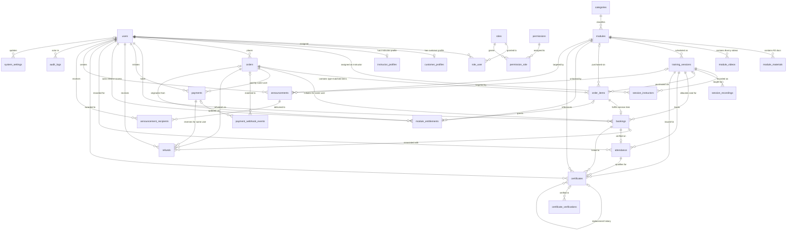
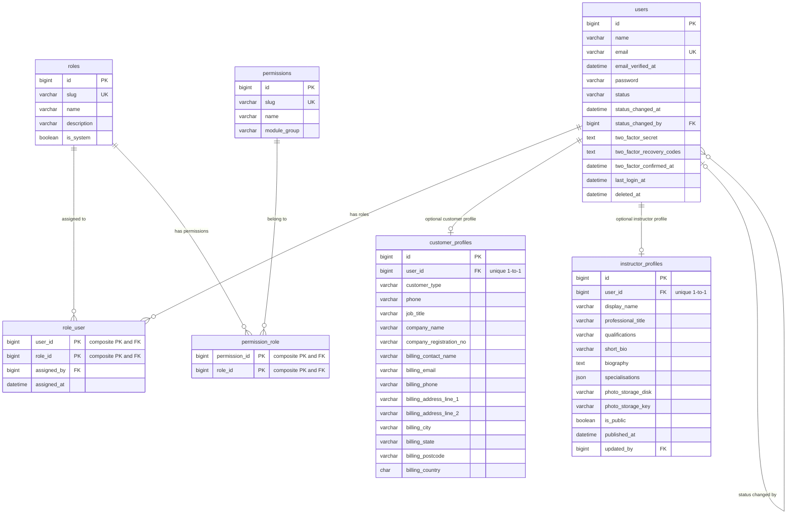
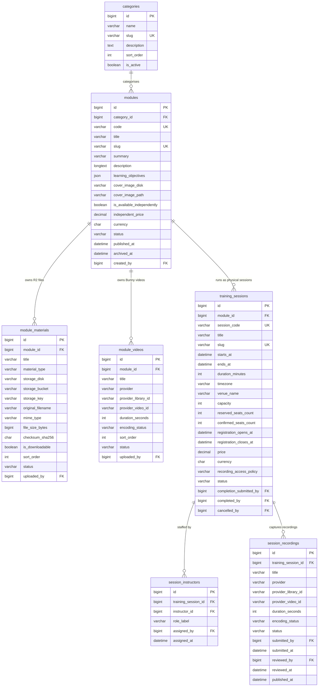
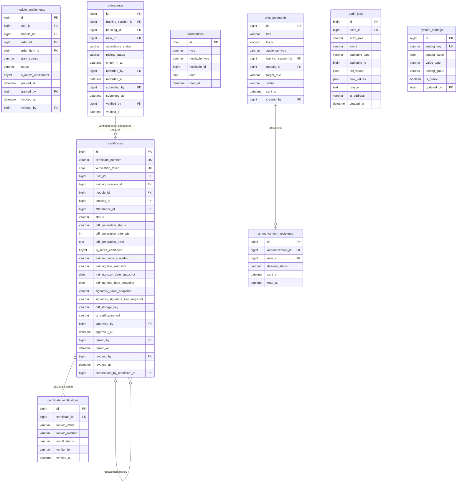

# ETMS Entity Relationship Diagram (ERD)

**Project:** Ecohydrotech Training Management System (ETMS)  
**Stage:** Stage 1 — Database Design (Revised after Review & Confirmed Decisions D-017..D-034 — Pending Final Approval)  
**Baseline:** [SRS and System Architecture v1.1](ETMS-SRS-and-System-Architecture-v1.1.md) & [Architecture and Business Decisions](DECISIONS.md)  
**Database Engine:** MySQL 8.4 (InnoDB, `utf8mb4_unicode_ci`, UTC `DATETIME` timestamps)  
**Companion Document:** [Database Design & Data Dictionary](DATABASE-DESIGN.md)

---

## 1. Domain Architecture Overview

The ETMS database comprises **29 domain tables** (the 28 original Stage 1 domain tables plus `instructor_profiles` required by confirmed decision **D-027**) organized into six bounded functional domains, plus **7 standard Laravel 13 infrastructure tables** documented in [DATABASE-DESIGN.md](DATABASE-DESIGN.md#appendix-a-laravel-13-framework-infrastructure-tables).

| Domain | Tables | Count |
|---|---|---:|
| **A. Identity, RBAC, Customer & Instructor Profiles** | `users`, `roles`, `permissions`, `role_user`, `permission_role`, `customer_profiles`, `instructor_profiles` | 7 |
| **B. Training Catalogue, Materials & Videos** | `categories`, `modules`, `module_materials`, `module_videos` | 4 |
| **C. Physical Sessions, Instructors & Recordings** | `training_sessions`, `session_instructors`, `session_recordings` | 3 |
| **D. Commerce, Bookings, Payments & Refunds** | `orders`, `order_items`, `bookings`, `payments`, `payment_webhook_events`, `refunds` | 6 |
| **E. Entitlements, Attendance & Certificates** | `module_entitlements`, `attendance`, `certificates`, `certificate_verifications` | 4 |
| **F. Operations, Communications & Governance** | `notifications`, `announcements`, `announcement_recipients`, `audit_logs`, `system_settings` | 5 |
| **Total Domain Tables** | | **29** |

> **Scope & Constraint Guard:** In strict compliance with SRS Section 1.4, Section 9.1, and Decisions D-003, D-022, D-023, D-024, D-028, and D-030, there are **no** `organizations`, `companies`, `organization_members`, `corporate_coordinators`, `employee_assignments`, `subscriptions`, `assessments`, `session_days`, or `category_module` tables, and no NRIC/passport or speculative tax columns. Company billing details are optional fields on `customer_profiles` and snapshotted onto `orders`.

---

## 2. Complete System ERD

---

## 3. Domain-Focused ERDs

### 3.1 Domain A — Identity, RBAC, Customer & Instructor Profiles

---

### 3.2 Domains B & C — Training Catalogue, Media & Physical Sessions

---

### 3.3 Domain D — Commerce, Orders, Bookings, Payments & Refunds

```mermaid
erDiagram
    orders {
        bigint id PK
        varchar order_number UK
        bigint user_id FK
        varchar order_type
        varchar status
        char currency
        decimal subtotal_amount
        decimal total_amount
        varchar customer_name
        varchar customer_email
        varchar customer_type
        varchar company_name
        datetime expires_at
        datetime paid_at
        datetime cancelled_at
        datetime refunded_at
    }

    order_items {
        bigint id PK
        bigint order_id FK
        varchar order_type
        varchar item_type
        bigint training_session_id FK
        bigint module_id FK
        varchar item_code_snapshot
        varchar item_title_snapshot
        decimal unit_price
        int quantity
        decimal line_total
        char currency
        json metadata_snapshot
    }

    bookings {
        bigint id PK
        varchar booking_reference UK
        bigint user_id FK
        bigint training_session_id FK
        bigint order_id FK
        bigint order_item_id FK
        varchar status
        tinyint is_active_booking
        datetime reserved_at
        datetime reservation_expires_at
        datetime confirmed_at
        datetime cancelled_at
        datetime expired_at
        datetime refunded_at
        bigint cancelled_by FK
    }

    payments {
        bigint id PK
        varchar payment_reference UK
        bigint order_id FK
        bigint user_id FK
        varchar gateway
        varchar payment_method
        decimal amount
        decimal refunded_amount
        char currency
        varchar status
        varchar gateway_bill_id
        varchar gateway_transaction_id
        varchar gateway_reference_1
        varchar gateway_state
        datetime paid_at
        varchar manual_reference
        varchar evidence_storage_key
        bigint verified_by FK
        datetime verified_at
    }

    payment_webhook_events {
        bigint id PK
        varchar gateway
        char idempotency_key
        char request_fingerprint
        varchar gateway_bill_id
        varchar gateway_transaction_id
        varchar gateway_collection_id
        bigint payment_id FK
        bigint order_id FK
        varchar event_type
        boolean signature_valid
        decimal reported_amount
        decimal reported_paid_amount
        boolean reported_paid
        varchar reported_state
        datetime reported_paid_at
        char reported_currency
        json headers
        json payload
        varchar processing_status
        text rejection_reason
        varchar source_ip
        datetime received_at
        datetime processed_at
        datetime created_at
        datetime updated_at
    }

    refunds {
        bigint id PK
        varchar refund_reference UK
        bigint order_id FK
        bigint payment_id FK
        bigint booking_id FK
        bigint user_id FK
        decimal amount
        char currency
        varchar refund_method
        varchar provider_disbursement_id
        varchar disbursement_reference
        varchar disbursement_status
        varchar status
        varchar request_source
        varchar source_event
        bigint requested_by FK
        bigint approved_by FK
        bigint processed_by FK
        datetime processed_at
    }

    orders ||--|{ order_items : "contains type-matched items"
    orders ||--o{ bookings : "creates booking for same user"
    order_items ||--o| bookings : "1-to-1 session booking"
    orders ||--o{ payments : "has payment attempts by same user"
    payments |o--o{ payment_webhook_events : "receives callbacks"
    orders |o--o{ payment_webhook_events : "correlated to"
    orders ||--o{ refunds : "has refunds"
    payments ||--o{ refunds : "refunded from"
    bookings |o--o{ refunds : "optional booking refund"
```

---

### 3.4 Domains E & F — Entitlements, Attendance, Certificates & Operations

> **Note on Polymorphic Tables:** `notifications` (`notifiable_type`, `notifiable_id`) and `audit_logs` (`auditable_type`, `auditable_id`) use polymorphic references without MySQL physical foreign keys on the target ID, enabling unified portal notifications and immutable audit coverage across all domain models. Cross-domain user FKs (`users` → `module_entitlements`, `attendance`, `certificates`, `announcements`, `announcement_recipients`, `audit_logs`, `system_settings`) are shown in the Complete System ERD above.

---

## 4. Relationship Cardinality Matrix

| Parent Entity | Child Entity | Cardinality | Foreign Key Column(s) & Composite Integrity Links | On Delete | On Update |
|---|---|---|---|---|---|
| `users` | `role_user` | `1 : 0..*` | `role_user.user_id` → `users.id` | `CASCADE` | `RESTRICT` |
| `roles` | `role_user` | `1 : 0..*` | `role_user.role_id` → `roles.id` | `RESTRICT` | `RESTRICT` |
| `roles` | `permission_role` | `1 : 0..*` | `permission_role.role_id` → `roles.id` | `CASCADE` | `RESTRICT` |
| `permissions` | `permission_role` | `1 : 0..*` | `permission_role.permission_id` → `permissions.id` | `CASCADE` | `RESTRICT` |
| `users` | `customer_profiles` | `1 : 0..1` | `customer_profiles.user_id` (UK) → `users.id` | `CASCADE` | `RESTRICT` |
| `users` | `instructor_profiles` | `1 : 0..1` | `instructor_profiles.user_id` (UK) → `users.id` | `CASCADE` | `RESTRICT` |
| `categories` | `modules` | `1 : 0..*` | `modules.category_id` → `categories.id` (single primary category, D-024) | `RESTRICT` | `RESTRICT` |
| `modules` | `module_materials` | `1 : 0..*` | `module_materials.module_id` → `modules.id` | `RESTRICT` | `RESTRICT` |
| `modules` | `module_videos` | `1 : 0..*` | `module_videos.module_id` → `modules.id` | `RESTRICT` | `RESTRICT` |
| `modules` | `training_sessions` | `1 : 0..*` | `training_sessions.module_id` → `modules.id` | `RESTRICT` | `RESTRICT` |
| `training_sessions` | `session_instructors` | `1 : 0..*` | `session_instructors.training_session_id` → `training_sessions.id` | `CASCADE` | `RESTRICT` |
| `users` | `session_instructors` | `1 : 0..*` | `session_instructors.instructor_id` → `users.id` | `RESTRICT` | `RESTRICT` |
| `training_sessions` | `session_recordings` | `1 : 0..*` | `session_recordings.training_session_id` → `training_sessions.id` | `RESTRICT` | `RESTRICT` |
| `users` | `orders` | `1 : 0..*` | `orders.user_id` → `users.id` | `RESTRICT` | `RESTRICT` |
| `orders` | `order_items` | `1 : 1..*` | `order_items.(order_id, order_type)` → `orders.(id, order_type)` (D-030, D-031) | `RESTRICT` | `RESTRICT` |
| `training_sessions` | `order_items` | `0..1 : 0..*` | `order_items.training_session_id` → `training_sessions.id` | `RESTRICT` | `RESTRICT` |
| `modules` | `order_items` | `0..1 : 0..*` | `order_items.module_id` → `modules.id` | `RESTRICT` | `RESTRICT` |
| `users` | `bookings` | `1 : 0..*` | `bookings.user_id` → `users.id` | `RESTRICT` | `RESTRICT` |
| `training_sessions` | `bookings` | `1 : 0..*` | `bookings.training_session_id` → `training_sessions.id` | `RESTRICT` | `RESTRICT` |
| `orders` | `bookings` | `1 : 0..*` | `bookings.(order_id, user_id)` → `orders.(id, user_id)` (D-032) | `RESTRICT` | `RESTRICT` |
| `order_items` | `bookings` | `1 : 0..1` | `bookings.(order_item_id, order_id, training_session_id)` → `order_items.(id, order_id, training_session_id)` | `RESTRICT` | `RESTRICT` |
| `orders` | `payments` | `1 : 0..*` | `payments.(order_id, user_id)` → `orders.(id, user_id)` (D-032) | `RESTRICT` | `RESTRICT` |
| `users` | `payments` | `1 : 0..*` | `payments.user_id` → `users.id` | `RESTRICT` | `RESTRICT` |
| `payments` | `payment_webhook_events` | `0..1 : 0..*` | `payment_webhook_events.(payment_id, order_id)` → `payments.(id, order_id)` | `RESTRICT` | `RESTRICT` |
| `orders` | `payment_webhook_events` | `0..1 : 0..*` | `payment_webhook_events.order_id` → `orders.id` | `RESTRICT` | `RESTRICT` |
| `orders` | `refunds` | `1 : 0..*` | `refunds.order_id` → `orders.id` | `RESTRICT` | `RESTRICT` |
| `payments` | `refunds` | `1 : 0..*` | `refunds.(payment_id, order_id, user_id)` → `payments.(id, order_id, user_id)` (D-032) | `RESTRICT` | `RESTRICT` |
| `bookings` | `refunds` | `0..1 : 0..*` | `refunds.(booking_id, order_id, user_id)` → `bookings.(id, order_id, user_id)` (D-032) | `RESTRICT` | `RESTRICT` |
| `users` | `refunds` | `1 : 0..*` | `refunds.user_id` → `users.id` | `RESTRICT` | `RESTRICT` |
| `users` | `module_entitlements` | `1 : 0..*` | `module_entitlements.user_id` → `users.id` | `RESTRICT` | `RESTRICT` |
| `modules` | `module_entitlements` | `1 : 0..*` | `module_entitlements.module_id` → `modules.id` | `RESTRICT` | `RESTRICT` |
| `orders` | `module_entitlements` | `0..1 : 0..*` | `module_entitlements.(order_id, user_id)` → `orders.(id, user_id)` (D-032) | `RESTRICT` | `RESTRICT` |
| `order_items` | `module_entitlements` | `0..1 : 0..1` | `module_entitlements.(order_item_id, order_id, module_id)` → `order_items.(id, order_id, module_id)` | `RESTRICT` | `RESTRICT` |
| `training_sessions` | `attendance` | `1 : 0..*` | `attendance.training_session_id` → `training_sessions.id` | `RESTRICT` | `RESTRICT` |
| `bookings` | `attendance` | `1 : 0..1` | `attendance.(booking_id, training_session_id, user_id)` → `bookings.(id, training_session_id, user_id)` | `RESTRICT` | `RESTRICT` |
| `users` | `attendance` | `1 : 0..*` | `attendance.user_id` → `users.id` | `RESTRICT` | `RESTRICT` |
| `attendance` | `certificates` | `1 : 0..*` | `certificates.(attendance_id, training_session_id, booking_id, user_id)` → `attendance.(id, training_session_id, booking_id, user_id)` | `RESTRICT` | `RESTRICT` |
| `bookings` | `certificates` | `1 : 0..*` | `certificates.booking_id` → `bookings.id` | `RESTRICT` | `RESTRICT` |
| `training_sessions` | `certificates` | `1 : 0..*` | `certificates.(training_session_id, module_id)` → `training_sessions.(id, module_id)` | `RESTRICT` | `RESTRICT` |
| `modules` | `certificates` | `1 : 0..*` | `certificates.module_id` → `modules.id` | `RESTRICT` | `RESTRICT` |
| `users` | `certificates` | `1 : 0..*` | `certificates.user_id` → `users.id` | `RESTRICT` | `RESTRICT` |
| `certificates` | `certificates` | `0..* : 0..1` | `certificates.superseded_by_certificate_id` → `certificates.id` (non-unique historical forward link; active uniqueness is per attendance) | `SET NULL` | `RESTRICT` |
| `certificates` | `certificate_verifications` | `0..1 : 0..*` | `certificate_verifications.certificate_id` → `certificates.id` | `SET NULL` | `RESTRICT` |
| `announcements` | `announcement_recipients` | `1 : 0..*` | `announcement_recipients.announcement_id` → `announcements.id` | `CASCADE` | `RESTRICT` |
| `users` | `announcement_recipients` | `1 : 0..*` | `announcement_recipients.user_id` → `users.id` | `CASCADE` | `RESTRICT` |
| `training_sessions` | `announcements` | `0..1 : 0..*` | `announcements.training_session_id` → `training_sessions.id` | `SET NULL` | `RESTRICT` |
| `modules` | `announcements` | `0..1 : 0..*` | `announcements.module_id` → `modules.id` | `SET NULL` | `RESTRICT` |
| `users` | `audit_logs` | `0..1 : 0..*` | `audit_logs.actor_id` → `users.id` | `SET NULL` | `RESTRICT` |
| `users` | `system_settings` | `0..1 : 0..*` | `system_settings.updated_by` → `users.id` | `SET NULL` | `RESTRICT` |

---

## 5. Verification Against Approved Constraints & Decisions (`D-001` – `D-034`)

- **Three roles only (`D-004`, `D-026`):** `roles` contains strictly `administrator`, `instructor`, and `customer`. Native `role_user` and `permission_role` support multiple roles per user so staff members may also hold the `customer` role when purchasing training.
- **No corporate portal or organisation tables (`D-003`, `D-023`):** Zero organisation, member, coordinator, or employee assignment tables exist. Each booking represents the authenticated customer purchasing for themselves (`quantity = 1`).
- **Same customer workflow (`D-001`, `D-002`):** Individuals and company purchasers share `users`, `customer_profiles`, `orders`, `order_items`, and `payments`.
- **Public instructor profiles (`D-027`):** `instructor_profiles` stores instructor public biography, qualifications, photograph key, and `is_public` visibility control.
- **One primary category per module (`D-024`):** `modules.category_id` (`NOT NULL`, `FK -> categories.id`).
- **One module -> multiple sessions (`D-005`, `D-022`, `D-029`):** `modules 1 -- 0..* training_sessions` with a single continuous `starts_at` / `ends_at` range and `CHECK (registration_closes_at < starts_at)`.
- **Strict order & item separation (`D-018`, `D-030`, `D-031`):** `order_items.(order_id, order_type)` references `orders.(id, order_type)` and a table `CHECK` binds `order_type` to `item_type`, making mixed orders or mismatched items impossible.
- **Cross-record ownership integrity (`D-032`):** Composite FKs guarantee `bookings.user_id`, `payments.user_id`, `refunds.user_id`, and purchased `module_entitlements.user_id` always match `orders.user_id`.
- **Billplz-only launch payments (`D-008`, `D-020`):** `payments.gateway` is constrained to `'billplz'` in the initial release; `payment_webhook_events` enforces `(gateway, idempotency_key)` uniqueness.
- **Lifetime module access (`D-006`):** `module_entitlements` has no expiry timestamp.
- **Separate booking, attendance, and review lifecycles (`D-017`, `D-025`):** `bookings.status` tracks seat state; `attendance.attendance_status` tracks participation (`pending`, `present`, `absent`, `excused`); `attendance.review_status` tracks verification (`draft`, `submitted`, `verified`, `correction_requested`).
- **Certificate integrity & global signatory snapshots (`D-007`, `D-027`, `D-034`):** `certificates` requires non-null `training_session_id`, `booking_id`, `attendance_id`, `approved_by`, and `approved_at`, tracks `pdf_generation_status` separately from `status`, and snapshots global signatory settings upon approval.
- **Certificate replacement cardinality:** A revoked certificate remains queryable for QR/history. Its non-unique `superseded_by_certificate_id` forward link records replacement history; `uq_certificates_active_attendance (attendance_id, is_active_certificate)` permits only one active certificate for an attendance. No unique constraint is applied to the replacement link.
- **Billplz callback contract:** The callback is form-encoded and carries `x_signature` in the POST body, not an HTTP `X-Signature` header. The stable callback identity is a hash of the canonical required callback fields, excluding `x_signature` and optional transaction identifiers, so exact retries deduplicate while legitimate status changes remain processable.

**Verification scope:** The relationship matrix and displayed columns were reviewed against the companion data dictionary. This is not a claim of complete bidirectional column parity, Mermaid parser validation, MySQL 8.4 DDL execution, constraint tests, or concurrency tests; those remain implementation-stage checks.
- **PDPA & tax data minimisation (`D-028`):** No NRIC/passport or speculative tax/e-Invoice fields are included.
