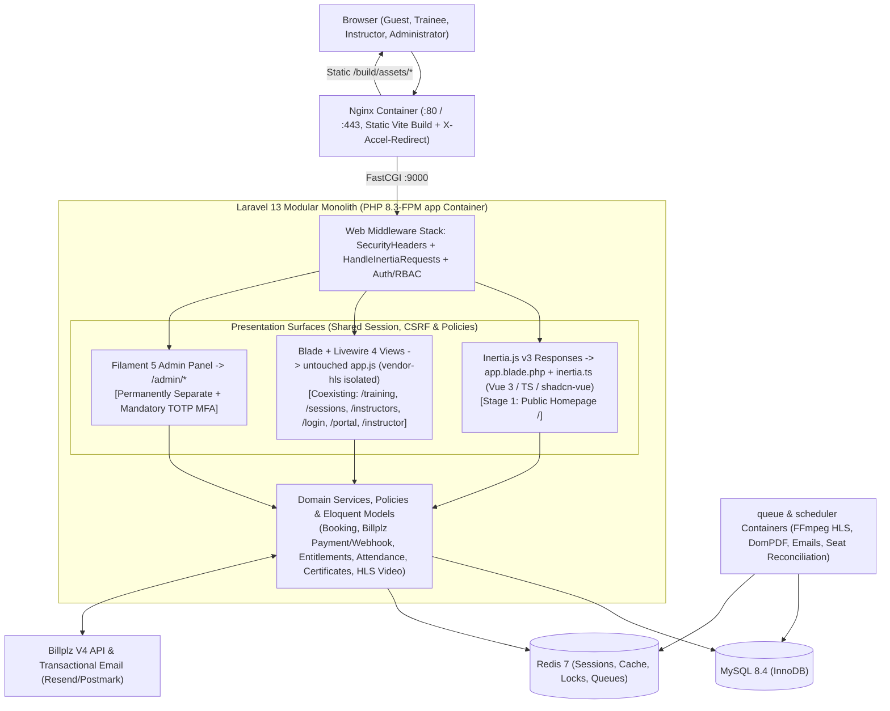

# Ecohydrotech Training Management System (ETMS)
## Software Requirements Specification (SRS) & System Architecture Specification — Revision 1.2 (Frontend Modernisation Addendum)

| Property | Value |
|---|---|
| **Project** | Ecohydrotech Training Management System (ETMS) |
| **Owner** | Ecohydrotech Solution |
| **Version** | 1.2 (Controlled Frontend Modernisation Revision) |
| **Revision Date** | 19 November 2026 |
| **Supersedes (Presentation Only)** | Frontend stack & UI shell sections of [SRS & System Architecture v1.1](ETMS-SRS-and-System-Architecture-v1.1.md) (Section 6, Decision `D-011`) |
| **Preserved Baseline** | `ETMS-SRS-and-System-Architecture-v1.1.md` remains intact and authoritative for all business rules (`BR-01`–`BR-16`), functional requirements (`FR-01`–`FR-12`), RBAC (`D-004`, `D-026`), database design (`ERD.md`, `DATABASE-DESIGN.md`), and Stage 10 self-hosted storage/HLS security architecture |
| **Status** | Approved Incremental Modernisation Architecture (Phase A–D Foundation & Stage 1 Public Homepage) |
| **Target Market** | Malaysia (`MYR`, `Asia/Kuala_Lumpur` UTC+8) |

> **Governance Rule:** This v1.2 specification introduces **Vue 3 + TypeScript + Inertia.js + shadcn-vue** strictly as a controlled, incremental presentation-layer upgrade inside the existing Laravel 13 modular monolith. It preserves 100% of existing Laravel controllers, services, policies, MySQL 8.4 schema, Billplz payment/webhook integrity, FFmpeg HLS media security, and the Filament 5 Administrator Panel without creating a separate frontend repository or Node API server.

---

## 1. Revision Purpose & Preserved Invariants

### 1.1 Why Revision 1.2 Exists
Following completion of Stage 10 (self-hosted private server storage, FFmpeg HLS streaming, security hardening, and production Docker builds), ETMS requires a modern, maintainable, strongly typed component UI for customer-facing and instructor-facing experiences while keeping all verified Laravel backend guarantees intact.

### 1.2 Non-Negotiable Preserved Baseline (From v1.1 & Stage 10)
1. **Modular Monolith (`D-009`):** Single Laravel 13 codebase. No microservices, no decoupled REST/GraphQL SPA backend, and no separate Node.js SSR/API server in production.
2. **Three Roles Only (`D-004`, `D-026`):** `administrator`, `instructor`, `customer`. Multi-role staff (`D-026`) retain independent portal switching.
3. **No Corporate Portal (`D-001`–`D-003`, `D-023`):** Individual and company buyers share the single customer registration, booking, and checkout workflow; company billing details remain optional invoice metadata.
4. **Physical Training vs. Independent Modules (`D-005`, `D-006`, `D-018`):** Physical sessions reserve capacity (`D-019` 15-minute hold, `D-033` `SELECT ... FOR UPDATE`), verify attendance (`D-025`), and unlock attendance-gated recordings (`D-017`) and admin-approved certificates (`D-007`, `D-034`). Independent module purchases grant lifetime module entitlement without physical seat reservations or certificates.
5. **Server-Side Authority (`FR-05`, `D-035`):** Billplz `X-Signature` callbacks remain server-authoritative; Inertia props never carry sensitive credentials, secrets, unredacted user fields, or private storage keys (`materials`, `videos`, `recordings`, `certificates`).
6. **Filament 5 Permanently Separate (`D-012`, `D-038`):** The `/admin` back-office remains exclusively on Filament 5 with mandatory TOTP MFA (`EnsureAdministratorMfa`).

---

## 2. Updated Technology Stack (Version 1.2)

| Layer | Technology (v1.2) | Responsibility & Scope |
|---|---|---|
| **Backend & Domain Logic** | Laravel 13 (`PHP 8.3+`) | Routing, sessions, CSRF, RBAC policies, `SessionBookingService`, `PaymentOrchestrationService`, `CertificateService`, `SelfHostedVideoService`, Inertia page props |
| **Modernised Frontend UI** | **Vue 3 + TypeScript + Inertia.js v3 + shadcn-vue (Reka UI)** | Public website, training catalogue, session/instructor details, authentication flows, Trainee Portal, and Instructor Portal (rolled out incrementally by stage) |
| **Transition Coexistence UI** | **Blade + Livewire 4** | Continues serving unmigrated routes cleanly alongside Vue/Inertia during staged migration without big-bang rewrites |
| **Administrator Back-Office** | **Filament 5** (`/admin`) | Permanently separate back-office resources, relation managers, actions, reports, and dashboard widgets |
| **Styling & Design System** | Tailwind CSS 4 + `@fontsource/plus-jakarta-sans` + `@fontsource/jetbrains-mono` | Shared `@theme` Ecohydrotech tokens plus minimalist `shadcn-vue` CSS variables (`resources/css/app.css`: `#FFFFFF`, `#FAFAFA`, `neutral-200`, `neutral-900`, single `#0F4C81` accent, capped `6px–8px` radii) |
| **Asset Bundler** | Vite 8 (Rolldown) + `@vitejs/plugin-vue` + `laravel-vite-plugin` | Dual entrypoints (`resources/js/inertia.ts` for Inertia/Vue routes; untouched `resources/js/app.js` for Blade/Livewire HLS pages) with isolated `vendor-hls`, `vendor-vue`, `vendor-inertia`, and `vendor-ui` chunks |
| **Database** | MySQL 8.4 (`InnoDB`) | Unchanged 29+ domain tables, CHECK constraints, composite FKs, and generated uniqueness columns |
| **Media Streaming** | FFmpeg (`local_hls`) + `hls.js` | Private signed `.m3u8`/`.ts` streaming via untouched `resources/js/app.js` (`vendor-hls` isolated from public Inertia bundles) |
| **Cache, Queues & Infra** | Redis 7 + Docker Compose v2 (`nginx`, `app`, `queue`, `scheduler`, `mysql`, `redis`) | Unchanged container topology; `node_assets` build stage compiles both Blade and Vue/Inertia Vite bundles |

---

## 3. Updated System Architecture Diagram (v1.2 Coexistence Topology)

---

## 4. Blade/Livewire + Vue/Inertia Coexistence Strategy (`D-039`)

During incremental migration, Laravel routes serve either Inertia/Vue responses or Blade/Livewire responses seamlessly under a single domain and session:

1. **Isolated Root Shells & Vite Entrypoints:**
   - **Inertia Routes** (starting with `GET /` via `PublicCatalogueController::home`) render `resources/views/app.blade.php` loading `['resources/css/app.css', 'resources/js/inertia.ts']`.
   - **Coexisting Blade/Livewire Routes** continue using `resources/views/components/layouts/{public,auth,portal,instructor}.blade.php` loading `['resources/css/app.css', 'resources/js/app.js']` plus `@livewireStyles`/`@livewireScripts`.
   - **Benefit:** Public Inertia pages never load Livewire or `hls.js`, and existing Blade/Livewire pages never download Vue 3 or Inertia runtime bundles.

2. **Cross-Boundary Navigation Contract:**
   - **Inertia → Inertia:** Use Inertia `<Link>` for client-side XHR transitions without full page reloads.
   - **Inertia → Blade/Livewire or `/admin`:** Use standard HTML `<a href>` (or shadcn-vue `<Button as="a" :href="...">`) so the browser performs a clean full-document transition that boots Livewire/Blade or Filament assets properly.
   - **Logout / Mutations across Boundaries:** Form submissions (`POST /logout`) executed via Inertia `router.post(...)` or standard POST forms receive standard HTTP redirects back to Laravel routes; Laravel `Inertia::location(...)` or normal 302 redirects handle cross-shell transitions cleanly.

3. **Shared Data & Security Boundary (`HandleInertiaRequests`):**
   - `HandleInertiaRequests` shares only minimal, explicit DTO properties (`app`, `auth.user` public session identity + `availablePortals`, lazy `flash`, and `routes` named URL strings).
   - **Strict Data Minimisation Rule:** Never pass raw Eloquent models with `$hidden` overrides, tokens, TOTP secrets, private filesystem disk keys (`storage_key`, `hls_manifest_key`), or private customer emails of other users into Inertia props.

4. **Shared Visual Continuity:**
   - Both Blade layouts and Vue/shadcn-vue components compile through `resources/css/app.css`, preserving consistent typography (`Plus Jakarta Sans` + `JetBrains Mono`) and Ecohydrotech Hydro Navy (`#0F4C81`) / neutral slate visual discipline.
   - `public/css/home.css` and `resources/views/public/home.blade.php` remain preserved until post-cutover verification confirms zero remaining references.

---

## 5. Why Filament 5 Remains Permanently Separate (`D-038`)

Filament 5 (`/admin`) is **not** part of the Vue/Inertia migration scope for the following architectural reasons:
1. **Rich Proven Operations Surface:** `/admin` already implements 17 Filament Resources, RelationManagers, custom audited actions (refund approval, session cancellation, attendance verification, certificate revocation, webhook Get-a-Bill recovery), `ReportsPage` exports, and dashboard chart widgets (`MonthlyRevenueChart`, `DeliveryMixChart`).
2. **Security & MFA Isolation:** `AdminPanelProvider` strictly gates `/admin` with `EnsureAccountIsActive`, `EnsureUserHasRole:administrator`, and `EnsureAdministratorMfa` over Filament's dedicated Livewire pipeline.
3. **Maintainability & Cost Discipline:** Rebuilding Filament CRUD, tables, filters, and charts in Vue would duplicate tested server-side administrative logic with zero end-user benefit. Multi-role administrators continue switching between `/admin`, `/instructor`, and `/portal` via standard cross-boundary links.

---

## 6. Bundle Optimisation & Asset Delivery Rules

To keep `hls.js` out of public Vue/Inertia routes while leaving `resources/js/app.js` completely untouched for Blade HLS pages:
1. **Isolated HLS Entrypoint (`resources/js/app.js` + `vendor-hls`):** `resources/js/app.js` remains untouched (`import Hls from 'hls.js'`), and `vite.config.js` splits `node_modules/hls.js` into an isolated `vendor-hls` chunk (`~578 kB`) referenced **only** by `app.js`. Public Vue/Inertia routes (`inertia.ts`) never download or parse `hls.js`.
2. **Lazy Inertia Page Code Splitting (`resources/js/inertia.ts`):** Resolve `./pages/**/*.vue` lazily via `import.meta.glob('./pages/**/*.vue')` instead of `{ eager: true }`, ensuring each migrated route downloads only its own chunk (e.g. `Home.js` `~40 kB`).
3. **Vite 8 Rolldown Vendor Splitting (`vite.config.js`):** Split `vite-preload`, `vendor-vue`, `vendor-hls`, `vendor-inertia`, and `vendor-ui` via `build.rolldownOptions.output.codeSplitting.groups`, plus serve WebP variants (`hero-field-hydrology.webp`, `classroom-session.webp`) with `.jpg` fallbacks.

---

## 7. Incremental Migration Phases & Acceptance Criteria

Each phase requires explicit verification (`vue-tsc --noEmit`, `vite build`, full PHPUnit feature suite, and live inspection) and explicit project-owner approval before proceeding.

| Phase | Scope | Screens (`SCREEN-INVENTORY.md`) | Acceptance Criteria | Status |
|---|---|---|---|---|
| **FM-1** | **Foundation & Public Homepage** | Infrastructure + `PUB-01` (`/`) | `inertia-laravel` v3, Vue 3, TS, minimalist `shadcn-vue` configured; `HandleInertiaRequests` active; `GET /` serves `pages/Public/Home.vue` with real DB data (`upcomingSessions`, `featuredModules`, `instructors`, live stats, WebP images); `hls.js` isolated from Vue/Inertia bundle; `vue-tsc` clean; all tests pass; `app.js`, Blade/Livewire & Filament untouched. | **Current Stage (Checkpoint)** |
| **FM-2** | **Public Catalogue, Sessions, Instructors & Verification** | `PUB-02`..`PUB-05`, `/verify` | Migrate `/training`, `/training/{module}`, `/sessions`, `/sessions/{session}`, `/instructors`, `/instructors/{instructor}` to Inertia + Vue; replace Livewire catalogue filtering with Inertia partial reloads (`preserveState`, URL query sync); preserve 404 guards & `reconcileSessionCounters`. | Planned (Requires Approval) |
| **FM-3** | **Authentication & Account Flows** | `PUB-06`..`PUB-10` | Migrate `/login`, `/register` (individual/company toggle), `/forgot-password`, `/reset-password`, `/email/verify`, `/two-factor-setup`, `/two-factor-challenge` preserving throttles, audit logs, and TOTP flow. | Planned |
| **FM-4** | **Trainee Portal, Checkout & HLS Playback** | `TRN-01`..`TRN-14` | Migrate `/portal/*` and `/checkout/*`; retain server-side 15m seat hold, read-only `/checkout/return` polling via Inertia `usePoll`, signed private material downloads, dynamic `hls.js/light` Vue player component, QR certificate modals, and notification centre. | Planned |
| **FM-5** | **Instructor Portal** | `INS-01`..`INS-07` | Migrate `/instructor/*`; retain session ownership 403 guards, tablet-friendly 44px attendance marking & `chk_attendance_marked_before_submit` UI guard, completion submission, and recording upload workflow. | Planned |
| **FM-6** | **Legacy Blade/Livewire Cleanup** | Legacy non-admin views | Repo-wide verification of zero references to legacy `public/css/home.css`, old Blade layouts, Livewire catalogue component, and `components/eht/*` before archival/removal; `livewire/livewire` retained only as required by Filament 5. | Planned |

---

**End of SRS and System Architecture Specification — ETMS Revision 1.2**
