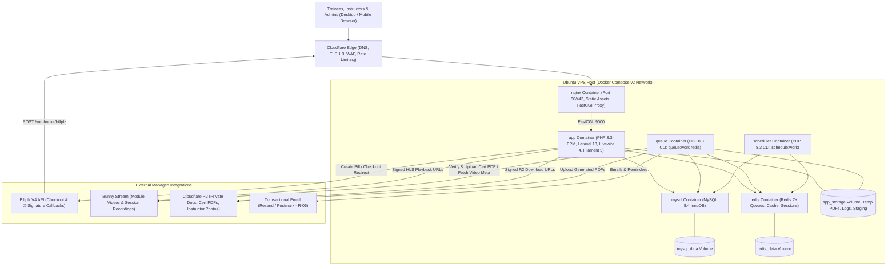

# ETMS UI/UX Blueprint & Application Design Specification

| Property | Value |
|---|---|
| **Project** | Ecohydrotech Training Management System (ETMS) |
| **Owner** | Ecohydrotech Solution |
| **Stage** | Stage 2 — UI/UX Blueprint & Application Design (Pending Review) |
| **Version** | 1.0 |
| **Date** | 17 November 2026 |
| **Target Market** | Malaysia (`MYR`, `Asia/Kuala_Lumpur` UTC+8) |
| **Authoritative Baseline** | [SRS & System Architecture v1.1](ETMS-SRS-and-System-Architecture-v1.1.md), [Database Design](DATABASE-DESIGN.md), [ERD](ERD.md), [Decisions](DECISIONS.md) |
| **Companion Documents** | [Screen Inventory](SCREEN-INVENTORY.md), [User Flows & Navigation](USER-FLOWS.md) |

> **Scope & Stage Control Notice:** This document is a design and architectural blueprint only. Per Stage 2 boundaries, no Laravel source files, database migrations, or Docker configuration files are generated here. Every screen, component, workflow, and badge state maps strictly to the approved 29-table MySQL 8.4 schema and decisions `D-001`–`D-036`.

---

## 1. Architectural Baseline & Technology Stack Alignment

### 1.1 Approved Technology Stack Mapping

ETMS follows a **Modular Monolith** (`D-009`) served by a unified Laravel 13 codebase without microservices or a decoupled SPA frontend:

| Layer | Technology | UI / Architectural Role in ETMS |
|---|---|---|
| **Backend & Domain Logic** | Laravel 13 / PHP 8.3+ | Routing, RBAC policies (`roles`, `permissions`), transactional services, Billplz/R2/Bunny integrations, Artisan commands (`etms:reconcile-session-seats`). |
| **Public, Trainee & Instructor UI** | Blade + Livewire 4 | Server-rendered semantic HTML (`Blade`), reactive filtering, checkout hold timer/polling, and touch-friendly attendance sheets (`Livewire 4`), paired with bundled `Alpine.js` for local UI toggles/modals. |
| **Administrator Portal (`/admin`)** | Filament 5 | Complete administrative back-office built on Filament 5 Panels, Resources, RelationManagers, Custom Actions, Infolists, Dashboard Widgets, and Notifications. |
| **Styling & Design Tokens** | Tailwind CSS 4 | CSS-first `@theme` design tokens compiled via Vite; shared brand identity between custom Blade/Livewire layouts and the Filament 5 Admin Panel. |
| **Database & Concurrency** | MySQL 8.4 (InnoDB) | 29 domain tables + 7 Laravel infrastructure tables; `DECIMAL(12,2)` monetary columns; UTC `DATETIME` stored and rendered in `Asia/Kuala_Lumpur`. |
| **Queues, Cache & Locks** | Redis 7+ | Primary driver for async jobs (`GenerateCertificatePdfJob`, Billplz webhook matching/reconciliation, transactional emails), distributed atomic locks, and view/query caching. |
| **Containerisation** | Docker + Docker Compose v2 | Consistent local development and production deployment across `nginx`, `app`, `queue`, `scheduler`, `mysql`, and `redis` containers (`D-036`). |
| **External Managed Services** | Billplz, Bunny Stream, Cloudflare R2, Cloudflare, Resend/Postmark | Outbound/inbound managed services outside the container host. Never store large binaries or customer card credentials inside the VPS containers. |

### 1.2 Containerisation & Hosting Architecture (`D-036`)

Stage 3 will implement the Docker Compose v2 environment matching this topology so local development mirrors production behaviour on Ubuntu VPS:



#### Container Responsibilities & Persistence Rules
1. **`nginx`:** Serves compiled Vite assets (`public/build`) directly with immutable cache headers, terminates internal HTTP from Cloudflare Tunnel/Origin SSL, enforces request body limits for material uploads, and proxies PHP requests to `app:9000`.
2. **`app` (`php:8.3-fpm`):** Executes synchronous HTTP requests for Public pages, Trainee/Customer portal, Instructor portal, Filament 5 Admin panel, and the fast-acknowledge Billplz webhook ingestion endpoint (`/webhooks/billplz`, acknowledging within 20 seconds).
3. **`queue` (`php:8.3-cli`):** Runs supervised `php artisan queue:work redis --queue=webhooks,pdfs,notifications,default --tries=3` to process Billplz `unmatched_pending` reconciliation, `GenerateCertificatePdfJob` (Dompdf/Browsershot -> R2 upload), announcement dispatches, and email notifications without blocking HTTP UI responses.
4. **`scheduler` (`php:8.3-cli`):** Runs `php artisan schedule:work` to trigger:
   - `etms:expire-pending-bookings` (every 1 minute): releases expired 15-minute checkout holds (`D-019`) and queues Billplz Delete Bill cleanup.
   - `etms:reconcile-session-seats` (every 5 minutes): verifies and heals `reserved_seats_count` / `confirmed_seats_count` against active `bookings` (`D-033`).
   - Scheduled session reminder emails and scheduled `announcements`.
5. **`mysql` (`mysql:8.4`):** Configured strictly with `--default-time-zone=+00:00`, `utf8mb4_unicode_ci`, and persistent named volume `mysql_data:/var/lib/mysql`.
6. **`redis` (`redis:7-alpine`):** Persistent append-only volume `redis_data:/data` backing queues, rate-limiters, session storage, and distributed checkout locks.
7. **Storage & Security Guardrails:** Persistent host/named volumes are used only for MySQL data, Redis AOF, Laravel logs, and temporary staging during PDF rendering or file upload validation. Long-term documents/certificates live exclusively in **Cloudflare R2**; videos live exclusively in **Bunny Stream**.

---

## 2. Experience Boundaries & Role Switching (`D-001`–`D-004`, `D-026`)

ETMS strictly enforces the **three approved application roles** (`customer`, `instructor`, `administrator`) across **four distinct UI experiences**:

| Experience | URL Prefix | Primary Users | Tech Shell | Auth & Security Gate |
|---|---|---|---|---|
| **A. Public Website & Auth** | `/`, `/training`, `/sessions`, `/instructors`, `/verify`, `/login`, `/register` | Guests & all authenticated users | Custom Blade + Livewire 4 (`layouts.public`) | Public access; `/verify` rate-limited; auth routes throttled. |
| **B. Trainee / Customer Portal** | `/portal/*`, `/checkout/*` | Users holding `customer` role (individual & company buyers, plus staff holding `customer` role per `D-026`) | Custom Blade + Livewire 4 (`layouts.portal` / `layouts.checkout`) | `auth`, `verified`, `active` account status, `role:customer`. |
| **C. Instructor Portal** | `/instructor/*` | Users holding `instructor` role | Custom Blade + Livewire 4 (`layouts.instructor`) | `auth`, `verified`, `active` account status, `role:instructor` + session assignment ownership checks. |
| **D. Administrator Portal** | `/admin/*` | Users holding `administrator` role | Filament 5 Panel (`AdminPanelProvider`) | `auth`, `verified`, `active` account status, `role:administrator`, **mandatory TOTP MFA** (`two_factor_confirmed_at` per SRS Sec. 14). |

### Multi-Role Staff Support (`D-026`)
- An `administrator` or `instructor` may also be granted the `customer` role so they can book sessions or purchase modules as a trainee without needing a separate email account.
- **UI Rule:** Users holding multiple roles see a **Portal Switcher** dropdown in the top header utility bar (e.g., *Switch to Trainee Portal* / *Switch to Instructor Portal* / *Switch to Admin Panel*). Switching context loads the dedicated shell and enforces that portal's policies independently—an instructor cannot view another instructor's roster, and an administrator viewing their own Trainee Portal sees only their personal bookings/certificates.
- **No Corporate Portal (`D-003`, `D-023`):** Every checkout uses the logged-in user as the sole participant (`quantity = 1`). Company buyers enter optional billing metadata on `customer_profiles` (snapshotted onto `orders`), using the exact same Trainee Portal and checkout screens as individuals.

---

## 3. Ecohydrotech Visual Design System

### 3.1 Brand Personality & Aesthetic Direction
Ecohydrotech Solution delivers specialised hydrological, environmental, and civil technical training across Malaysia. The visual identity communicates:
- **Engineering Precision:** Crisp 1px borders (`slate-200`), structured technical grids, monospaced tabular identifiers (`EHT-HYD-101`, `SES-2026-001`, `RM 1,250.00`), and clear typographic hierarchy.
- **Hydrological & Environmental Trust:** Deep maritime navy (`#0B2545` / `#0F4C81`) anchored by hydrological teal (`#0D9488`) and ecological emerald (`#059669`) on clean `#F8FAFC` light canvas surfaces.
- **Low-Friction Clarity:** Unambiguous separation between **Physical Session Bookings** (date-bound, capacity-limited, leads to attendance & certificate) and **Independent Module Purchases** (self-paced, lifetime access, no certificate).

### 3.2 Colour Palette & Design Tokens (Tailwind CSS 4)

Define the following tokens in `resources/css/app.css` using Tailwind CSS 4 `@theme` syntax so both custom Blade/Livewire views and Filament 5 share identical CSS custom properties:

```css
@import "tailwindcss";

@theme {
  /* Typography */
  --font-sans: "Plus Jakarta Sans", "Inter", ui-sans-serif, system-ui, -apple-system, sans-serif;
  --font-mono: "JetBrains Mono", ui-monospace, SFMono-Regular, Menlo, monospace;
  --font-serif: "Libre Baskerville", Georgia, Cambria, serif;

  /* Brand Primary — Deep Hydro Navy */
  --color-eht-navy-50: #F0F7FF;
  --color-eht-navy-100: #E0EEFF;
  --color-eht-navy-200: #B9D8FE;
  --color-eht-navy-500: #2574C7;
  --color-eht-navy-600: #1D63A5;
  --color-eht-navy-700: #0F4C81;
  --color-eht-navy-800: #134074;
  --color-eht-navy-900: #0B2545;
  --color-eht-navy-950: #07192F;

  /* Brand Secondary — Hydrological Teal */
  --color-eht-teal-50: #F0FDFA;
  --color-eht-teal-100: #CCFBF1;
  --color-eht-teal-200: #99F6E4;
  --color-eht-teal-500: #14B8A6;
  --color-eht-teal-600: #0D9488;
  --color-eht-teal-700: #0F766E;
  --color-eht-teal-800: #115E59;

  /* Brand Accent — Ecological Emerald */
  --color-eht-emerald-50: #ECFDF5;
  --color-eht-emerald-100: #D1FAE5;
  --color-eht-emerald-500: #10B981;
  --color-eht-emerald-600: #059669;
  --color-eht-emerald-700: #047857;

  /* Semantic Status Tokens */
  --color-status-success-bg: #ECFDF5;
  --color-status-success-text: #065F46;
  --color-status-success-border: #A7F3D0;

  --color-status-warning-bg: #FFFBEB;
  --color-status-warning-text: #92400E;
  --color-status-warning-border: #FDE68A;

  --color-status-danger-bg: #FFF1F2;
  --color-status-danger-text: #9F1239;
  --color-status-danger-border: #FECDD3;

  --color-status-info-bg: #F0F9FF;
  --color-status-info-text: #075985;
  --color-status-info-border: #BAE6FD;

  --color-status-neutral-bg: #F1F5F9;
  --color-status-neutral-text: #334155;
  --color-status-neutral-border: #CBD5E1;

  /* Radius & Elevation */
  --radius-card: 0.75rem;
  --radius-control: 0.5rem;
  --radius-badge: 9999px;
}
```

#### Filament 5 Color Mapping (`AdminPanelProvider`)
In Filament 5, register matching semantic colours so admin badges and buttons visually align with the public and trainee portals:
- `primary`: `Color::hex('#0F4C81')` (`eht-navy-700`)
- `info`: `Color::hex('#0D9488')` (`eht-teal-600`)
- `success`: `Color::hex('#059669')` (`eht-emerald-600`)
- `warning`: `Color::Amber` (`#D97706`)
- `danger`: `Color::Rose` (`#E11D48`)
- `gray`: `Color::Slate`

#### Neutral Surface & Text Contrast Rules
| Role | Hex / Tailwind Token | Usage | WCAG Contrast on `#FFFFFF` |
|---|---|---|---|
| **Page Canvas** | `#F8FAFC` (`slate-50`) | Default portal and catalogue background | — |
| **Card / Panel Surface** | `#FFFFFF` (`white`) | Primary cards, forms, tables, modals | — |
| **Subtle Surface** | `#F1F5F9` (`slate-100`) | Table headers, inactive tabs, secondary panels | — |
| **Hairline Border** | `#E2E8F0` (`slate-200`) | Card borders, table dividers, form inputs (`slate-300` `#CBD5E1` for inputs) | — |
| **Primary Ink** | `#0F172A` (`slate-900`) | Headings, primary labels, monetary figures | `17.4 : 1` (AAA) |
| **Body Text** | `#334155` (`slate-700`) | Long-form syllabus prose, descriptions | `10.3 : 1` (AAA) |
| **Muted Metadata** | `#475569` (`slate-600`) | Secondary labels, timestamps, helper text | `7.5 : 1` (AAA) |
| **Placeholder / Micro** | `#64748B` (`slate-500`) | Input placeholders, disabled text (minimum AA large/UI) | `4.76 : 1` (AA) |

### 3.3 Typography & Hierarchy

- **Primary UI Font:** `Plus Jakarta Sans` (weights `400`, `500`, `600`, `700`) self-hosted via `@fontsource/plus-jakarta-sans` or Vite bundle for zero third-party tracking latency and consistent rendering.
- **Technical Monospace:** `JetBrains Mono` (`400`, `500`, `600`) paired with `tabular-nums` (`font-variant-numeric: tabular-nums`) on **all** reference numbers (`ORD-*`, `BKG-*`, `PAY-*`, `RFD-*`, `EHT-*`, `SES-*`), prices (`RM 1,250.00`), seat counters (`18 / 25 seats`), and countdown timers (`14:32`).
- **Certificate Serif:** `Libre Baskerville` (`400`, `700`) used exclusively on certificate preview headers and rendered certificate PDFs.

| Token Level | Desktop Size / Line Height | Mobile Size / Line Height | Weight | Tracking | Example Usage |
|---|---|---|---|---|---|
| **Display Hero** | `2.5rem` (40px) / `1.15` | `1.875rem` (30px) / `1.2` | `700` | `-0.025em` | Public Homepage Hero H1 |
| **Page Title (H1)** | `1.875rem` (30px) / `1.25` | `1.5rem` (24px) / `1.3` | `700` | `-0.02em` | Portal page headers, Module Detail title |
| **Section Heading (H2)** | `1.375rem` (22px) / `1.35` | `1.25rem` (20px) / `1.35` | `600` | `-0.015em` | Card group titles, Syllabus sections |
| **Card Title (H3)** | `1.125rem` (18px) / `1.4` | `1.0625rem` (17px) / `1.4` | `600` | `-0.01em` | Module card title, Widget header |
| **Subheading (H4)** | `0.9375rem` (15px) / `1.45` | `0.9375rem` (15px) / `1.45` | `600` | `0` | Form fieldset title, sidebar block header |
| **Body Default** | `0.9375rem` (15px) / `1.6` | `0.9375rem` (15px) / `1.6` | `400` | `0` | Descriptions, instructions, table cells |
| **Body Compact / Table** | `0.875rem` (14px) / `1.5` | `0.875rem` (14px) / `1.5` | `400`/`500` | `0` | Data table rows, form labels, nav links |
| **Overline / Eyebrow** | `0.75rem` (12px) / `1.33` | `0.75rem` (12px) / `1.33` | `600` | `+0.06em` | Uppercase section eyebrows, KPI labels |
| **Mono Reference** | `0.8125rem` (13px) / `1.4` | `0.8125rem` (13px) / `1.4` | `500` | `0` | `SES-2026-001`, `ORD-20261117-000123`, `RM 850.00` |

### 3.4 Spacing, Containers & Responsive Breakpoints

- **Base Grid Unit:** `4px` (`0.25rem`). Standard vertical rhythm between sections is `space-y-6` (24px) inside portals and `py-12 lg:py-16` (48–64px) on public marketing bands.
- **Card Padding:** `p-4 sm:p-6` with internal element gaps of `gap-4` (16px).
- **Breakpoints:**
  - `< 640px` (Mobile Base): Single-column layouts, stacked data cards replacing wide tables, full-width primary action buttons, bottom sticky mobile action bars on booking/attendance screens.
  - `sm: 640px`: Two-column KPI grids, compact horizontal button groups.
  - `md: 768px`: Two-column catalogue grids, side-by-side form field pairs.
  - `lg: 1024px`: Persistent left sidebar (`260px` Trainee / `240px` Instructor / Filament default) appears; 2-column detail + sticky purchase sidebar (`8/4` col split).
  - `xl: 1280px`: 3-column catalogue card grid (`max-w-7xl` = `1280px` public container); full multi-column tables.
  - `2xl: 1536px`: Filament 5 admin full-width (`max-w-full`) tables with optional expanded columns.

---

## 4. Core UI Components & Interaction Patterns

### 4.1 Buttons & Action Hierarchy

| Variant | Tailwind Visual Styling | Usage Rule |
|---|---|---|
| **Primary CTA** | `bg-eht-navy-700 hover:bg-eht-navy-800 text-white font-semibold rounded-lg shadow-xs focus-visible:ring-2 focus-visible:ring-eht-teal-600 focus-visible:ring-offset-2` | One primary action per viewport/card (e.g., *Proceed to Billplz Payment*, *Book Physical Session*, *Submit Attendance*). |
| **Secondary / Accent** | `bg-eht-teal-600 hover:bg-eht-teal-700 text-white font-semibold rounded-lg` | Distinct secondary conversion (e.g., *Buy Self-Paced Module*, *Watch Session Recording*). |
| **Outline / Neutral** | `bg-white hover:bg-slate-50 text-slate-700 border border-slate-300 font-medium rounded-lg` | Filters, *Cancel*, *Back*, *View Details*, *Download Receipt*. |
| **Ghost / Subtle** | `text-slate-600 hover:text-eht-navy-700 hover:bg-slate-100 rounded-lg` | Table row secondary icon actions, breadcrumb/utility links. |
| **Destructive** | `bg-rose-600 hover:bg-rose-700 text-white font-semibold rounded-lg` | Inside confirmation modals only (e.g., *Revoke Certificate*, *Cancel Session*). Never naked on list rows. |
| **Loading / Disabled** | `opacity-60 cursor-not-allowed` with inline spinner SVG (`wire:loading`) | All Livewire submit buttons disable during request (`wire:loading.attr="disabled"`) to prevent double-submit/double-checkout. |

- **Touch Target Rule:** Minimum clickable height is `40px` (`h-10`) on desktop and `44px` (`min-h-11`) on mobile/touch controls, particularly on Instructor attendance toggle buttons.

### 4.2 Forms, Fieldsets & Validation

- **Standard Field Anatomy:**
  1. Label (`text-sm font-medium text-slate-800`) + explicit red asterisk `*` (`aria-hidden="true"`) or `(Optional)` muted tag.
  2. Input control (`rounded-lg border-slate-300 bg-white px-3.5 py-2.5 text-sm text-slate-900 focus:border-eht-teal-600 focus:ring-2 focus:ring-eht-teal-600/20`).
  3. Inline validation error (`text-xs font-medium text-rose-700 mt-1 flex items-center gap-1` with exclamation icon and `aria-describedby` linkage).
  4. Helper micro-copy (`text-xs text-slate-500 mt-1`).
- **Individual vs. Company Billing Toggle (`customer_profiles` / Checkout):**
  - Rendered as a two-option radio-card group: **Individual Learner** (`customer_type = 'individual'`) and **Purchasing on Behalf of Company** (`customer_type = 'company'`).
  - Selecting **Company** smoothly reveals optional `company_name`, `company_registration_no` (SSM), `billing_contact_name`, `billing_email`, `billing_phone`, and billing address fields (`billing_address_line_1..2`, `billing_city`, `billing_state`, `billing_postcode`, `billing_country = 'MY'`).
  - Helper banner clearly reminds users of `D-023`: *"Training seats and certificates are registered exclusively to the logged-in account holder (`{{ user.name }}`). Company details appear on your order billing receipt."*
- **Protected File Uploads (R2 & Bunny):**
  - Show accepted MIME types, max file size, and SHA-256 integrity/scan status before persisting. Private R2 files never render direct S3/R2 public URLs—downloads route through signed expiring application endpoints (`route('portal.materials.download', $material)`).

### 4.3 Domain-Specific Card Components

#### A. Training Module Catalogue Card (Public `/training`)
Displays one `modules` record (`status = 'published'`) without conflating physical sessions and self-paced access (`D-018`):
- **Header Media:** 16:9 cover image (`cover_image_path`) with category badge (`categories.name`) overlaid top-left in frosted navy pill.
- **Body:** Monospace `modules.code` (`EHT-HYD-101`), `modules.title` (max 2 lines), `modules.summary` (max 3 lines).
- **Dual-Delivery Footer Strip (divided cleanly):**
  - *Left / Top Pill (Self-Paced):* Shows `RM {independent_price}` + `Lifetime Access` if `is_available_independently = true`, or `Session Delivery Only` if `false`.
  - *Right / Bottom Pill (Physical):* Shows `{upcoming_sessions_count} Upcoming Sessions` (e.g., `From RM 1,450.00`) or `No Upcoming Dates`.
- **Action:** Full-card link to Module Details (`/training/{module:slug}`).

#### B. Physical Session Schedule Card (Module Details & `/sessions`)
Displays one `training_sessions` record:
- **Top Row:** `session_code` mono pill + Session Status Badge (`Registration Open`, `Almost Full`, `Full`, `Registration Closed`).
- **Title & Schedule:** `training_sessions.title`, formatted date/time range in `Asia/Kuala_Lumpur (MYT)` (e.g., `12–13 Dec 2026 · 09:00 – 17:00 MYT`), and calculated duration (`16 hours`).
- **Location & Instructors:** Venue name, city/state (`Bangi, Selangor`), and avatar stack of assigned instructors whose `instructor_profiles.is_public = true` (`D-027`).
- **Seat Availability Meter (`D-033`):**
  - Visual progress bar showing `occupied = reserved_seats_count + confirmed_seats_count` out of `capacity`.
  - Label: `{capacity - occupied} of {capacity} seats left` (switches to amber warning when `<= 3` seats remain; switches to rose `Session Full` when `occupied == capacity`, noting that unpaid 15-min holds may reopen seats).
  - Explicit deadline line: `Registration closes: {registration_closes_at}` (`D-029`).
- **Footer CTA:** Price (`RM {price}`) + `View & Book Session` primary button (disabled when `full`, `registration_closed`, `in_progress`, `completed`, or `cancelled`).

### 4.4 Responsive Data Tables & Mobile Card Adaptation

- On `md+` (`>= 768px`): Clean bordered white card wrapper (`rounded-xl border border-slate-200 bg-white overflow-hidden`), sticky subtle header (`bg-slate-50 text-xs font-semibold uppercase tracking-wider text-slate-600`), single-line truncation with hover tooltips where appropriate, right-aligned monetary columns (`tabular-nums`), and trailing action group.
- On `< 768px`: Every Trainee/Instructor table (`Bookings`, `Orders`, `Certificates`, `Participant Roster`) transforms into a **Stacked Summary Card List** where each card shows:
  1. Top row: Public Reference (`BKG-*` / `ORD-*`) + Primary Status Badge.
  2. Middle row: Title + key metadata (`MYT` date or `RM` total).
  3. Bottom row: Full-width or 2-up action buttons (`min-h-11`).

### 4.5 Complete Status Badge Taxonomy (100% Schema Parity)

Every status value from `docs/DATABASE-DESIGN.md` has a canonical display label, semantic colour variant, and Heroicon so statuses are never overloaded across domains (`D-025`):

| Domain / Column | Database Enum Value | UI Display Label | Semantic Variant | Icon (`Heroicons v2`) |
|---|---|---|---|---|
| **`users.status`** | `active` | Active | Success (`eht-emerald`) | `check-circle` |
| | `suspended` | Suspended | Warning (`amber`) | `pause-circle` |
| | `deactivated` | Deactivated | Danger (`rose`) | `no-symbol` |
| **`modules.status`** | `draft` | Draft | Neutral (`slate`) | `pencil-square` |
| | `published` | Published | Success (`emerald`) | `globe-alt` |
| | `unpublished` | Unpublished | Warning (`amber`) | `eye-slash` |
| | `archived` | Archived | Neutral (`slate`) | `archive-box` |
| **`module_materials.status` & `module_videos.status`** | `draft` | Draft | Neutral (`slate`) | `document` |
| | `published` | Published | Success (`emerald`) | `check-circle` |
| | `archived` | Archived | Neutral (`slate`) | `archive-box` |
| **`*.encoding_status`** | `pending` | Queued for Encoding | Neutral (`slate`) | `clock` |
| | `processing` | Processing Video | Info (`sky`) | `arrow-path` |
| | `ready` | Video Ready | Success (`emerald`) | `play-circle` |
| | `failed` | Encoding Failed | Danger (`rose`) | `exclamation-triangle` |
| **`training_sessions.status`** | `draft` | Draft | Neutral (`slate`) | `pencil-square` |
| | `published` | Registration Open | Success (`emerald`) | `calendar-days` |
| | `full` | Session Full | Warning (`amber`) | `users` |
| | `registration_closed` | Registration Closed | Neutral (`slate`) | `lock-closed` |
| | `in_progress` | In Progress | Info (`sky`) | `play` |
| | `completed` | Completed | Success (`eht-teal`) | `check-badge` |
| | `cancelled` | Cancelled | Danger (`rose`) | `x-circle` |
| **`session_recordings.status`** | `draft` | Draft | Neutral (`slate`) | `film` |
| | `pending_review` | Pending Admin Review | Warning (`amber`) | `clock` |
| | `published` | Published | Success (`emerald`) | `video-camera` |
| | `rejected` | Rejected | Danger (`rose`) | `x-circle` |
| | `archived` | Archived | Neutral (`slate`) | `archive-box` |
| **`orders.status`** | `pending_payment` | Pending Payment | Warning (`amber`) | `clock` |
| | `paid` | Paid | Success (`emerald`) | `check-circle` |
| | `failed` | Payment Failed | Danger (`rose`) | `exclamation-circle` |
| | `cancelled` | Cancelled | Neutral (`slate`) | `x-mark` |
| | `expired` | Expired | Neutral (`slate`) | `clock` |
| | `partially_refunded` | Partially Refunded | Info (`sky`) | `arrow-uturn-left` |
| | `refunded` | Refunded | Info (`sky`) | `arrow-uturn-left` |
| **`bookings.status`** | `pending_payment` | Seat Held (15m) | Warning (`amber`) | `clock` |
| | `confirmed` | Confirmed | Success (`emerald`) | `ticket` |
| | `expired` | Hold Expired | Neutral (`slate`) | `clock` |
| | `cancelled` | Cancelled | Danger (`rose`) | `x-circle` |
| | `refunded` | Refunded | Info (`sky`) | `arrow-uturn-left` |
| **`payments.status`** | `pending` | Awaiting Billplz | Warning (`amber`) | `clock` |
| | `successful` | Successful | Success (`emerald`) | `banknotes` |
| | `failed` | Failed | Danger (`rose`) | `x-circle` |
| | `cancelled` | Cancelled | Neutral (`slate`) | `no-symbol` |
| | `expired` | Expired | Neutral (`slate`) | `clock` |
| | `partially_refunded` | Partially Refunded | Info (`sky`) | `arrow-uturn-left` |
| | `refunded` | Refunded | Info (`sky`) | `arrow-uturn-left` |
| **`payment_webhook_events.processing_status`** | `received` | Received | Info (`sky`) | `inbox-arrow-down` |
| | `unmatched_pending` | Unmatched (Recovering) | Warning (`amber`) | `arrow-path` |
| | `processed` | Processed | Success (`emerald`) | `check-circle` |
| | `ignored_duplicate` | Duplicate (Ignored) | Neutral (`slate`) | `document-duplicate` |
| | `rejected_invalid_signature` | Invalid Signature | Danger (`rose`) | `shield-exclamation` |
| | `rejected_mismatch` | Payload Mismatch | Danger (`rose`) | `exclamation-triangle` |
| | `failed` | Processing Failed | Danger (`rose`) | `x-circle` |
| **`refunds.status`** | `requested` | Refund Requested | Warning (`amber`) | `inbox` |
| | `approved` | Approved | Info (`sky`) | `check` |
| | `processing` | Payout Processing | Info (`sky`) | `arrow-path` |
| | `completed` | Refund Completed | Success (`emerald`) | `check-circle` |
| | `rejected` | Rejected | Danger (`rose`) | `x-circle` |
| | `failed` | Payout Failed | Danger (`rose`) | `exclamation-triangle` |
| **`module_entitlements.status`** | `active` | Lifetime Active | Success (`emerald`) | `key` |
| | `revoked` | Revoked | Danger (`rose`) | `lock-closed` |
| **`attendance.attendance_status`** | `pending` | Unmarked | Neutral (`slate`) | `minus-circle` |
| | `present` | Present | Success (`emerald`) | `check-circle` |
| | `absent` | Absent | Danger (`rose`) | `x-circle` |
| | `excused` | Excused | Warning (`amber`) | `information-circle` |
| **`attendance.review_status`** | `draft` | Draft | Neutral (`slate`) | `pencil` |
| | `submitted` | Submitted for Review | Info (`sky`) | `paper-airplane` |
| | `verified` | Verified | Success (`emerald`) | `shield-check` |
| | `correction_requested` | Correction Requested | Danger (`rose`) | `arrow-uturn-left` |
| **`certificates.status`** | `pending` | Pending Issuance | Warning (`amber`) | `clock` |
| | `issued` | Issued | Success (`emerald`) | `academic-cap` |
| | `revoked` | Revoked | Danger (`rose`) | `shield-exclamation` |
| **`certificates.pdf_generation_status`** | `queued` | PDF Queued | Neutral (`slate`) | `queue-list` |
| | `generating` | Rendering PDF | Info (`sky`) | `arrow-path` |
| | `completed` | PDF Stored (R2) | Success (`emerald`) | `document-check` |
| | `failed` | PDF Failed | Danger (`rose`) | `exclamation-triangle` |
| **`announcements.status`** | `draft` | Draft | Neutral (`slate`) | `pencil` |
| | `scheduled` | Scheduled | Info (`sky`) | `calendar` |
| | `sending` | Sending | Warning (`amber`) | `arrow-path` |
| | `sent` | Sent | Success (`emerald`) | `paper-airplane` |
| | `failed` | Dispatch Failed | Danger (`rose`) | `exclamation-triangle` |

### 4.6 Modals & Audited Reason Prompts

- Destructive or compliance-sensitive actions (`Session Cancellation`, `Certificate Revocation`, `Attendance Correction Reopening`, `Refund Approval/Rejection`, `Account Suspension`, `Entitlement Revocation`) **always** open a confirmation modal requiring:
  1. Clear blast-radius summary (e.g., *"Cancelling this session will cancel 14 confirmed bookings and create 14 pending refund requests"*).
  2. Mandatory `reason` textarea (`min:10` chars) written directly to `audit_logs.reason`, `certificates.revocation_reason`, or `training_sessions.cancellation_reason`.

---

## 5. Detailed Specification of the Four Application Experiences

### 5.1 Experience A — Public Website (`layouts.public`)

- **Purpose:** Present Ecohydrotech Solution credibly, showcase the dual training model (Physical Sessions vs. Independent Self-Paced Modules), convert learners to registration/login, and provide frictionless public certificate verification.
- **Key UX Rules:**
  - **Homepage:** Hero highlighting hydrological & environmental technical training; Dual Delivery Model explainer cards (*Hands-On Physical Sessions with Certification* vs. *Self-Paced Online Modules with Lifetime Access*); Featured Upcoming Physical Sessions; Browse by Category grid; Featured Training Modules; Public Certificate Verification quick-lookup widget.
  - **Training Catalogue (`/training`):** Livewire-powered filter sidebar/bar (Category single-select, Delivery Availability toggles: *Has Upcoming Physical Sessions* / *Available for Independent Purchase*, Keyword search by `code` or `title`). Zero page reload filtering with URL query string sync (`?category=...&mode=...&q=...`).
  - **Module Detail (`/training/{module:slug}`):** Left 8-col syllabus (`description`, structured `learning_objectives` checklist, preview of material/video counts without exposing private R2/Bunny URLs). Right 4-col sticky conversion stack containing **two clearly separated boxes**:
    1. *Physical Sessions Card:* Lists upcoming open sessions for this module with date, venue, live seat availability, price, and `View Session & Book` links.
    2. *Independent Self-Paced Purchase Card:* Shown if `is_available_independently = true`. Displays `independent_price`, `Lifetime Access` badge, itemised count of included PDFs/videos, `Buy Module Now` CTA, and an explicit note: *"Self-paced purchase grants lifetime access to module documents and videos. Physical training attendance and certificates require separate session booking (`D-018`)."*
  - **Session Detail (`/sessions/{session:slug}`):** Full schedule (`starts_at`–`ends_at` MYT), venue address, Google Maps link (`venue_map_url`), PPE/parking notes (`venue_notes`), public instructor cards (`instructor_profiles.is_public = true`), live seat counter, registration cutoff timestamp, and single primary CTA (`Book Physical Session` -> redirects guests to `/login?intended=...` with clear banner *"Customer account required before booking (`BR-01`)"*).
  - **Instructor Profiles (`/instructors` & `/instructors/{id}`):** Shows only instructors with `is_public = true` (`R-03`). Displays `display_name` (fallback `users.name`), `professional_title`, `qualifications`, `specialisations` tags, photo, `biography`, and upcoming sessions assigned to them.
  - **Certificate Verification (`/verify` & `/verify/{token}`):** Supports both direct QR scan landing (`/verify/{verification_token}`) and manual entry of `certificate_number` (`EHT-2026-000123`). Logs every lookup to `certificate_verifications`. Displays **only** `BR-13` minimised fields: Status banner (`VALID` / `REVOKED` / `PENDING` / `NOT FOUND`), Trainee Name (`trainee_name_snapshot`), Training Title (`training_title_snapshot`), Training Dates, Issuing Organisation, Certificate Number, Issue Date, and (if revoked) Revocation Date & notice that a replacement may exist. Never exposes email, phone, company billing info, or internal IDs.
  - **Auth Screens (`/register`, `/login`, `/forgot-password`, `/reset-password/{token}`, `/email/verify`, `/two-factor-challenge`):** Clean centered auth card (`max-w-md`) on subtle slate canvas. Registration includes Name, Email, Password, optional Phone, and **Account Purchase Profile Type** (`Individual` vs `Company` optional billing fields per `D-001`/`D-002`). Admin accounts with TOTP configured (`two_factor_confirmed_at`) proceed through `/two-factor-challenge` before accessing `/admin`.

### 5.2 Experience B — Trainee / Customer Portal (`layouts.portal` & `layouts.checkout`)

- **Purpose:** Unified personal workspace for both individual learners and company-sponsored buyers (`D-001`, `D-002`, `D-003`) to manage checkouts, track bookings, consume learning materials/videos, watch authorised session recordings, and download certificates.
- **Key Screens & Rules:**
  - **Dashboard (`/portal`):**
    - *Urgent Action Banner (Conditional):* If user has an active `pending_payment` booking (`reservation_expires_at > now`), display an amber countdown banner showing remaining hold time (`MM:SS`) and a one-click `Resume Billplz Payment` button.
    - *4 KPI Summary Cards:* Upcoming Confirmed Sessions, Active Purchased Modules, Issued Certificates, Unread Notifications.
    - *Upcoming Sessions & Active Entitlements Quick Lists.*
  - **Checkout & Billplz Return (`/checkout/session/{session:slug}`, `/checkout/module/{module:slug}`, `/checkout/return`, `/portal/orders/{order:order_number}`):**
    - Strict separation (`D-030`): Session checkout and Module checkout use distinct routes and summaries—no mixed cart.
    - Displays prefilled Customer & Billing Snapshot from `customer_profiles` (editable for this order or updatable on profile), clear MYR total, non-negotiable `D-023` attendee identity confirmation (`Attendee: {{ user.name }}`), and `Pay via Billplz` CTA.
    - **Return URL (`/checkout/return`):** Strictly **read-only (`FR-05`, Sec. 6.2)**. Never mutates payment/order state from query parameters. If webhook confirmation is still `pending`, renders a live Livewire `wire:poll.3s` "Verifying payment with Billplz..." card (max 30s auto-poll with manual Refresh + "We will email you once Billplz confirms" fallback) until server-side `orders.status` transitions to `paid` or `failed`/`expired`.
  - **Bookings & Session History (`/portal/bookings` & `/portal/bookings/{booking:booking_reference}`):**
    - Lists physical bookings only (`bookings` table).
    - Each row/detail view displays **three separate status pills (`D-025`)**: `Booking Status` (`bookings.status`), `Attendance` (`attendance.attendance_status` + `attendance.review_status`), and `Certificate` (`certificates.status` if applicable).
    - No self-cancellation button (`D-021`); instead, displays support contact instructions and cancellation/refund policy notice if applicable.
  - **Orders & Payment History (`/portal/orders` & `/portal/orders/{order:order_number}`):**
    - Unified order ledger showing `order_type` (`Physical Session` vs `Self-Paced Module`), `order_number`, snapshot line items, company billing snapshot (if `company`), Billplz payment attempt history (`PAY-*`), printable HTML/PDF Order Receipt, and Refund status (`RFD-*`) when applicable.
  - **Purchased Modules & Learning Workspace (`/portal/modules` & `/portal/modules/{module:slug}`):**
    - Lists all modules with active `module_entitlements` (`Lifetime Access` badge).
    - Module Workspace: 2-column player/curriculum view:
      - *Left/Main:* Secure Bunny Stream responsive iframe/HLS player (using signed expiring token generated per request after entitlement policy check) OR document viewer card.
      - *Right/Sidebar:* Tabbed/ordered curriculum list of `module_videos` (showing duration & ready badge) and `module_materials` (showing MIME icon, file size, and `Download` button via signed R2 route).
  - **Authorised Session Recordings (`/portal/recordings`):**
    - Lists only attended physical sessions where `training_sessions.recording_access_policy = 'attendees_only'` AND `session_recordings.status = 'published'` (`D-017`).
    - Locked vs Unlocked UX: If a trainee has `confirmed` booking for a session with published recordings, but `attendance` is not yet `present` + `verified`, show an informative lock state (*"Recording available once your physical attendance is marked Present and Verified by Administration"*). When eligible, streams via signed Bunny Stream URL.
  - **Certificates (`/portal/certificates`):**
    - Lists issued, pending (PDF generating), and revoked certificates.
    - For `issued` (`pdf_generation_status = 'completed'`): `Download Official PDF` (signed R2 route), `View QR Verification` modal, and `Copy Verification Link`.
    - For `pending` (`pdf_generation_status` in `queued`/`generating`): non-blocking badge *"Approved — Your PDF certificate is being prepared."*
    - For `revoked`: shows `revocation_reason` and link to replacement certificate (`superseded_by_certificate_id`) if reissued.
  - **Notifications (`/portal/notifications`):** Unified feed of Laravel `notifications` and `announcement_recipients` with unread filter and *Mark all as read*.

### 5.3 Experience C — Instructor Portal (`layouts.instructor`)

- **Purpose:** Streamlined operational workspace built for trainers—frequently accessed on tablets or phones in training rooms—with strict session-scoped authorization (`session_instructors`).
- **Key UX Rules:**
  - **Dashboard (`/instructor`):** Today's / Active Sessions (`in_progress`), Pending Attendance Submissions (`draft` or `correction_requested` alerts highlighted prominently at top), Pending Session Completions, and Recording Submissions status.
  - **Assigned Sessions (`/instructor/sessions` & `/instructor/sessions/{session:session_code}`):**
    - Shows only sessions linked in `session_instructors` for the logged-in instructor.
    - Session workspace uses horizontal sub-tabs: **Overview & Logistics**, **Participants & Roster**, **Attendance**, **Session Completion**, and **Recordings**.
  - **Participant Lists:** Displays confirmed trainees (`users.name`, `customer_profiles.company_name`, `booking_reference`, dietary/venue notes if any) plus a **Print Sign-In Roster** view. Excludes payment amounts, orders, refunds, and personal billing addresses (privacy & least-privilege per SRS Sec. 2.2).
  - **Attendance Recording & Submission (`/instructor/sessions/{session}/attendance`):**
    - Designed for fast tablet/mobile tap marking (`>= 44px` segmented buttons per trainee: **Present** | **Absent** | **Excused**, plus optional remarks input and auto-timestamped `check_in_at` when marked Present).
    - Real-time counter header: `Total Confirmed: 24 | Present: 20 | Absent: 2 | Excused: 1 | Unmarked (Pending): 1`.
    - Enforces `chk_attendance_marked_before_submit` in UI: **Submit Attendance for Admin Review** button remains visibly guarded with helper summary (*"Mark all remaining Unmarked trainees before submitting"*) until zero `pending` rows remain.
    - If `review_status = 'correction_requested'`, displays a high-visibility rose banner displaying the Administrator's `verification_notes` and highlights rows needing update before resubmission.
    - Once `review_status` is `submitted` or `verified`, the roster enters read-only locked mode for the instructor.
  - **Session Completion Submission (`/instructor/sessions/{session}/completion`):**
    - Form for `completion_notes` (`training_sessions.completion_notes`). Shows warning if attendance has not yet been submitted, submits `completion_submitted_by` / `completion_submitted_at`, and explains that Administrator confirmation transitions `training_sessions.status` to `completed`.
  - **Recording Submission (`/instructor/sessions/{session}/recordings`):**
    - Allows instructor to upload/register session recordings to Bunny Stream (`title`, `description`, `sort_order`, Bunny upload/GUID) which enter `status = 'pending_review'` for Admin review/publication. Shows admin `review_notes` if a recording is `rejected`.
  - **Instructor Profile (`/instructor/profile`):**
    - Self-service editing of `display_name`, `professional_title`, `qualifications`, `short_bio`, `biography`, `specialisations` tags, and photo upload (`instructor_profiles`). Shows live indicator of current `is_public` visibility status controlled/reviewed per `R-03`.

### 5.4 Experience D — Administrator Portal (Filament 5 at `/admin`)

Built natively with **Filament 5**, organised into 7 logical navigation groups so administrators can navigate all 29 domain entities without clutter:

#### Filament 5 Navigation Architecture

| Group | Resource / Page | Underlying Table(s) | Key Filament 5 Capabilities |
|---|---|---|---|
| **1. Overview** | **Dashboard** (`AdminDashboard`) | Aggregated views | 4 KPI Stat Widgets, Revenue vs Bookings Chart, Operational Action Queue Widget (Pending Refunds, Unverified Attendance, Unmatched Webhooks, Failed Cert PDFs), Upcoming Sessions Table. |
| **2. Training & Catalogue** | **Categories** | `categories` | Reorderable table (`sort_order`), active toggle, safe delete guard (blocked if modules exist). |
| | **Modules** | `modules` | Wizard/Tabbed Form (Details, Objectives repeater, Cover Image, Independent Pricing), RelationManagers (`ModuleMaterialsRelationManager`, `ModuleVideosRelationManager`, `TrainingSessionsRelationManager`, `ModuleEntitlementsRelationManager`), Publish/Unpublish/Archive actions. |
| | **Module Materials** | `module_materials` | Global overview & R2 upload form (MIME/size validation, `is_downloadable` toggle, checksum tracking). |
| | **Module Videos** | `module_videos` | Global overview & Bunny Stream video ID/status management + encoding sync action. |
| **3. Physical Sessions & Delivery** | **Training Sessions** | `training_sessions`, `session_instructors` | Tabbed Form (Schedule & `Asia/Kuala_Lumpur` conversion, Venue & Map, Capacity & Registration Cutoff `registration_closes_at < starts_at`, Pricing & `recording_access_policy`), RelationManagers (`SessionInstructors`, `Bookings`, `Attendance`, `SessionRecordings`), Custom Header Actions: **Publish**, **Close Registration**, **Confirm Completion**, **Cancel Session** (triggers `BR-16` modal & bulk refund workflow), **Reconcile Seats** (`D-033`). |
| | **Attendance Review** | `attendance` | Filterable queue defaulting to `review_status = 'submitted'`; Bulk **Verify Selected Attendance**; Row actions: **Verify**, **Return for Correction** (requires `verification_notes`), **Admin Override / Correct** (requires `audit_logs.reason`). |
| | **Session Recordings** | `session_recordings` | Review queue (`pending_review` badge count in nav); embedded admin preview player; **Approve & Publish** / **Reject with Notes** actions. |
| | **Certificates** | `certificates` | Two tabs: *Eligible Attendees Ready for Approval* (queries `completed` session + `confirmed` booking + `present` + `verified` attendance without active cert) and *Issued / Pending / Revoked Certificates*. Bulk **Approve & Queue PDF** (`D-027` signatory check), **Retry Failed PDF**, **Revoke Certificate** (requires `revocation_reason`), **Issue Replacement** (`superseded_by_certificate_id`). |
| | **Verification Logs** | `certificate_verifications` | Read-only security/telemetry log showing QR vs number lookups, `result_status`, IP, and timestamp. |
| **4. Commerce & Finance** | **Bookings** | `bookings` | Status tabs (`All`, `Seat Held`, `Confirmed`, `Expired`, `Cancelled`, `Refunded`), countdown badge for `pending_payment`, **Cancel Booking** action (with mandatory reason), **Export Participant List (CSV/XLSX/PDF)**. |
| | **Orders** | `orders`, `order_items` | Read-only commercial ledger with Infolist view showing customer/company billing snapshot, `order_items`, `payments`, and `refunds`; **Print Invoice/Receipt** action. |
| | **Payments** | `payments` | Attempt ledger showing `payment_reference`, `gateway_bill_id`, `gateway_transaction_id`, `amount`, `refunded_amount`, **Query Billplz Status** (Get a Bill recovery action). |
| | **Refunds** | `refunds` | Badge counter for `status = 'requested'` (late payments & cancelled sessions). Custom Actions: **Select Method & Approve** (checks `R-08` method), **Reject**, **Mark Processing**, **Complete Payout** (records `disbursement_reference` and transitions booking/order/entitlement cleanly). |
| | **Payment Webhooks** | `payment_webhook_events` | Forensic table with tabs for `unmatched_pending`, `rejected_invalid_signature`, `rejected_mismatch`, `failed`; JSON payload inspector modal + **Retry Matching / Reconcile via Get a Bill** action. |
| | **Module Entitlements** | `module_entitlements` | View purchased & manual grants; **Grant Manual Access** modal (`grant_source = 'admin_grant'`, mandatory `grant_reason`), **Revoke Entitlement** (mandatory `revocation_reason`). |
| **5. Users & Access** | **Users** | `users`, `role_user`, `customer_profiles` | Role filter (`Administrator`, `Instructor`, `Customer`), MFA status icon, **Manage Roles** (supports multi-role `D-026`), **Suspend / Activate / Deactivate** modal with `status_reason`, `CustomerProfile` view/edit section. |
| | **Instructor Profiles** | `instructor_profiles` | Profile form (`display_name`, `professional_title`, `qualifications`, `short_bio`, `biography`, `specialisations`, photo) + **Publish/Hide Public Profile (`is_public`)** toggle (`D-027`, `R-03`). |
| **6. Communications & Reports** | **Announcements** | `announcements`, `announcement_recipients` | Create/schedule/send campaign targeting `selected_users`, `session_participants`, `module_entitled_users`, `role`, or `all_customers`; delivery metrics Infolist. |
| | **Reports & Exports** (`ReportsPage`) | Cross-table queries | Dedicated Filament custom page with date range & filter controls + one-click **PDF** and **Excel/CSV** exports for all 7 SRS FR-12 reports: Participant Lists, Booking Report, Attendance Summary, Payment & Refund Reconciliation, Revenue Summary, Module Sales Report, Certificate Issuance Report. |
| **7. System & Governance** | **System Settings** (`SystemSettingsPage`) | `system_settings` | Grouped settings form (`Booking`: `booking.reservation_hold_minutes`; `Recordings`: `recordings.default_access_policy`; `Certificates`: `certificates.issuing_organisation`, `signatory_name`, `signatory_title`, signature upload to R2 per `D-027`, `R-04`). |
| | **Audit Logs** | `audit_logs` | Read-only immutable log table with diff viewer (`old_values` vs `new_values`), `actor_role`, `event`, `reason`, and IP filter. |

---

## 6. Dashboard Widgets, States & Data Visualisation

### 6.1 Administrative Dashboard Widgets (Filament 5)
1. **Row 1 — Core KPI Stats Overview (`StatsOverviewWidget`, 4 columns):**
   - *Registered Customers:* Total active `customer` users + 30-day growth delta.
   - *Upcoming Open Sessions:* Count of `published` / `full` sessions with `starts_at > now` + total occupied seats percentage.
   - *Confirmed Revenue (MYR):* Sum of `orders.total_amount` where `status IN ('paid','partially_refunded')` minus completed `refunds.amount` (current month + all-time tooltip).
   - *Certificates Issued:* Count of `certificates.status = 'issued'` + count pending approval.
2. **Row 2 — Charts (`ChartWidget`, 8 / 4 col split):**
   - *Monthly Revenue Breakdown (Stacked Bar Chart):* `session_booking` revenue vs `module_purchase` revenue over the past 12 months (`MYR`).
   - *Training Delivery Mix (Doughnut Chart):* Confirmed physical bookings vs active independent module entitlements.
3. **Row 3 — Operational Action Queue (`TableWidget` / Alert Cards):**
   - Live counters linking directly to filtered admin queues whenever count > 0:
     - `Pending Refund Requests` (`refunds.status = 'requested'`)
     - `Submitted Attendance Awaiting Verification` (`attendance.review_status = 'submitted'`)
     - `Recordings Pending Review` (`session_recordings.status = 'pending_review'`)
     - `Unmatched / Failed Webhooks` (`payment_webhook_events.processing_status IN ('unmatched_pending','failed')`)
     - `Failed Certificate PDFs` (`certificates.pdf_generation_status = 'failed'`)

### 6.2 Empty, Loading, Success, Error & Validation States

| State Type | Visual Pattern & User Guidance |
|---|---|
| **Empty States** | Centered dashed/soft-bordered container (`p-10 text-center`), muted Heroicon (`40px` in `bg-slate-100 rounded-full p-3`), crisp title (*"No certificates issued yet"*), 1-line explanation (*"Certificates appear here once you attend a physical session and administration approves your eligibility."*), and single helpful CTA (*"Browse Upcoming Sessions"*). |
| **Loading / Skeleton** | Initial route loads use server-rendered Blade (zero blank-screen SPA flicker). Livewire actions (`filter`, `mark attendance`, `checkout`) show: (1) inline button spinner + `disabled` attribute (`wire:loading.attr="disabled"`), and (2) `wire:loading` placeholder pulse cards on catalogue grids or subtle top progress bar (`Livewire.navigate` bar in `eht-teal-600`). |
| **Billplz Checkout Polling** | `/checkout/return` displays a dedicated waiting card while `orders.status = 'pending_payment'`: animated teal pulse ring, `order_number`, `payment_reference`, auto-poll every 3 seconds (`wire:poll.3s`), and clear fallback after 30 seconds (*"Billplz verification may take a moment. You may safely close this page—we will notify you by email."*). |
| **Success Toasts & Banners** | Top-right floating toast (`bg-white border-l-4 border-eht-emerald-600 shadow-lg`) auto-dismissing after 5s for routine saves; persistent inline emerald banner for critical milestones (*"Attendance Submitted for Review"*, *"Certificate Approved & PDF Queued"*). |
| **Validation Summary & Inline Errors** | Forms with `> 5` fields display a top summary alert box (`bg-rose-50 border-rose-200 text-rose-900`) listing anchor-linked errors on submit failure **plus** individual inline field messages and `aria-invalid="true"`. |
| **Authorization / 403 / 404 / Expired Hold** | Branded friendly error views: `403` explains missing entitlement or role without leaking record existence; Expired Hold (`/checkout/session/...`) shows exact expiry message (`"Your 15-minute seat hold expired"`) and a one-click **Check Seat Availability & Retry Booking** button if session is still open. |

---

## 7. Accessibility, Mobile Usability & Localisation Standards

### 7.1 Accessibility (WCAG 2.1 Level AA)
- **Keyboard & Focus:** Skip-to-content link (`Skip to main content`) first in DOM on all layouts; visible `2px` focus rings (`focus-visible:outline-none focus-visible:ring-2 focus-visible:ring-eht-teal-600`) across every button, link, tab, and custom radio card.
- **Colour Independence:** Status badges and attendance markers never rely solely on colour; every badge pairs text + icon + colour token.
- **Semantic Landmarks & ARIA:** Proper `<header>`, `<nav aria-label="...">`, `<main id="main-content">`, `<footer>`, `aria-live="polite"` on Livewire filter result counts and checkout hold countdown announcements, `aria-expanded` on mobile drawers and dropdowns.
- **Images & Media:** Meaningful `alt` text on module covers and instructor photos; captions/transcript notes supported on Bunny Stream embeds where provided.

### 7.2 Mobile Usability
- **Viewport & Layout:** Zero horizontal page overflow at `360px` width; tables smoothly collapse to mobile card views or clean horizontally scrolled tables with shadow hints where tabular density is essential (e.g., Admin Filament tables).
- **Touch Ergonomics:** Minimum `44x44px` tap targets for mobile nav triggers, checkout selectors, and Instructor venue attendance toggle buttons (`Present`, `Absent`, `Excused`).
- **Thumb-Zone CTAs:** On `< 1024px`, Module Details and Session Details display a subtle sticky bottom bar showing price and the primary `Book Session` / `Buy Module` button so users do not scroll back to the top to act.

### 7.3 Malaysian Localisation Conventions
- **Currency Formatting:** Prefix `RM ` with space, 2 decimal places, thousand separator comma (`RM 1,250.00`), aligned right in financial tables (`tabular-nums`).
- **Date & Time Display:** All database `DATETIME` values are stored in **UTC** and presented in **`Asia/Kuala_Lumpur` (`MYT`)** using unambiguous format:
  - Dates: `17 Nov 2026` (day-month-year, avoiding US `MM/DD/YYYY` ambiguity).
  - Date-Time: `17 Nov 2026, 9:00 AM MYT` (or `09:00 – 17:00 MYT` for session schedules).
- **Language:** Clean British/Malaysian English terminology matching SRS v1.1 (`Trainee`, `Programme`, `Catalogue`, `Organisation`, `Authorised`).

---

## 8. Stage 3 Readiness & Open Business Clarifications

### 8.1 Stage 3 Implementation Hand-Off Checklist
When Stage 2 is approved, Stage 3 has complete UI and infrastructure specs to immediately scaffold:
1. Docker Compose v2 stack (`nginx`, `app`, `queue`, `scheduler`, `mysql`, `redis` + persistent volumes).
2. Laravel 13 project with Tailwind CSS 4 `@theme` CSS tokens and self-hosted `Plus Jakarta Sans`, `JetBrains Mono`, and `Libre Baskerville`.
3. Custom Blade layout shells (`layouts.public`, `layouts.checkout`, `layouts.portal`, `layouts.instructor`) and Filament 5 `AdminPanelProvider` configured with matching Ecohydrotech brand colours and 7 navigation groups.
4. Native RBAC (`roles`, `permissions`, `role_user`, `permission_role`), multi-role Portal Switcher, Customer Profile (`customer_profiles`), and mandatory Admin TOTP 2FA.
5. Reusable Blade components (`<x-eht.status-badge>`, `<x-eht.module-card>`, `<x-eht.session-card>`, `<x-eht.empty-state>`, `<x-eht.reason-modal>`) matching Section 4.

### 8.2 Open Business Clarifications (`R-01`–`R-08`) Preserved for Downstream Stages

These clarifications from `docs/DECISIONS.md` remain intentionally open and do not block Stage 2 approval:

| ID | Clarification | Target Stage | How Stage 2 UI Design Accommodates It |
|---|---|---|---|
| **R-01** | Refund operational policy details (cut-offs, partial vs full, post-module-access policy). | Stage 6 | Order/booking pages include a dedicated policy notice slot driven by configurable copy; Admin Refund form supports full or partial amounts (`<= order.total_amount`) and optional entitlement revocation checkbox. |
| **R-02** | Multi-day contiguous session attendance semantics (single attendance record across multi-day session). | Stage 5 / 8 | Instructor attendance screen records one status per confirmed trainee for the session (`uq_attendance_booking`) and notes the session's full start-to-end date range. |
| **R-03** | Instructor profile required vs optional UI fields & hide capability. | Stage 5 | UI exposes all `instructor_profiles` fields with clean fallbacks (`display_name -> users.name`) and an explicit Admin `is_public` toggle. Owner to confirm minimum required fields before publishing an instructor publicly. |
| **R-04** | Initial certificate signatory values, org logo, and PDF layout governance. | Stage 8 | `SystemSettingsPage` includes dedicated `Certificates` inputs (`issuing_organisation`, `signatory_name`, `signatory_title`, signature upload to R2). Admin certificate approval disables issuing with a clear warning if `signatory_name` or `signatory_title` is blank. |
| **R-05** | Tax / SST & LHDN e-Invoice applicability. | Pre-Stage 6 | No SST/e-Invoice UI fields added per `D-028`. Order totals display `Subtotal = Total (MYR)` cleanly. |
| **R-06** | Email provider, VPS host/region, and backup retention targets. | Stage 9 / 10 | Infrastructure `.env` and ops configuration only; zero UI dependency. |
| **R-07** | Exact Billplz payment channels enabled on merchant account. | Stage 6 | Checkout page displays generic *"Online Banking (FPX) & Supported Channels via Billplz"* messaging; Order/Payment details render `payments.payment_method` dynamically when reported. |
| **R-08** | Refund disbursement method (`payment_order` API vs manual bank transfer). | Stage 6 | Admin Refund modal includes a `refund_method` selector (`Payment Order`, `Manual Bank Transfer`, `Other`) and `disbursement_reference` field; no customer bank-account form fields are collected in the Trainee Portal until confirmed. |
