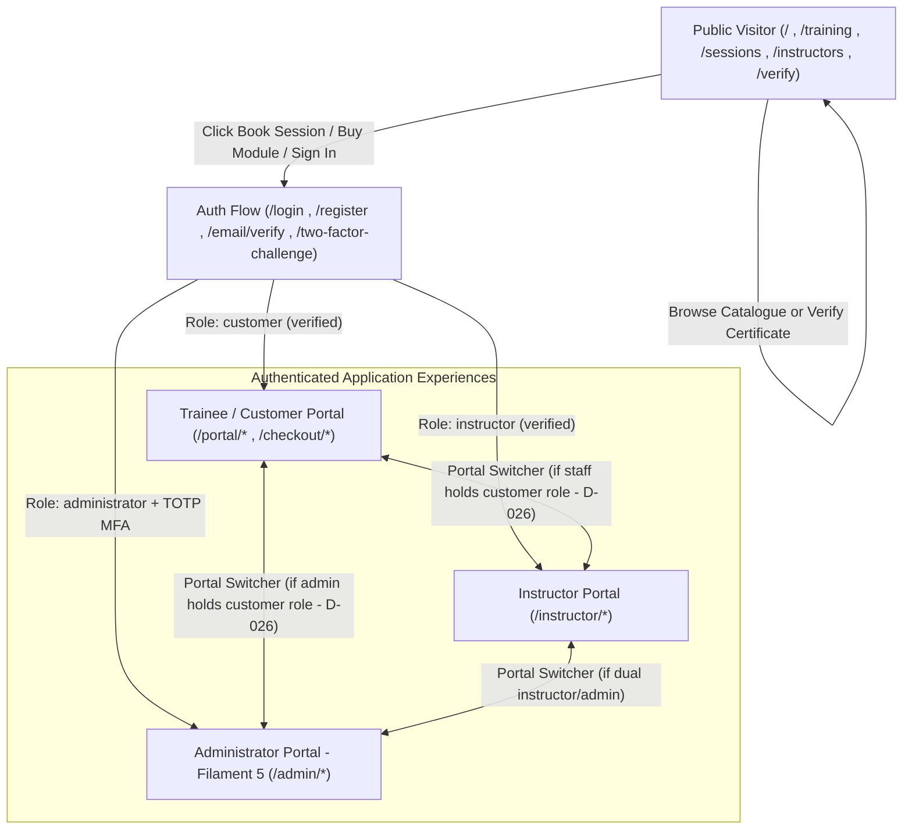
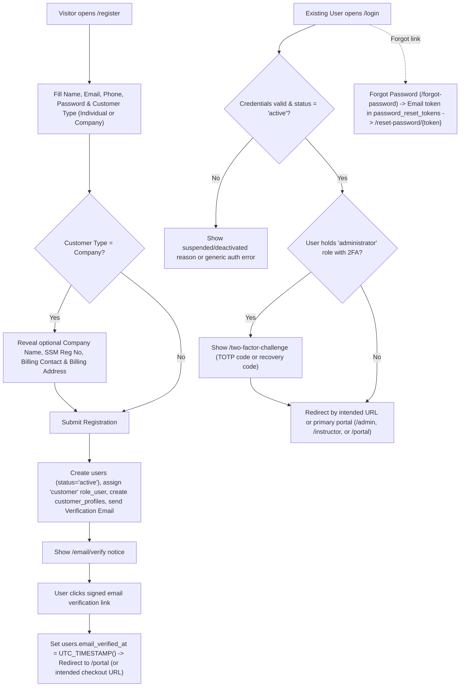
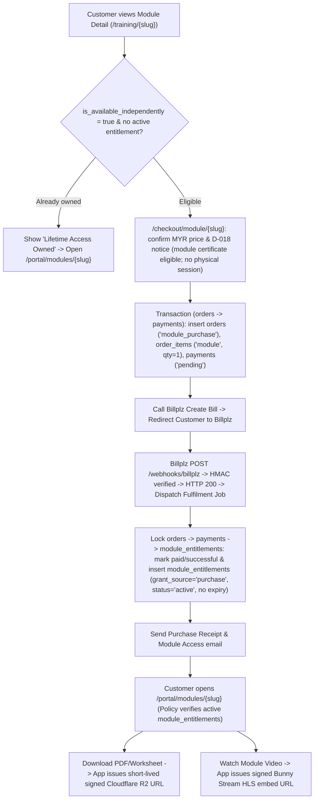
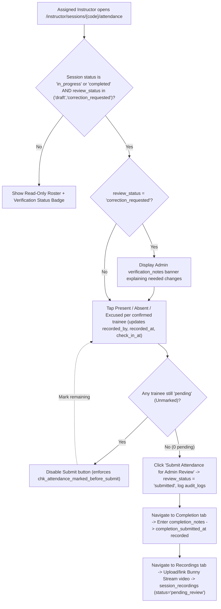
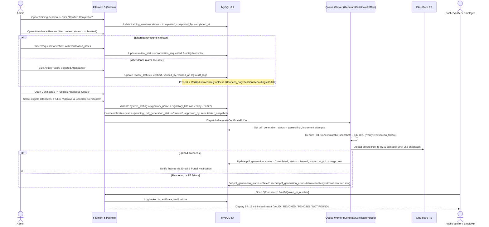
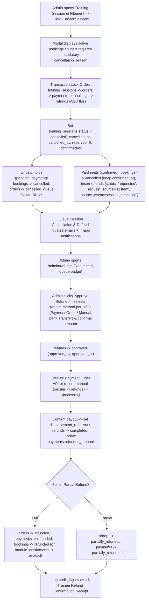

# ETMS Navigation Architecture & User Flows

| Property | Value |
|---|---|
| **Project** | Ecohydrotech Training Management System (ETMS) |
| **Stage** | Stage 2 — UI/UX Blueprint & Application Design (Pending Review) |
| **Version** | 1.0 |
| **Date** | 17 November 2026 |
| **Companion Documents** | [UI/UX Blueprint](UI-UX-BLUEPRINT.md), [Screen Inventory](SCREEN-INVENTORY.md), [Database Design](DATABASE-DESIGN.md) |

---

## 1. Global Navigation Architecture & Multi-Role Context

ETMS routes users into four clean, isolated experience shells while supporting seamless switching for multi-role staff (`D-026`) and maintaining strict role/policy enforcement on every route (`FR-01`, `D-004`).



---

## 2. Navigation Specification Across the Four Experiences

### 2.1 Experience A — Public Website (`layouts.public`)

| Element | Desktop (`>= 1024px`) | Tablet / Mobile (`< 1024px`) |
|---|---|---|
| **Top Header** | Sticky `h-16` white bar with subtle bottom border (`border-slate-200`). Left: Ecohydrotech brand mark (`/`). Center: Primary nav links (`Training Catalogue`, `Physical Sessions`, `Instructors`, `Verify Certificate`). Right: Guest (`Log In`, primary `Create Account`) or Authenticated (`My Portal` badge + Account Menu). | Sticky `h-16` bar: Left brand mark, Right compact `My Portal` / `Log In` button + `44x44px` Hamburger drawer trigger. Drawer slides from right with primary links, quick `Verify Certificate` CTA, and auth actions. |
| **Breadcrumbs** | Rendered on `/training/{slug}`, `/sessions/{slug}`, `/instructors/{id}` (e.g., `Home / Training / Hydrology / EHT-HYD-101`). | Horizontally truncated single-line breadcrumb with back-to-parent link (`< Back to Training Catalogue`). |
| **Footer** | 4-column structured footer: Brand & Malaysia focus notice, Quick Links (`Catalogue`, `Sessions`, `Instructors`, `Verify Certificate`), Portal Links (`Trainee Sign In`, `Instructor Portal`), Support & Compliance (`Contact`, `Privacy / PDPA Notice`). | Single-column accordion or stacked 2-column grid. |

### 2.2 Experience B — Trainee / Customer Portal (`layouts.portal` & `layouts.checkout`)

| Element | Desktop (`>= 1024px`) | Tablet / Mobile (`< 1024px`) |
|---|---|---|
| **Left Sidebar (`260px`)** | Fixed dark navy/white contrast sidebar (`bg-eht-navy-900 text-slate-100`) divided into 3 labelled groups: **Overview** (`Dashboard`), **Training & Learning** (`My Bookings`, `Purchased Modules`, `Session Recordings`, `Certificates`), **Account & Finance** (`Orders & Receipts`, `Notifications` with unread badge, `Profile & Company Billing`, `Security`). Bottom utility link: `Browse Catalogue (/)`. | Collapsible slide-over drawer triggered by top-left menu button **plus** a fixed bottom quick-nav bar (4 icons: `Dashboard`, `Bookings`, `Modules`, `Certificates`) for single-thumb mobile access. |
| **Top Utility Bar** | Left: Dynamic Breadcrumb (`Portal / Bookings / BKG-20261117-000123`). Right: Notification Bell dropdown (last 5 unread alerts + link to `/portal/notifications`), **Portal Switcher** (shown only if user holds `instructor` or `administrator` role per `D-026`), and **Account Menu** (`Profile`, `Security`, `Sign Out`). | Compact page title, Notification Bell icon (`44x44px`), and Avatar Account Menu. |
| **Checkout Header (`layouts.checkout`)** | Distraction-free bar (`h-16`): Brand mark + `Secure Checkout (Billplz)` lock pill + Live 15-minute Seat Hold Countdown badge (for session checkouts) + `Exit to Session` link. Sidebar is omitted so user focuses on checkout. | Identical compact top header; hold countdown remains sticky below header on mobile scroll. |

### 2.3 Experience C — Instructor Portal (`layouts.instructor`)

| Element | Desktop (`>= 1024px`) | Tablet / Mobile (`< 1024px`) |
|---|---|---|
| **Left Sidebar (`240px`)** | Fixed slate/navy operational sidebar: `Dashboard`, `Assigned Sessions`, `My Public Profile`, plus `Browse Public Catalogue (/)`. | Slide-over drawer triggered from header menu. Designed for one-handed tablet use in classrooms. |
| **Session Workspace Sub-Nav** | Horizontal underlined tab strip inside `/instructor/sessions/{code}`: `Overview`, `Participants & Roster`, `Attendance` (with unmarked count pill), `Session Completion`, `Recordings`. | Horizontally scrollable snap-tab bar (`overflow-x-auto`) with `min-h-11` tap targets. |
| **Top Utility Bar** | Breadcrumb (`Instructor / SES-2026-001 / Attendance`), Portal Switcher (if user also holds `customer` or `administrator` role), and Account Menu. | Back button + Session Code pill + Account Menu. |

### 2.4 Experience D — Administrator Portal (`Filament 5` at `/admin`)

| Element | Desktop (`>= 1024px`) | Tablet / Mobile (`< 1024px`) |
|---|---|---|
| **Filament Sidebar** | Native Filament 5 sidebar with a visible desktop collapse toggle and independently collapsible sections: **Overview**, **Training & Catalogue**, **Sessions & Delivery**, **Commerce & Finance**, **Users & Access**, **Communications & Reports**, and **System & Governance**. | Native Filament 5 responsive slide-over drawer. |
| **Top Bar** | Filament Global Search (`Ctrl+K` across users, `order_number`, `booking_reference`, `certificate_number`, `session_code`), Database Notifications bell (async PDF failures, webhook alerts), Custom **Portal Switcher** action (if admin holds `customer`/`instructor` role), and Profile/Sign Out menu. | Global Search modal icon, Notifications bell, and User Avatar menu. |
| **Breadcrumbs** | Native Filament resource/action breadcrumbs (`Training Sessions > SES-2026-001 > Edit`). | Compact parent back link. |

---

## 3. Core End-to-End User Journeys

### 3.1 Journey 1 — Customer Registration, Email Verification, Login & Password Recovery

Covers `FR-01`, `D-001`, `D-002`, `D-026`, `D-028` (no NRIC/passport collected).



---

### 3.2 Journey 2 — Physical Session Booking, 15-Minute Seat Hold & Billplz Checkout

Covers `FR-03`, `FR-04`, `FR-05`, `D-019`, `D-020`, `D-023`, `D-029`, `D-030`, `D-031`, `D-032`, `D-033`, `D-035`.

```mermaid
sequenceDiagram
    actor Customer
    participant UI as Checkout UI (/checkout/session/{slug})
    participant Service as SessionCheckoutService
    participant DB as MySQL 8.4 (InnoDB)
    participant Billplz as Billplz V4 API
    participant Queue as Redis Queue Worker

    Customer->>UI: Click "Proceed to Billplz Payment"
    UI->>Service: Validate customer_profiles snapshot & terms

    Note over Service,DB: Global Lock Hierarchy: training_sessions -> orders -> payments -> bookings
    Service->>DB: BEGIN TRANSACTION & SELECT training_sessions FOR UPDATE
    Service->>DB: Check status IN ('published','full') & UTC_TIMESTAMP < registration_closes_at
    Service->>DB: Sweep expired holds (reservation_expires_at <= UTC_TIMESTAMP -> expired)
    Service->>DB: Recompute active_reserved + active_confirmed < capacity
    Service->>DB: Insert orders ('session_booking'), order_items ('training_session', qty=1)
    Service->>DB: Insert payments (stable payment_reference, status='pending', bill_id=NULL)
    Service->>DB: Insert bookings (status='pending_payment', reservation_expires_at=+15 min)
    Service->>DB: Recompute training_sessions counters (+1 reserved; 'full' if at capacity)
    Service->>DB: COMMIT TRANSACTION

    Note over Service,Billplz: External HTTP call strictly outside DB locks
    Service->>Billplz: POST Create Bill (amount cents MYR, reference_1=payment_reference, callback_url, redirect_url)
    Billplz-->>Service: Return Bill ID (gateway_bill_id) & checkout URL
    Service->>DB: Short locked update: save gateway_bill_id & gateway_payment_url on payments
    UI-->>Customer: Redirect browser to Billplz hosted checkout

    Customer->>Billplz: Completes FPX / online payment
    par Browser Return (Informational Only)
        Billplz-->>Customer: GET /checkout/return?billplz[id]=...
        Customer->>UI: Poll GET /checkout/return (read-only until webhook settles)
    and Server-to-Server Callback (Authoritative)
        Billplz->>UI: POST /webhooks/billplz (form-urlencoded + x_signature)
        UI->>UI: Verify HMAC-SHA256 X-Signature (canonical sorted keys without '=')
        UI->>DB: Persist payment_webhook_events (unique idempotency_key if verified)
        UI-->>Billplz: Return HTTP 200 within 20s & dispatch fulfilment job
    end

    Queue->>DB: Lock hierarchy (training_sessions -> orders -> payments -> bookings -> refunds)
    alt Paid within 15-min hold OR late callback while session open & seat free
        Queue->>DB: payments -> successful, orders -> paid, bookings -> confirmed
        Queue->>DB: Seed attendance row (attendance_status='pending', review_status='draft')
        Queue->>DB: Recompute session reserved & confirmed counters
        Queue-->>Customer: Queue Booking Confirmation & Payment Receipt emails
    else Late callback after hold expired AND session full/closed/started/cancelled
        Queue->>DB: payments -> successful, orders -> paid, bookings stays expired
        Queue->>DB: Insert refunds (status='requested', request_source='system', source_event='late_payment_capacity_unavailable')
        Queue-->>Customer: Notify customer & escalate to Admin Refund queue
    end
```

---

### 3.3 Journey 3 — Independent Module Purchase, Lifetime Entitlement & Learning Access

Covers `FR-06`, `FR-07`, `D-006`, `D-018`, `D-030`, `D-031`, `D-032`.



---

### 3.4 Journey 4 — Instructor Attendance Recording, Submission & Recording Upload

Covers `FR-08`, `D-017`, `D-022`, `D-025`, SRS Sec. 2.2.



---

### 3.5 Journey 5 — Administrator Attendance Verification, Certificate Issuance & Public QR Verification

Covers `FR-09`, `FR-10`, `BR-09`–`BR-13`, `D-007`, `D-017`, `D-027`, `D-034`.



---

### 3.6 Journey 6 — Physical Session Cancellation & Administrator-Managed Refund Workflow

Covers `FR-03`, `FR-05`, `BR-15`, `BR-16`, `D-021`, `D-033`, `R-01`, `R-08`.



---

## 4. Cross-Experience Role & Permission Matrix

Enforced server-side via Laravel Policies and Middleware (`D-026`, SRS Sec. 2 & 23), never solely by hiding UI navigation links:

| Capability / Experience Area | Guest | Customer (`customer`) | Instructor (`instructor`) | Administrator (`administrator`) |
|---|---|---|---|---|
| Browse public pages & verify certificates (`/verify`) | Yes | Yes | Yes | Yes |
| Register account & verify email | Yes | — | — | — |
| Book physical session / Buy independent module | Redirect to Login | Yes (self only, `D-023`) | Only if also holds `customer` role (`D-026`) | Only if also holds `customer` role (`D-026`) |
| View own bookings, orders, receipts & certificates (`/portal`) | No | Yes | Only if also holds `customer` role | Only if also holds `customer` role |
| Download `module_materials` & stream `module_videos` | No | Only with active `module_entitlements` | Only for modules of assigned sessions (`Sec. 6.3`) | Yes |
| Stream `session_recordings` (`attendees_only`) | No | Only if `confirmed` + `present` + `verified` (`D-017`) | Only for assigned sessions | Yes |
| View assigned sessions & participant names (`/instructor`) | No | No | Assigned sessions only (`session_instructors`) | Yes (via `/admin`) |
| Record & submit attendance (`draft` / `correction_requested`) | No | No | Assigned sessions only (`in_progress`/`completed`) | Yes |
| Verify attendance, override attendance, approve certificates | No | No | No | Yes (via `/admin` + TOTP MFA + `audit_logs`) |
| Submit session completion notes & recordings (`pending_review`) | No | No | Assigned sessions only | Yes (can publish directly) |
| Publish modules/sessions, cancel sessions, manage refunds | No | No | No | Yes (via `/admin` + TOTP MFA + `audit_logs`) |
| Configure `system_settings`, RBAC roles, view `audit_logs` | No | No | No | Yes (via `/admin` + TOTP MFA) |
